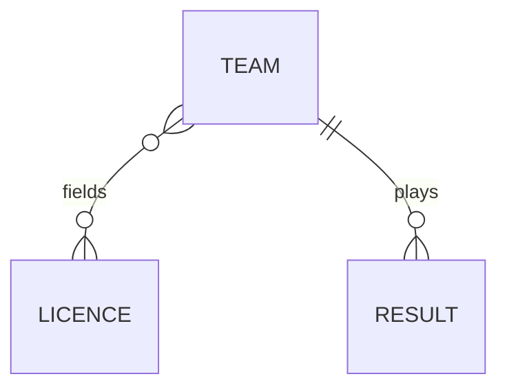
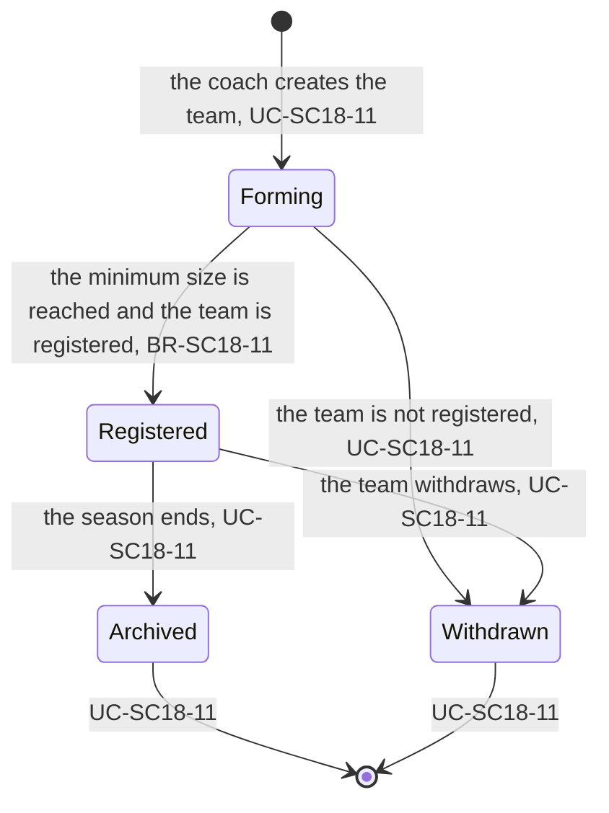

🏠 [Specs](../../../README.md) › 🏷️ [Sectors](../../README.md) › 🏋️ [SC18 Sports and fitness](../README.md) ›
🗃️ [Data](README.md) › 🗃️ E-SC18-08 Sports team

# 🗃️ E-SC18-08 Sports team

**Status:** 🔄 waiting for the owner

## Purpose

A team of the club in a competition: its category, players, captain and state
([D562](../../../06-decisions/sectors/d562-benchmark-gaps-sc18-sports-and-fitness.md)). The players' eligibility comes
from their licences ([E-SC18-06 Licence](e-sc18-06-licence.md)) and certificates
([E-SC18-07 Medical certificate](e-sc18-07-medical-certificate.md)); this record is the registration built on them.

## Fields

| Name | Type | Required | Validation | Default | Example | Personal data | Custom fields |
|---|---|---|---|---|---|---|---|
| name | text | yes | unique in the season | - | U15 football | no | no |
| category | choice | yes | a category of the federation | - | U15 | no | no |
| competition | text | yes | an open competition | - | District league U15 | no | no |
| season | text | yes | one season | the current season | 2026-27 | no | no |
| players | members with licences (E-SC18-06) | yes | licensed, in the category | - | 14 players | yes | no |
| captain | customer record (E-F6-01) | no | a player of the team | - | Lena T. | yes | no |
| coach | employee (E-F9-01) | yes | a coach with the diploma | the user | Hugo B. | no | no |
| state | Forming, Registered, Withdrawn, Archived | yes | the lifecycle below | Forming | Registered | no | no |
| owner | user | yes | a user of the company | the creator | Claire P. | yes | no |

## Relations

- [E-SC18-06 Licence](e-sc18-06-licence.md)
- [E-SC18-07 Medical certificate](e-sc18-07-medical-certificate.md)
- [E-SC18-09 Result](e-sc18-09-result.md)

## Lifecycle

## Indexes and search

By name, category, competition, season and state.

## Retention

Kept with the club's records
([CR-FR-002](../../../10-country-packs/france/accounting/cr-fr-002-accounting-records-kept-ten-years.md)).

## Audit

Every team, player added or removed, registration and withdrawal, with who and when.

## Import and export

Export of the team sheet in the federation's format; no import.

## Used by

- [UC-SC18-11](../use-cases/03-licences-and-competitions/uc-sc18-11-run-teams-and-competitions.md)
- [UC-SC18-12](../use-cases/03-licences-and-competitions/uc-sc18-12-record-results.md)

## Open questions

None.

---

⬅️ [E-SC18-07 Medical certificate](e-sc18-07-medical-certificate.md) · ⬆️ [Up](README.md) ·
➡️ [E-SC18-09 Result](e-sc18-09-result.md)
