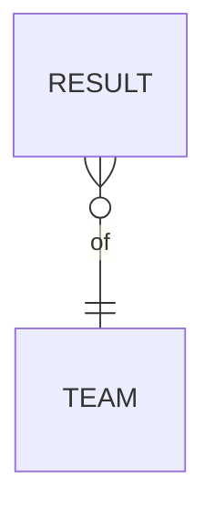
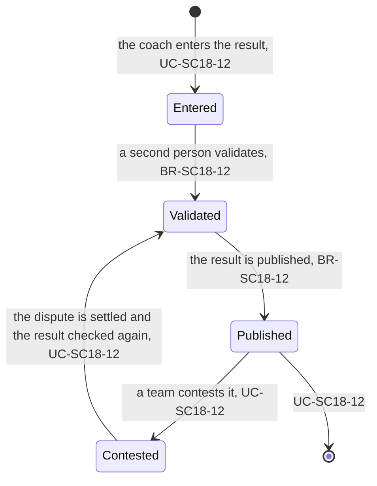

🏠 [Specs](../../../README.md) › 🏷️ [Sectors](../../README.md) › 🏋️ [SC18 Sports and fitness](../README.md) ›
🗃️ [Data](README.md) › 🗃️ E-SC18-09 Result

# 🗃️ E-SC18-09 Result

**Status:** ✅ specified

## Purpose

The result of one match or event of a team: score, notes, who entered and validated it, and its publication
([D562](../../../06-decisions/sectors/d562-benchmark-gaps-sc18-sports-and-fitness.md)).

## Fields

| Name | Type | Required | Validation | Default | Example | Personal data | Custom fields |
|---|---|---|---|---|---|---|---|
| team | team (E-SC18-08) | yes | a registered team | - | U15 football | no | no |
| match | text | yes | a match of the calendar | - | U15 Club - Rivals | no | no |
| score | numbers | yes | one number per side | - | 3 - 1 | no | no |
| notes | text | no | free text | - | Rain at half time | no | no |
| entered by | employee (E-F9-01) | yes | a coach of the team | the user | Hugo B. | no | no |
| validated by | text | no | another person than the one who entered | - | Karim A. | no | no |
| published on | date and time | no | set when published | - | 2026-12-06 20:10 | no | no |
| state | Entered, Validated, Published, Contested | yes | the lifecycle below | Entered | Validated | no | no |
| owner | user | yes | a user of the company | the creator | Claire P. | yes | no |

## Relations

- [E-SC18-08 Sports team](e-sc18-08-team.md)
- [E-SC18-14 Tournament](e-sc18-14-tournament.md)

## Lifecycle

## Indexes and search

By team, competition, state and date.

## Retention

Kept with the club's history
([CR-FR-002](../../../10-country-packs/france/accounting/cr-fr-002-accounting-records-kept-ten-years.md)).

## Audit

Every result, validation, publication, dispute and correction, with who, when and the old score.

## Import and export

Export of the results to the federation; no import.

## Used by

- [UC-SC18-12](../use-cases/03-licences-and-competitions/uc-sc18-12-record-results.md)
- [UC-SC18-11](../use-cases/03-licences-and-competitions/uc-sc18-11-run-teams-and-competitions.md)

## Open questions

None.

---

⬅️ [E-SC18-08 Sports team](e-sc18-08-team.md) · ⬆️ [Up](README.md) ·
➡️ [E-SC18-10 Coaching package](e-sc18-10-coaching-package.md)
