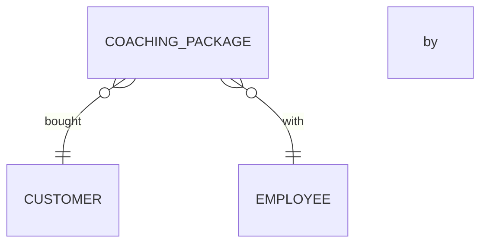
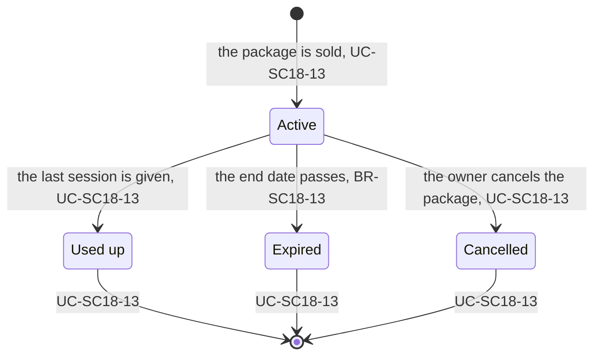

🏠 [Specs](../../../README.md) › 🏷️ [Sectors](../../README.md) › 🏋️ [SC18 Sports and fitness](../README.md) ›
🗃️ [Data](README.md) › 🗃️ E-SC18-10 Coaching package

# 🗃️ E-SC18-10 Coaching package

**Status:** ✅ specified

## Purpose

A package of personal training sessions bought by a member, with the sessions left and the end date
([D562](../../../06-decisions/sectors/d562-benchmark-gaps-sc18-sports-and-fitness.md)). It is prepaid sessions with a
coach, not a membership ([E-SC18-01 Club membership](e-sc18-01-club-membership.md)) and not a sum of money
([E-F10-10](../../../02-functional/f10-point-of-sale/data/e-f10-10-loyalty-card-and-gift-card.md)).

## Fields

| Name | Type | Required | Validation | Default | Example | Personal data | Custom fields |
|---|---|---|---|---|---|---|---|
| member | customer record (E-F6-01) | yes | a member of the club | - | Mia L. | yes | no |
| coach | employee (E-F9-01) | yes | a coach of the club | - | Hugo B. | no | no |
| sessions bought | number | yes | 1 or more | - | 10 | no | no |
| sessions left | number | yes | 0 to sessions bought | sessions bought | 9 | no | no |
| valid to | date | yes | after the sale date | sale date plus the validity | 2027-05-21 | no | no |
| price | amount | yes | 0 or more | from the catalogue | 450.00 EUR | no | no |
| expiry terms | text | yes | shown before the sale | from the package | lost at the end date | no | no |
| sale | point of sale order (E-F10-03) | yes | the order that sold it | - | O-2026-6120 | no | no |
| state | Active, Used up, Expired, Cancelled | yes | the lifecycle below | Active | Used up | no | no |
| owner | user | yes | a user of the company | the creator | Claire P. | yes | no |

## Relations

- [E-F6-01](../../../02-functional/f06-customers-and-sales/data/e-f06-01-customer-record.md)
- [E-F9-01](../../../02-functional/f09-hr-and-projects/data/e-f09-01-employee-record.md)
- [E-F10-03](../../../02-functional/f10-point-of-sale/data/e-f10-03-point-of-sale-order.md)
- [E-SC18-11 Training programme](e-sc18-11-training-programme.md)

## Lifecycle

## Indexes and search

By member, coach, state and end date.

## Retention

Kept with the sales records
([CR-FR-002](../../../10-country-packs/france/accounting/cr-fr-002-accounting-records-kept-ten-years.md)).

## Audit

Every sale, session, extension, expiry and cancellation, with who and when.

## Import and export

Export of the sessions owed at a date for the books; no import.

## Used by

- [UC-SC18-13](../use-cases/04-personal-training/uc-sc18-13-sell-coaching-packages.md)
- [UC-SC18-14](../use-cases/04-personal-training/uc-sc18-14-plan-a-training-programme.md)
- [UC-SC18-15 Follow progress](../use-cases/04-personal-training/uc-sc18-15-follow-progress.md)

## Open questions

None.

---

⬅️ [E-SC18-09 Result](e-sc18-09-result.md) · ⬆️ [Up](README.md) ·
➡️ [E-SC18-11 Training programme](e-sc18-11-training-programme.md)
