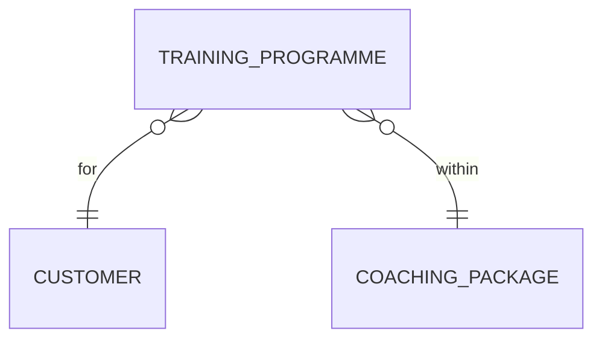
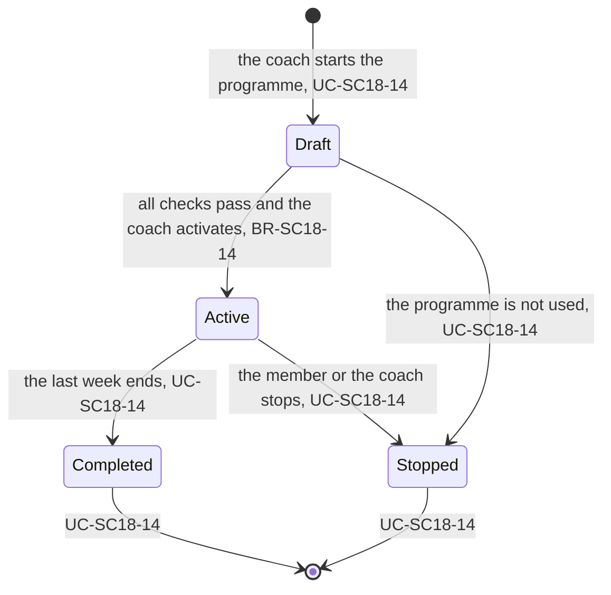

🏠 [Specs](../../../README.md) › 🏷️ [Sectors](../../README.md) › 🏋️ [SC18 Sports and fitness](../README.md) ›
🗃️ [Data](README.md) › 🗃️ E-SC18-11 Training programme

# 🗃️ E-SC18-11 Training programme

**Status:** ✅ specified

## Purpose

A training programme written for one member: the goal, the weeks, the sessions and the exercises, with the checks
against the member's declared limits
([D562](../../../06-decisions/sectors/d562-benchmark-gaps-sc18-sports-and-fitness.md)). It uses the sessions of a
coaching package ([E-SC18-10 Coaching package](e-sc18-10-coaching-package.md)).

## Fields

| Name | Type | Required | Validation | Default | Example | Personal data | Custom fields |
|---|---|---|---|---|---|---|---|
| member | customer record (E-F6-01) | yes | a member of the club | - | Mia L. | yes | no |
| coach | employee (E-F9-01) | yes | a coach of the club | the user | Hugo B. | no | no |
| goal | text | yes | free text | - | Run 10 km | yes | no |
| weeks | list of sessions | yes | at least one session | - | 8 weeks | yes | no |
| checks | list of flags | no | computed | - | none | no | no |
| override reason | text | no | needed to keep a flagged exercise | - | - | yes | no |
| starts on | date | no | set when activated | - | 2026-12-07 | no | no |
| state | Draft, Active, Completed, Stopped | yes | the lifecycle below | Draft | Active | no | no |
| owner | user | yes | a user of the company | the creator | Claire P. | yes | no |

## Relations

- [E-SC18-10 Coaching package](e-sc18-10-coaching-package.md)
- [E-SC18-12 Progress record](e-sc18-12-progress-record.md)
- [E-F6-01](../../../02-functional/f06-customers-and-sales/data/e-f06-01-customer-record.md)

## Lifecycle

## Indexes and search

By member, coach, state and start date; the goal and the limits are not searched by other users.

## Retention

Kept while the member is active and for a set period after, then erased
([CR-FR-052](../../../10-country-packs/france/data-protection/cr-fr-052-storage-limitation.md)).

## Audit

Every programme, limit, check, override, activation and end, with who and when.

## Import and export

Export of one programme for the member; no import.

## Used by

- [UC-SC18-14](../use-cases/04-personal-training/uc-sc18-14-plan-a-training-programme.md)
- [UC-SC18-15 Follow progress](../use-cases/04-personal-training/uc-sc18-15-follow-progress.md)

## Open questions

None.

---

⬅️ [E-SC18-10 Coaching package](e-sc18-10-coaching-package.md) · ⬆️ [Up](README.md) ·
➡️ [E-SC18-12 Progress record](e-sc18-12-progress-record.md)
