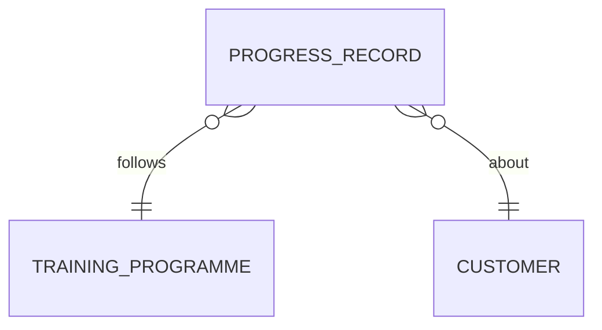
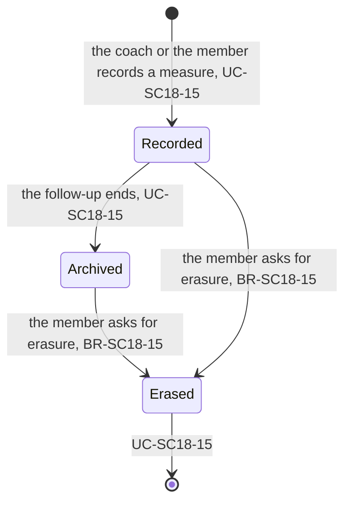

🏠 [Specs](../../../README.md) › 🏷️ [Sectors](../../README.md) › 🏋️ [SC18 Sports and fitness](../README.md) ›
🗃️ [Data](README.md) › 🗃️ E-SC18-12 Progress record

# 🗃️ E-SC18-12 Progress record

**Status:** ✅ specified

## Purpose

A progress record of a member: measures, how they felt and notes, at a date
([D562](../../../06-decisions/sectors/d562-benchmark-gaps-sc18-sports-and-fitness.md)). It is health data kept for the
member and the coach only; the programme it follows is [E-SC18-11 Training programme](e-sc18-11-training-programme.md).

## Fields

| Name | Type | Required | Validation | Default | Example | Personal data | Custom fields |
|---|---|---|---|---|---|---|---|
| member | customer record (E-F6-01) | yes | a member of the club | - | Mia L. | yes | no |
| programme | training programme (E-SC18-11) | yes | an active programme | - | 8 weeks | no | no |
| recorded on | date | yes | not in the future | today | 2026-12-14 | yes | no |
| measures | numbers with units | yes | at least one | - | 10 km in 62 minutes | yes | no |
| felt | choice | no | tired, ok or good | - | good | yes | no |
| notes | text | no | free text | - | New best | yes | no |
| source | choice | yes | coach, member or import | coach | coach | no | no |
| state | Recorded, Archived, Erased | yes | the lifecycle below | Recorded | Archived | no | no |
| owner | user | yes | a user of the company | the creator | Claire P. | yes | no |

## Relations

- [E-SC18-11 Training programme](e-sc18-11-training-programme.md)
- [E-F6-01](../../../02-functional/f06-customers-and-sales/data/e-f06-01-customer-record.md)

## Lifecycle

## Indexes and search

By member and date; no field is searched by users other than the member and the coach.

## Retention

Kept while the follow-up lasts and a set period after, then erased
([CR-FR-052](../../../10-country-packs/france/data-protection/cr-fr-052-storage-limitation.md)).

## Audit

Every record, reading, export, archive and erasure, with who and when.

## Import and export

Export of one member's own records at their request
([CR-FR-051](../../../10-country-packs/france/data-protection/cr-fr-051-access-and-erasure.md)); import from a connected
watch.

## Used by

- [UC-SC18-15 Follow progress](../use-cases/04-personal-training/uc-sc18-15-follow-progress.md)
- [UC-SC18-14](../use-cases/04-personal-training/uc-sc18-14-plan-a-training-programme.md)

## Open questions

None.

---

⬅️ [E-SC18-11 Training programme](e-sc18-11-training-programme.md) · ⬆️ [Up](README.md) ·
➡️ [E-SC18-13 Court booking](e-sc18-13-court-booking.md)
