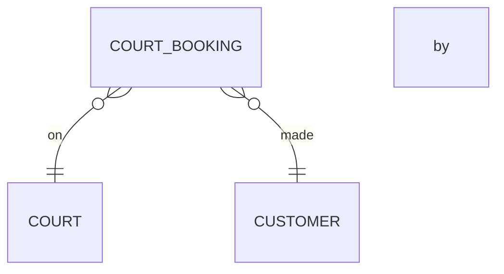
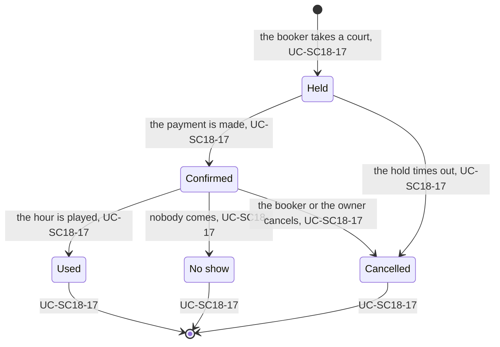

🏠 [Specs](../../../README.md) › 🏷️ [Sectors](../../README.md) › 🏋️ [SC18 Sports and fitness](../README.md) ›
🗃️ [Data](README.md) › 🗃️ E-SC18-13 Court booking

# 🗃️ E-SC18-13 Court booking

**Status:** ✅ specified

## Purpose

A booking of a court or a facility by a member or a guest: the court, the hour, the rate and the payment
([D562](../../../06-decisions/sectors/d562-benchmark-gaps-sc18-sports-and-fitness.md)). The court's calendar is the
shared booking engine ([E-F2-18](../../../02-functional/f02-no-code-configuration/data/e-f02-18-resource-booking.md));
this record adds the booker, the rate and the payment.

## Fields

| Name | Type | Required | Validation | Default | Example | Personal data | Custom fields |
|---|---|---|---|---|---|---|---|
| court | bookable resource (E-F2-17) | yes | free for the whole hour | - | Padel court 2 | no | no |
| starts at | date and time | yes | inside the opening hours | - | 2026-11-21 10:00 | no | no |
| duration minutes | number | yes | above 0 | 60 | 60 | no | no |
| booker | customer record (E-F6-01) | yes | a member or a guest | - | Mia L. | yes | no |
| rate | choice | yes | members or public | from the membership | members | no | no |
| price | amount | yes | 0 or more | from the rate | 18.00 EUR | no | no |
| payment | customer payment (E-F6-06) | no | set when paid | - | P-88410 | no | no |
| players | list of names | no | free text | - | Mia L., Noor A. | yes | no |
| state | Held, Confirmed, Cancelled, Used, No show | yes | the lifecycle below | Held | Confirmed | no | no |
| owner | user | yes | a user of the company | the creator | Claire P. | yes | no |

## Relations

- [E-F2-17](../../../02-functional/f02-no-code-configuration/data/e-f02-17-bookable-resource-setting.md)
- [E-F2-18](../../../02-functional/f02-no-code-configuration/data/e-f02-18-resource-booking.md)
- [E-F6-06](../../../02-functional/f06-customers-and-sales/data/e-f06-06-customer-payment.md)
- [E-SC18-01 Club membership](e-sc18-01-club-membership.md)

## Lifecycle

## Indexes and search

By court, day, booker and state.

## Retention

Kept with the sales records
([CR-FR-002](../../../10-country-packs/france/accounting/cr-fr-002-accounting-records-kept-ten-years.md)).

## Audit

Every hold, payment, cancellation, no-show and block, with who and when.

## Import and export

Export of the bookings of a period; no import.

## Used by

- [UC-SC18-17](../use-cases/05-facilities-events-camps-and-rentals/uc-sc18-17-book-courts-and-facilities.md)
- [UC-SC18-05](../use-cases/02-classes-and-waiting-lists/uc-sc18-05-publish-the-class-timetable.md)

## Open questions

None.

---

⬅️ [E-SC18-12 Progress record](e-sc18-12-progress-record.md) · ⬆️ [Up](README.md) ·
➡️ [E-SC18-14 Tournament](e-sc18-14-tournament.md)
