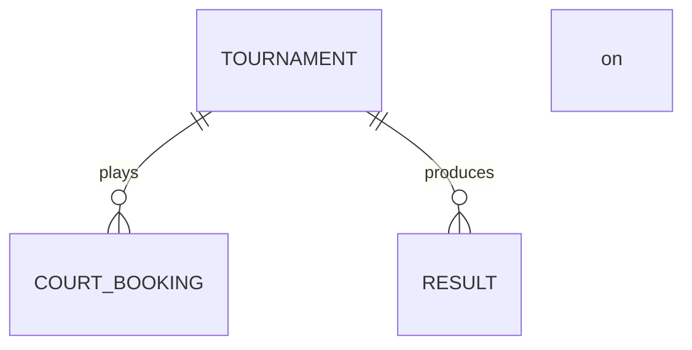
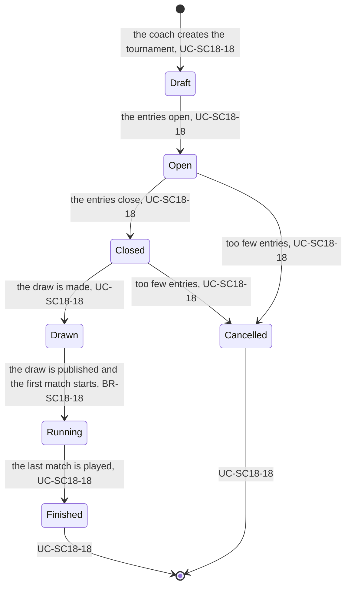

🏠 [Specs](../../../README.md) › 🏷️ [Sectors](../../README.md) › 🏋️ [SC18 Sports and fitness](../README.md) ›
🗃️ [Data](README.md) › 🗃️ E-SC18-14 Tournament

# 🗃️ E-SC18-14 Tournament

**Status:** ✅ specified

## Purpose

A tournament or an event of the club: its categories, dates, courts, entries, draw and state
([D562](../../../06-decisions/sectors/d562-benchmark-gaps-sc18-sports-and-fitness.md)). The matches are court bookings
([E-SC18-13 Court booking](e-sc18-13-court-booking.md)) and the results are the club's results
([E-SC18-09 Result](e-sc18-09-result.md)); spectator tickets use the shared event ticketing
([E-F5-12 Event ticket](../../../02-functional/f05-social-media/data/e-f05-12-event-ticket.md)).

## Fields

| Name | Type | Required | Validation | Default | Example | Personal data | Custom fields |
|---|---|---|---|---|---|---|---|
| name | text | yes | unique in the season | - | Club championship 2026 | no | no |
| sport | choice | yes | a sport of the club | - | tennis | no | no |
| categories | list | yes | at least one | - | men singles, women singles | no | no |
| starts on | date | yes | not in the past | - | 2026-12-12 | no | no |
| courts | list of courts | yes | bookable | - | Courts 1 to 3 | no | no |
| entry fee | amount | yes | 0 or more | 0 | 15.00 EUR | no | no |
| minimum entries | number | no | 0 or more | 0 | 8 | no | no |
| draw published on | date and time | no | before the first match | - | 2026-12-10 18:00 | no | no |
| spectator tickets | event ticket (E-F5-12) | no | only if ticketed | - | - | no | no |
| state | Draft, Open, Closed, Drawn, Running, Finished, Cancelled | yes | the lifecycle below | Draft | Open | no | no |
| owner | user | yes | a user of the company | the creator | Claire P. | yes | no |

## Relations

- [E-SC18-13 Court booking](e-sc18-13-court-booking.md)
- [E-SC18-09 Result](e-sc18-09-result.md)
- [E-F5-12 Event ticket](../../../02-functional/f05-social-media/data/e-f05-12-event-ticket.md)

## Lifecycle

## Indexes and search

By name, sport, start date and state.

## Retention

Kept with the club's history
([CR-FR-002](../../../10-country-packs/france/accounting/cr-fr-002-accounting-records-kept-ten-years.md)).

## Audit

Every tournament, entry, payment, refund, draw, publication and result, with who and when.

## Import and export

Export of the draw and schedule as a file; no import.

## Used by

- [UC-SC18-18](../use-cases/05-facilities-events-camps-and-rentals/uc-sc18-18-run-tournaments-and-events.md)
- [UC-SC18-12](../use-cases/03-licences-and-competitions/uc-sc18-12-record-results.md)

## Open questions

None.

---

⬅️ [E-SC18-13 Court booking](e-sc18-13-court-booking.md) · ⬆️ [Up](README.md) ·
➡️ [E-SC18-15 Camp registration](e-sc18-15-camp-registration.md)
