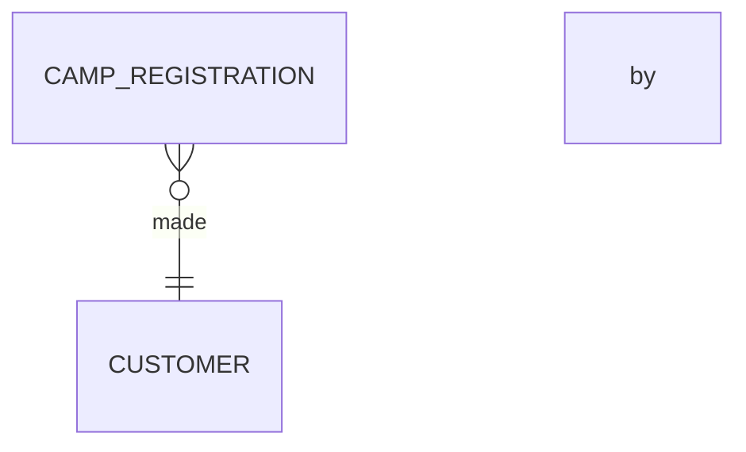
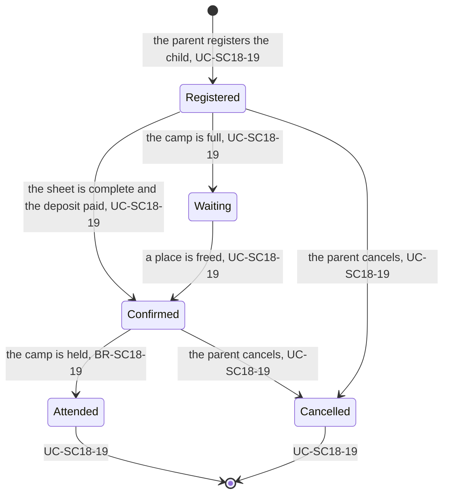

🏠 [Specs](../../../README.md) › 🏷️ [Sectors](../../README.md) › 🏋️ [SC18 Sports and fitness](../README.md) ›
🗃️ [Data](README.md) › 🗃️ E-SC18-15 Camp registration

# 🗃️ E-SC18-15 Camp registration

**Status:** ✅ specified

## Purpose

The registration of one child in a holiday camp: the parent, the health sheet, the people allowed to collect, the group
and the attendance ([D562](../../../06-decisions/sectors/d562-benchmark-gaps-sc18-sports-and-fitness.md)). It holds
health data about a minor, kept private and for a short time.

## Fields

| Name | Type | Required | Validation | Default | Example | Personal data | Custom fields |
|---|---|---|---|---|---|---|---|
| camp | text | yes | an open camp | - | Summer multisport | no | no |
| child | text | yes | name and birth date | - | Leo P., 2018-03-14 | yes | no |
| parent | customer record (E-F6-01) | yes | an adult with the authority | - | Mia L. | yes | no |
| health sheet | form | yes | complete | - | allergy: peanuts | yes | no |
| collectors | list of names | yes | at least one adult | the parent | Mia L., Noor A. | yes | no |
| group | choice | no | an age band group | from the age | Juniors | no | no |
| photo consent | yes or no | yes | answered | no | no | yes | no |
| days | list of dates | yes | inside the camp | all days | 6 to 17 July | no | no |
| deposit | amount | no | 0 or more | from the camp | 50.00 EUR | no | no |
| state | Registered, Confirmed, Waiting, Attended, Cancelled | yes | the lifecycle below | Registered | Confirmed | no | no |
| owner | user | yes | a user of the company | the creator | Claire P. | yes | no |

## Relations

- [E-F6-01](../../../02-functional/f06-customers-and-sales/data/e-f06-01-customer-record.md)
- [E-F9-12](../../../02-functional/f09-hr-and-projects/data/e-f09-12-certification.md)
- [E-F9-16 Shift](../../../02-functional/f09-hr-and-projects/data/e-f09-16-shift.md)

## Lifecycle

## Indexes and search

By camp, group, parent and state; the child's name and health sheet are shown only to those who need them for the
child's care.

## Retention

Health sheets are erased a short time after the camp; the registration is kept with the sales records
([CR-FR-052](../../../10-country-packs/france/data-protection/cr-fr-052-storage-limitation.md)).

## Audit

Every registration, health sheet reading, group, check-in, check-out and release, with who and when.

## Import and export

Export of the day sheet for the animators; no import.

## Used by

- [UC-SC18-19](../use-cases/05-facilities-events-camps-and-rentals/uc-sc18-19-run-holiday-camps.md)
- [UC-SC18-20](../use-cases/05-facilities-events-camps-and-rentals/uc-sc18-20-rent-out-equipment.md)

## Open questions

None.

---

⬅️ [E-SC18-14 Tournament](e-sc18-14-tournament.md) · ⬆️ [Up](README.md) ·
➡️ [E-SC18-16 Rental item](e-sc18-16-rental-item.md)
