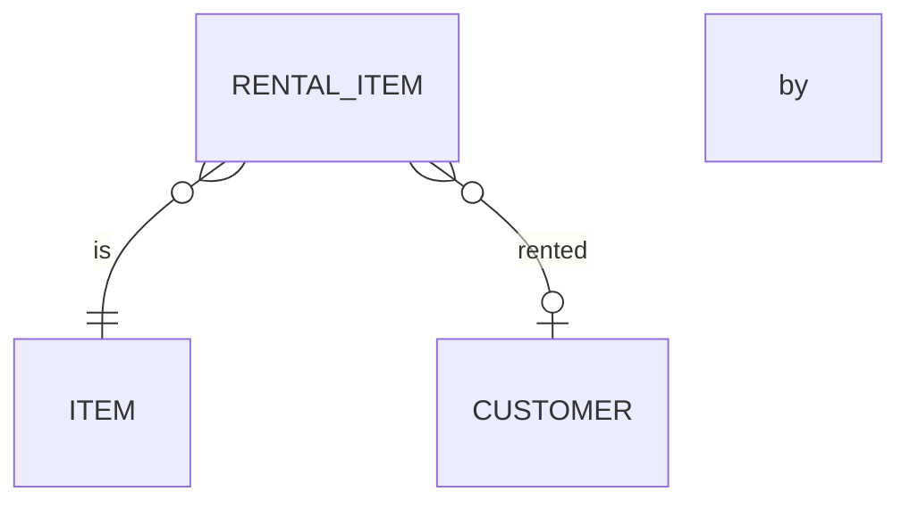
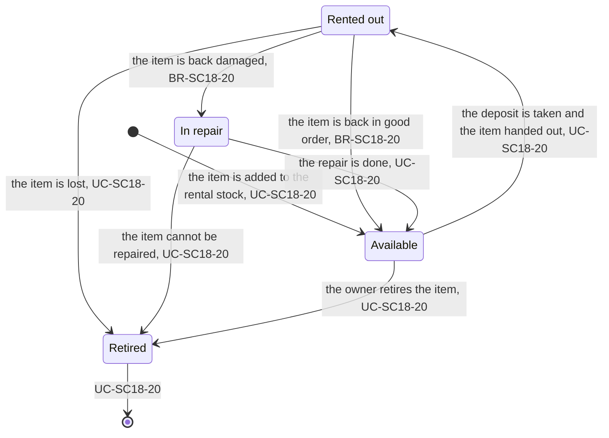

🏠 [Specs](../../../README.md) › 🏷️ [Sectors](../../README.md) › 🏋️ [SC18 Sports and fitness](../README.md) ›
🗃️ [Data](README.md) › 🗃️ E-SC18-16 Rental item

# 🗃️ E-SC18-16 Rental item

**Status:** ✅ specified

## Purpose

An item of equipment that the club rents out: its code, condition, state and the current rental with its deposit
([D562](../../../06-decisions/sectors/d562-benchmark-gaps-sc18-sports-and-fitness.md)). The item as a product is a stock
item ([E-F7-06 Item](../../../02-functional/f07-purchasing-and-stock/data/e-f07-06-item.md)); this record adds the
rental state and the deposit.

## Fields

| Name | Type | Required | Validation | Default | Example | Personal data | Custom fields |
|---|---|---|---|---|---|---|---|
| item | item (E-F7-06) | yes | a rental item | - | Racket R-114 | no | no |
| code | text | yes | unique | - | R-114 | no | no |
| price | amount | yes | 0 or more | from the catalogue | 6.00 EUR | no | no |
| deposit | amount | yes | 0 or more | from the catalogue | 30.00 EUR | no | no |
| renter | customer record (E-F6-01) | no | set when rented out | - | Noor A. | yes | no |
| out at | date and time | no | set when rented out | - | 2026-11-21 16:00 | no | no |
| due at | date and time | no | after the out time | - | 2026-11-21 18:00 | no | no |
| condition | choice | no | good, damaged or lost | good | good | no | no |
| photos | images | no | free | - | 2 | no | no |
| state | Available, Rented out, In repair, Retired | yes | the lifecycle below | Available | Rented out | no | no |
| owner | user | yes | a user of the company | the creator | Claire P. | yes | no |

## Relations

- [E-F7-06 Item](../../../02-functional/f07-purchasing-and-stock/data/e-f07-06-item.md)
- [E-F6-06](../../../02-functional/f06-customers-and-sales/data/e-f06-06-customer-payment.md)
- [E-F7-14](../../../02-functional/f07-purchasing-and-stock/data/e-f07-14-repair-order.md)

## Lifecycle

## Indexes and search

By item, code, renter and state.

## Retention

Kept with the sales records
([CR-FR-002](../../../10-country-packs/france/accounting/cr-fr-002-accounting-records-kept-ten-years.md)); photos are
erased after the delay of any dispute.

## Audit

Every rental, deposit, return, condition, photo, repair, refund and retirement, with who and when.

## Import and export

Export of the rental history; no import.

## Used by

- [UC-SC18-20](../use-cases/05-facilities-events-camps-and-rentals/uc-sc18-20-rent-out-equipment.md)
- [UC-SC18-19](../use-cases/05-facilities-events-camps-and-rentals/uc-sc18-19-run-holiday-camps.md)

## Open questions

None.

---

⬅️ [E-SC18-15 Camp registration](e-sc18-15-camp-registration.md) · ⬆️ [Up](README.md)
