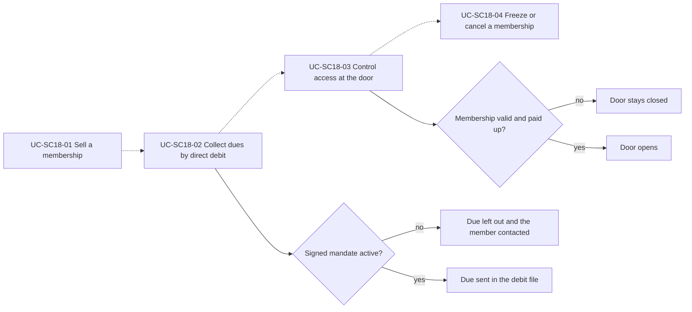
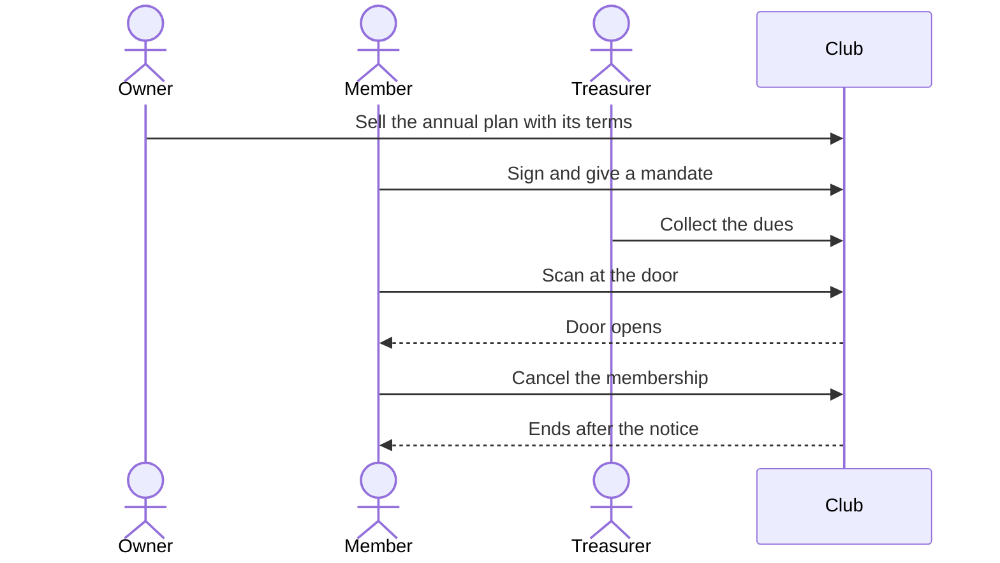

🏠 [Specs](../../../README.md) › 🏷️ [Sectors](../../README.md) › 🏋️ [SC18 Sports and fitness](../README.md) ›
🔀 [Flows](README.md) › 🔀 FL-SC18-01 Memberships and access

# 🔀 FL-SC18-01 Memberships and access

**Status:** ✅ specified

## Summary

Four situations of membership: selling a membership with its signed cancellation terms, collecting the dues by direct
debit, controlling access at the door, and freezing or cancelling a membership
([D562](../../../06-decisions/sectors/d562-benchmark-gaps-sc18-sports-and-fitness.md)).

## Personas

- [U13 Owner](../../../01-users/personas/u13-owner.md), who sells memberships and handles changes
- [U09 Customer](../../../01-users/personas/u09-customer.md), who signs, enters and cancels
- [U31 Treasurer](../../../01-users/personas/u31-treasurer.md), who collects the dues

## Flowchart

## Sequence diagram

## Steps

| Step | Persona | Screen | Use case | What happens |
|---|---|---|---|---|
| 1 | [U13](../../../01-users/personas/u13-owner.md) | [S-SC18-01](../screens/01-memberships-and-access/s-sc18-01-membership-sale.md) | [UC-SC18-01](../use-cases/01-memberships-and-access/uc-sc18-01-sell-a-membership.md) | The owner offers a plan, the member reads the terms and signs on the phone |
| 2 | [U31](../../../01-users/personas/u31-treasurer.md) | [S-SC18-02](../screens/01-memberships-and-access/s-sc18-02-dues-collection.md) | [UC-SC18-02](../use-cases/01-memberships-and-access/uc-sc18-02-collect-dues-by-direct-debit.md) | The treasurer collects the dues by direct debit from the signed mandates |
| 3 | [U09](../../../01-users/personas/u09-customer.md) | [S-SC18-03](../screens/01-memberships-and-access/s-sc18-03-door-access.md) | [UC-SC18-03](../use-cases/01-memberships-and-access/uc-sc18-03-control-access-at-the-door.md) | The member scans a code at the door and the reader checks the membership |
| 4 | [U13](../../../01-users/personas/u13-owner.md) | [S-SC18-04](../screens/01-memberships-and-access/s-sc18-04-membership-changes.md) | [UC-SC18-04](../use-cases/01-memberships-and-access/uc-sc18-04-freeze-or-cancel-a-membership.md) | The member freezes or cancels and sees the effect date and the last due |

### Entities and screens

| Entity | States in this flow | Shown at step and screen | Aggregated view |
|---|---|---|---|
| [E-SC18-01 Club membership](../data/e-sc18-01-club-membership.md) | Offered, Active, Frozen, Notice given, Ended, Withdrawn | 1 [S-SC18-01](../screens/01-memberships-and-access/s-sc18-01-membership-sale.md) | Club memberships |
| [E-SC18-02 Dues mandate](../data/e-sc18-02-dues-mandate.md) | Pending, Active, Suspended, Revoked, Expired | 2 [S-SC18-02](../screens/01-memberships-and-access/s-sc18-02-dues-collection.md) | Dues mandates |
| [E-SC18-03 Access event](../data/e-sc18-03-access-event.md) | Granted, Denied, Overridden | 3 [S-SC18-03](../screens/01-memberships-and-access/s-sc18-03-door-access.md) | Access events |

## Errors

- **E1 Access is denied.** The membership is frozen, ended or the dues are overdue: the door stays closed, the denial is
  recorded with its reason and a staff member may open it with a reason
  ([BR-SC18-03](../business-rules/br-sc18-03-access-needs-a-valid-membership.md), step 3).

## Images

Every step and error, for each persona taking part, in light and dark mode (D120). Steps are numbered as in the Steps
table; E rows are the error cases.

| Step | Persona | Device | Light | Dark |
|---|---|---|---|---|
| 1 | U13 | desktop | [light](../images/01-memberships-and-access/u13-owner/1-membership-sale-desktop-light.png) | [dark](../images/01-memberships-and-access/u13-owner/1-membership-sale-desktop-dark.png) |
| 1 | U09 | phone | [light](../images/01-memberships-and-access/u09-customer/1-membership-sale-phone-light.png) | [dark](../images/01-memberships-and-access/u09-customer/1-membership-sale-phone-dark.png) |
| 1 | U13 | phone | [light](../images/01-memberships-and-access/u13-owner/1-membership-sale-phone-light.png) | [dark](../images/01-memberships-and-access/u13-owner/1-membership-sale-phone-dark.png) |
| 2 | U31 | desktop | [light](../images/01-memberships-and-access/u31-treasurer/2-dues-collection-desktop-light.png) | [dark](../images/01-memberships-and-access/u31-treasurer/2-dues-collection-desktop-dark.png) |
| 2 | U31 | phone | [light](../images/01-memberships-and-access/u31-treasurer/2-dues-collection-phone-light.png) | [dark](../images/01-memberships-and-access/u31-treasurer/2-dues-collection-phone-dark.png) |
| 3 | U09 | phone | [light](../images/01-memberships-and-access/u09-customer/3-door-access-phone-light.png) | [dark](../images/01-memberships-and-access/u09-customer/3-door-access-phone-dark.png) |
| 4 | U13 | desktop | [light](../images/01-memberships-and-access/u13-owner/4-membership-changes-desktop-light.png) | [dark](../images/01-memberships-and-access/u13-owner/4-membership-changes-desktop-dark.png) |
| 4 | U09 | phone | [light](../images/01-memberships-and-access/u09-customer/4-membership-changes-phone-light.png) | [dark](../images/01-memberships-and-access/u09-customer/4-membership-changes-phone-dark.png) |
| 4 | U13 | phone | [light](../images/01-memberships-and-access/u13-owner/4-membership-changes-phone-light.png) | [dark](../images/01-memberships-and-access/u13-owner/4-membership-changes-phone-dark.png) |
| E1 | U13 | desktop | [light](../images/01-memberships-and-access/u13-owner/e1-access-is-denied-desktop-light.png) | [dark](../images/01-memberships-and-access/u13-owner/e1-access-is-denied-desktop-dark.png) |
| E1 | U13 | phone | [light](../images/01-memberships-and-access/u13-owner/e1-access-is-denied-phone-light.png) | [dark](../images/01-memberships-and-access/u13-owner/e1-access-is-denied-phone-dark.png) |

## Open questions

None.

---

⬆️ [Up](README.md) · ➡️ [FL-SC18-02 Classes and waiting lists](fl-sc18-02-classes-and-waiting-lists.md)
