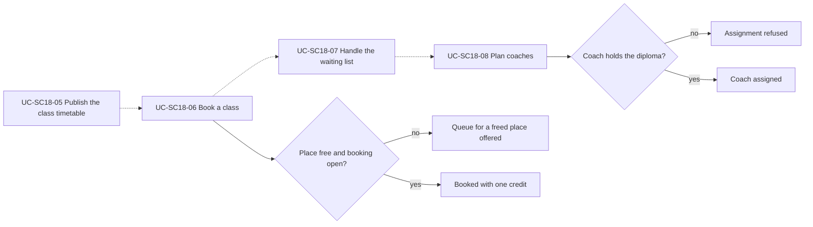
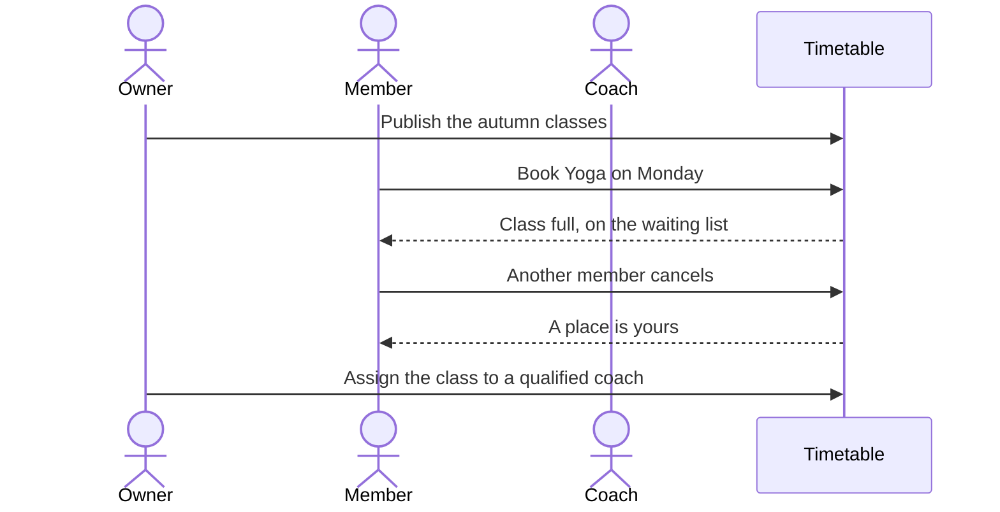

🏠 [Specs](../../../README.md) › 🏷️ [Sectors](../../README.md) › 🏋️ [SC18 Sports and fitness](../README.md) ›
🔀 [Flows](README.md) › 🔀 FL-SC18-02 Classes and waiting lists

# 🔀 FL-SC18-02 Classes and waiting lists

**Status:** ✅ specified

## Summary

Four situations of classes: publishing the timetable, booking a class, handling the waiting list, and planning the
coaches with their diplomas ([D562](../../../06-decisions/sectors/d562-benchmark-gaps-sc18-sports-and-fitness.md)).

## Personas

- [U13 Owner](../../../01-users/personas/u13-owner.md), who publishes the timetable and plans coaches
- [U09 Customer](../../../01-users/personas/u09-customer.md), who books and waits
- [U53 Coach](../../../01-users/personas/u53-coach.md), who teaches and manages the list

## Flowchart

## Sequence diagram

## Steps

| Step | Persona | Screen | Use case | What happens |
|---|---|---|---|---|
| 1 | [U13](../../../01-users/personas/u13-owner.md) | [S-SC18-05](../screens/02-classes-and-waiting-lists/s-sc18-05-class-timetable.md) | [UC-SC18-05](../use-cases/02-classes-and-waiting-lists/uc-sc18-05-publish-the-class-timetable.md) | The owner creates the classes with coach, room, time and capacity and publishes them |
| 2 | [U09](../../../01-users/personas/u09-customer.md) | [S-SC18-06](../screens/02-classes-and-waiting-lists/s-sc18-06-class-booking.md) | [UC-SC18-06](../use-cases/02-classes-and-waiting-lists/uc-sc18-06-book-a-class.md) | The member books a place and uses a credit, until the closing time |
| 3 | [U53](../../../01-users/personas/u53-coach.md) | [S-SC18-07](../screens/02-classes-and-waiting-lists/s-sc18-07-waiting-list.md) | [UC-SC18-07](../use-cases/02-classes-and-waiting-lists/uc-sc18-07-handle-the-waiting-list.md) | A freed place goes to the first member on the waiting list |
| 4 | [U13](../../../01-users/personas/u13-owner.md) | [S-SC18-08](../screens/02-classes-and-waiting-lists/s-sc18-08-coach-planning.md) | [UC-SC18-08](../use-cases/02-classes-and-waiting-lists/uc-sc18-08-plan-coaches.md) | The owner assigns each class to a coach who holds the diploma |

### Entities and screens

| Entity | States in this flow | Shown at step and screen | Aggregated view |
|---|---|---|---|
| [E-SC18-04 Class](../data/e-sc18-04-class.md) | Draft, Published, Full, Held, Cancelled | 1 [S-SC18-05](../screens/02-classes-and-waiting-lists/s-sc18-05-class-timetable.md) | Classes |
| [E-SC18-05 Class booking](../data/e-sc18-05-class-booking.md) | Booked, Waiting, Attended, Missed, Cancelled | 2 [S-SC18-06](../screens/02-classes-and-waiting-lists/s-sc18-06-class-booking.md) | Class bookings |
| [E-F5-20 Waiting list](../../../02-functional/f05-social-media/data/e-f05-20-waiting-list.md) | Active | Shown elsewhere: [S-F5-11 Event](../../../02-functional/f05-social-media/screens/07-events-and-ticketing/s-f05-11-event.md) | Waiting lists |

## Errors

- **E1 The class is full.** The capacity is reached: the booking is refused and the member joins the waiting list
  ([BR-SC18-05](../business-rules/br-sc18-05-classes-have-a-capacity.md), step 1).

## Images

Every step and error, for each persona taking part, in light and dark mode (D120). Steps are numbered as in the Steps
table; E rows are the error cases.

| Step | Persona | Device | Light | Dark |
|---|---|---|---|---|
| 1 | U13 | desktop | [light](../images/02-classes-and-waiting-lists/u13-owner/1-class-timetable-desktop-light.png) | [dark](../images/02-classes-and-waiting-lists/u13-owner/1-class-timetable-desktop-dark.png) |
| 1 | U13 | phone | [light](../images/02-classes-and-waiting-lists/u13-owner/1-class-timetable-phone-light.png) | [dark](../images/02-classes-and-waiting-lists/u13-owner/1-class-timetable-phone-dark.png) |
| 2 | U09 | phone | [light](../images/02-classes-and-waiting-lists/u09-customer/2-class-booking-phone-light.png) | [dark](../images/02-classes-and-waiting-lists/u09-customer/2-class-booking-phone-dark.png) |
| 3 | U53 | phone | [light](../images/02-classes-and-waiting-lists/u53-coach/3-waiting-list-phone-light.png) | [dark](../images/02-classes-and-waiting-lists/u53-coach/3-waiting-list-phone-dark.png) |
| 3 | U09 | phone | [light](../images/02-classes-and-waiting-lists/u09-customer/3-waiting-list-phone-light.png) | [dark](../images/02-classes-and-waiting-lists/u09-customer/3-waiting-list-phone-dark.png) |
| 4 | U13 | desktop | [light](../images/02-classes-and-waiting-lists/u13-owner/4-coach-planning-desktop-light.png) | [dark](../images/02-classes-and-waiting-lists/u13-owner/4-coach-planning-desktop-dark.png) |
| 4 | U53 | phone | [light](../images/02-classes-and-waiting-lists/u53-coach/4-coach-planning-phone-light.png) | [dark](../images/02-classes-and-waiting-lists/u53-coach/4-coach-planning-phone-dark.png) |
| 4 | U13 | phone | [light](../images/02-classes-and-waiting-lists/u13-owner/4-coach-planning-phone-light.png) | [dark](../images/02-classes-and-waiting-lists/u13-owner/4-coach-planning-phone-dark.png) |
| E1 | U13 | desktop | [light](../images/02-classes-and-waiting-lists/u13-owner/e1-the-class-is-full-desktop-light.png) | [dark](../images/02-classes-and-waiting-lists/u13-owner/e1-the-class-is-full-desktop-dark.png) |
| E1 | U13 | phone | [light](../images/02-classes-and-waiting-lists/u13-owner/e1-the-class-is-full-phone-light.png) | [dark](../images/02-classes-and-waiting-lists/u13-owner/e1-the-class-is-full-phone-dark.png) |

## Open questions

None.

---

⬅️ [FL-SC18-01 Memberships and access](fl-sc18-01-memberships-and-access.md) · ⬆️ [Up](README.md) ·
➡️ [FL-SC18-03 Licences and competitions](fl-sc18-03-licences-and-competitions.md)
