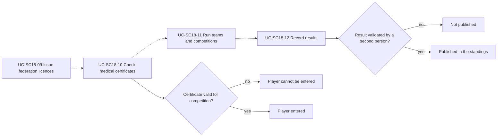
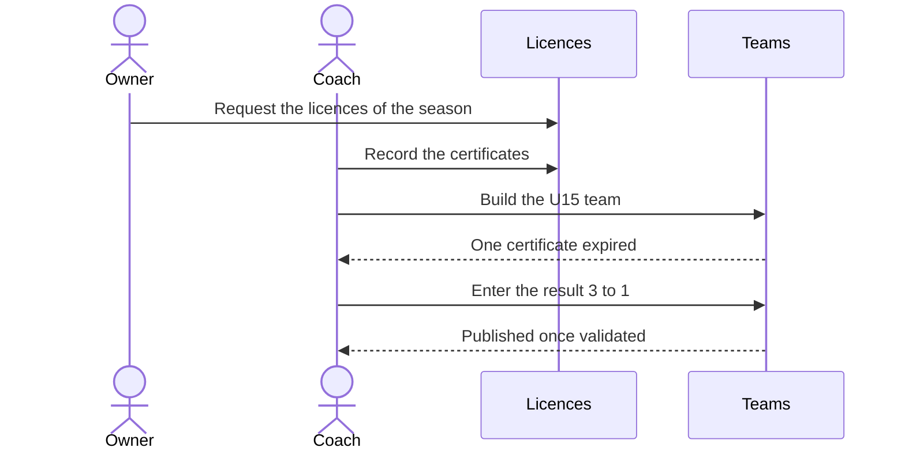

🏠 [Specs](../../../README.md) › 🏷️ [Sectors](../../README.md) › 🏋️ [SC18 Sports and fitness](../README.md) ›
🔀 [Flows](README.md) › 🔀 FL-SC18-03 Licences and competitions

# 🔀 FL-SC18-03 Licences and competitions

**Status:** 🔄 waiting for the owner

## Summary

Four situations of the sporting year: issuing federation licences, checking medical certificates, running teams and
competitions, and recording results
([D562](../../../06-decisions/sectors/d562-benchmark-gaps-sc18-sports-and-fitness.md)).

## Personas

- [U13 Owner](../../../01-users/personas/u13-owner.md), who issues the licences
- [U09 Customer](../../../01-users/personas/u09-customer.md), who holds the licence
- [U53 Coach](../../../01-users/personas/u53-coach.md), who checks certificates, builds teams and enters results

## Flowchart

## Sequence diagram

## Steps

| Step | Persona | Screen | Use case | What happens |
|---|---|---|---|---|
| 1 | [U13](../../../01-users/personas/u13-owner.md) | [S-SC18-09](../screens/03-licences-and-competitions/s-sc18-09-federation-licences.md) | [UC-SC18-09](../use-cases/03-licences-and-competitions/uc-sc18-09-issue-federation-licences.md) | The owner requests one licence per member and season and records the numbers returned |
| 2 | [U53](../../../01-users/personas/u53-coach.md) | [S-SC18-10](../screens/03-licences-and-competitions/s-sc18-10-medical-certificates.md) | [UC-SC18-10](../use-cases/03-licences-and-competitions/uc-sc18-10-check-medical-certificates.md) | The coach records each certificate and sees who is covered for competition |
| 3 | [U53](../../../01-users/personas/u53-coach.md) | [S-SC18-11](../screens/03-licences-and-competitions/s-sc18-11-teams-and-competitions.md) | [UC-SC18-11](../use-cases/03-licences-and-competitions/uc-sc18-11-run-teams-and-competitions.md) | The coach builds a team of licensed players of the right category and registers it |
| 4 | [U53](../../../01-users/personas/u53-coach.md) | [S-SC18-12](../screens/03-licences-and-competitions/s-sc18-12-results.md) | [UC-SC18-12](../use-cases/03-licences-and-competitions/uc-sc18-12-record-results.md) | The coach enters the result, a second person validates it and it is published |

### Entities and screens

| Entity | States in this flow | Shown at step and screen | Aggregated view |
|---|---|---|---|
| [E-SC18-06 Licence](../data/e-sc18-06-licence.md) | Requested, Issued, Cancelled, Expired | 1 [S-SC18-09](../screens/03-licences-and-competitions/s-sc18-09-federation-licences.md) | Licences |
| [E-SC18-07 Medical certificate](../data/e-sc18-07-medical-certificate.md) | Received, Valid, Rejected, Expired | 2 [S-SC18-10](../screens/03-licences-and-competitions/s-sc18-10-medical-certificates.md) | Medical certificates |
| [E-SC18-08 Sports team](../data/e-sc18-08-team.md) | Forming, Registered, Withdrawn, Archived | 3 [S-SC18-11](../screens/03-licences-and-competitions/s-sc18-11-teams-and-competitions.md) | Teams |
| [E-SC18-09 Result](../data/e-sc18-09-result.md) | Entered, Validated, Published, Contested | 4 [S-SC18-12](../screens/03-licences-and-competitions/s-sc18-12-results.md) | Results |

## Errors

- **E1 The certificate has expired.** The player's certificate is past its validity: the entry in the competition is
  blocked and the member is asked for a new one
  ([BR-SC18-10](../business-rules/br-sc18-10-competitions-need-a-valid-certificate.md), step 2).

## Images

Every step and error, for each persona taking part, in light and dark mode (D120). Steps are numbered as in the Steps
table; E rows are the error cases.

| Step | Persona | Device | Light | Dark |
|---|---|---|---|---|
| 1 | U13 | desktop | [light](../images/03-licences-and-competitions/u13-owner/1-federation-licences-desktop-light.png) | [dark](../images/03-licences-and-competitions/u13-owner/1-federation-licences-desktop-dark.png) |
| 1 | U09 | phone | [light](../images/03-licences-and-competitions/u09-customer/1-federation-licences-phone-light.png) | [dark](../images/03-licences-and-competitions/u09-customer/1-federation-licences-phone-dark.png) |
| 1 | U13 | phone | [light](../images/03-licences-and-competitions/u13-owner/1-federation-licences-phone-light.png) | [dark](../images/03-licences-and-competitions/u13-owner/1-federation-licences-phone-dark.png) |
| 2 | U53 | phone | [light](../images/03-licences-and-competitions/u53-coach/2-medical-certificates-phone-light.png) | [dark](../images/03-licences-and-competitions/u53-coach/2-medical-certificates-phone-dark.png) |
| 3 | U53 | phone | [light](../images/03-licences-and-competitions/u53-coach/3-teams-and-competitions-phone-light.png) | [dark](../images/03-licences-and-competitions/u53-coach/3-teams-and-competitions-phone-dark.png) |
| 4 | U53 | phone | [light](../images/03-licences-and-competitions/u53-coach/4-results-phone-light.png) | [dark](../images/03-licences-and-competitions/u53-coach/4-results-phone-dark.png) |
| E1 | U13 | desktop | [light](../images/03-licences-and-competitions/u13-owner/e1-the-certificate-has-expired-desktop-light.png) | [dark](../images/03-licences-and-competitions/u13-owner/e1-the-certificate-has-expired-desktop-dark.png) |
| E1 | U13 | phone | [light](../images/03-licences-and-competitions/u13-owner/e1-the-certificate-has-expired-phone-light.png) | [dark](../images/03-licences-and-competitions/u13-owner/e1-the-certificate-has-expired-phone-dark.png) |

## Open questions

None.

---

⬅️ [FL-SC18-02 Classes and waiting lists](fl-sc18-02-classes-and-waiting-lists.md) · ⬆️ [Up](README.md) ·
➡️ [FL-SC18-04 Personal training](fl-sc18-04-personal-training.md)
