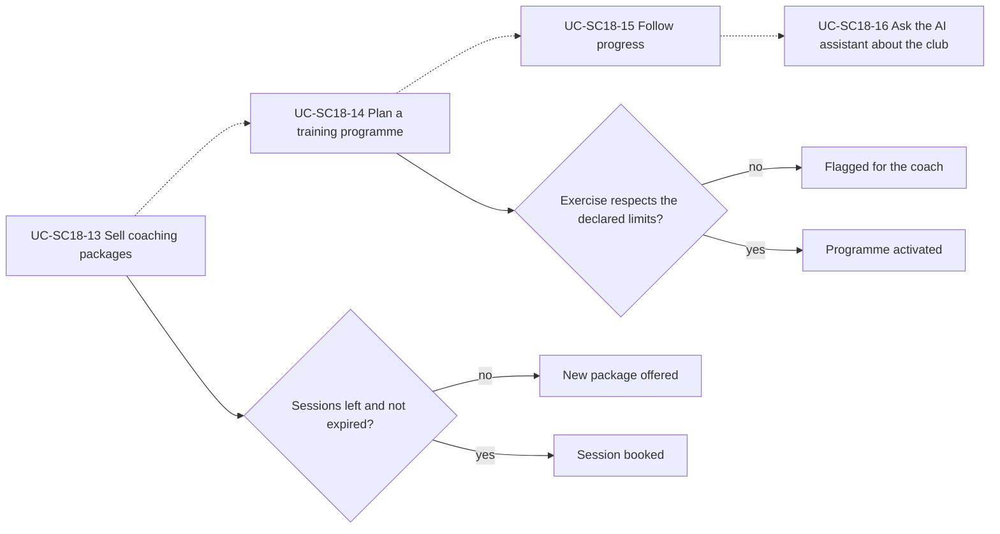
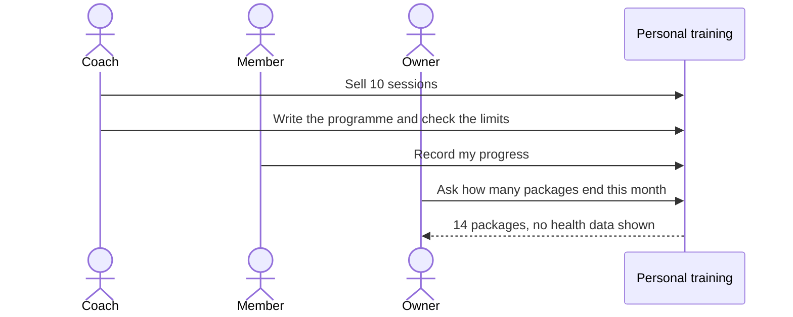

🏠 [Specs](../../../README.md) › 🏷️ [Sectors](../../README.md) › 🏋️ [SC18 Sports and fitness](../README.md) ›
🔀 [Flows](README.md) › 🔀 FL-SC18-04 Personal training

# 🔀 FL-SC18-04 Personal training

**Status:** 🔄 waiting for the owner

## Summary

Four situations of personal training: selling coaching packages, planning a training programme within the declared
health limits, following progress, and asking the AI assistant about the club
([D562](../../../06-decisions/sectors/d562-benchmark-gaps-sc18-sports-and-fitness.md)).

## Personas

- [U53 Coach](../../../01-users/personas/u53-coach.md), who sells, plans and follows
- [U09 Customer](../../../01-users/personas/u09-customer.md), who buys and trains
- [U13 Owner](../../../01-users/personas/u13-owner.md), who asks the AI assistant about the club

## Flowchart

## Sequence diagram

## Steps

| Step | Persona | Screen | Use case | What happens |
|---|---|---|---|---|
| 1 | [U53](../../../01-users/personas/u53-coach.md) | [S-SC18-13](../screens/04-personal-training/s-sc18-13-coaching-packages.md) | [UC-SC18-13](../use-cases/04-personal-training/uc-sc18-13-sell-coaching-packages.md) | The coach sells a package with the expiry terms shown before the sale |
| 2 | [U53](../../../01-users/personas/u53-coach.md) | [S-SC18-14](../screens/04-personal-training/s-sc18-14-training-programme.md) | [UC-SC18-14](../use-cases/04-personal-training/uc-sc18-14-plan-a-training-programme.md) | The coach writes a programme and each exercise is checked against the declared limits |
| 3 | [U53](../../../01-users/personas/u53-coach.md) | [S-SC18-15](../screens/04-personal-training/s-sc18-15-progress.md) | [UC-SC18-15](../use-cases/04-personal-training/uc-sc18-15-follow-progress.md) | The coach and the member record progress that only the two of them can read |
| 4 | [U13](../../../01-users/personas/u13-owner.md) | [S-SC18-16](../screens/04-personal-training/s-sc18-16-club-assistant.md) | [UC-SC18-16](../use-cases/04-personal-training/uc-sc18-16-ask-the-assistant-about-the-club.md) | The owner asks the AI assistant about the club and confirms what it prepares |

### Entities and screens

| Entity | States in this flow | Shown at step and screen | Aggregated view |
|---|---|---|---|
| [E-SC18-10 Coaching package](../data/e-sc18-10-coaching-package.md) | Active, Used up, Expired, Cancelled | 1 [S-SC18-13](../screens/04-personal-training/s-sc18-13-coaching-packages.md) | Coaching packages |
| [E-SC18-11 Training programme](../data/e-sc18-11-training-programme.md) | Draft, Active, Completed, Stopped | 2 [S-SC18-14](../screens/04-personal-training/s-sc18-14-training-programme.md) | Training programmes |
| [E-SC18-12 Progress record](../data/e-sc18-12-progress-record.md) | Recorded, Archived, Erased | 3 [S-SC18-15](../screens/04-personal-training/s-sc18-15-progress.md) | Progress records |

## Errors

- **E1 The package is used up.** The last session was given or the end date passed: no session can be booked and a new
  package is offered ([BR-SC18-13](../business-rules/br-sc18-13-sessions-expire-per-the-package-terms.md), step 1).

## Images

Every step and error, for each persona taking part, in light and dark mode (D120). Steps are numbered as in the Steps
table; E rows are the error cases.

| Step | Persona | Device | Light | Dark |
|---|---|---|---|---|
| 1 | U53 | phone | [light](../images/04-personal-training/u53-coach/1-coaching-packages-phone-light.png) | [dark](../images/04-personal-training/u53-coach/1-coaching-packages-phone-dark.png) |
| 1 | U09 | phone | [light](../images/04-personal-training/u09-customer/1-coaching-packages-phone-light.png) | [dark](../images/04-personal-training/u09-customer/1-coaching-packages-phone-dark.png) |
| 2 | U53 | phone | [light](../images/04-personal-training/u53-coach/2-training-programme-phone-light.png) | [dark](../images/04-personal-training/u53-coach/2-training-programme-phone-dark.png) |
| 3 | U53 | phone | [light](../images/04-personal-training/u53-coach/3-progress-phone-light.png) | [dark](../images/04-personal-training/u53-coach/3-progress-phone-dark.png) |
| 3 | U09 | phone | [light](../images/04-personal-training/u09-customer/3-progress-phone-light.png) | [dark](../images/04-personal-training/u09-customer/3-progress-phone-dark.png) |
| 4 | U13 | phone | [light](../images/04-personal-training/u13-owner/4-club-assistant-phone-light.png) | [dark](../images/04-personal-training/u13-owner/4-club-assistant-phone-dark.png) |
| 4 | U13 | desktop | [light](../images/04-personal-training/u13-owner/4-club-assistant-desktop-light.png) | [dark](../images/04-personal-training/u13-owner/4-club-assistant-desktop-dark.png) |
| E1 | U53 | phone | [light](../images/04-personal-training/u53-coach/e1-the-package-is-used-up-phone-light.png) | [dark](../images/04-personal-training/u53-coach/e1-the-package-is-used-up-phone-dark.png) |

## Open questions

None.

---

⬅️ [FL-SC18-03 Licences and competitions](fl-sc18-03-licences-and-competitions.md) · ⬆️ [Up](README.md) ·
➡️ [FL-SC18-05 Facilities, events, camps and rentals](fl-sc18-05-facilities-events-camps-and-rentals.md)
