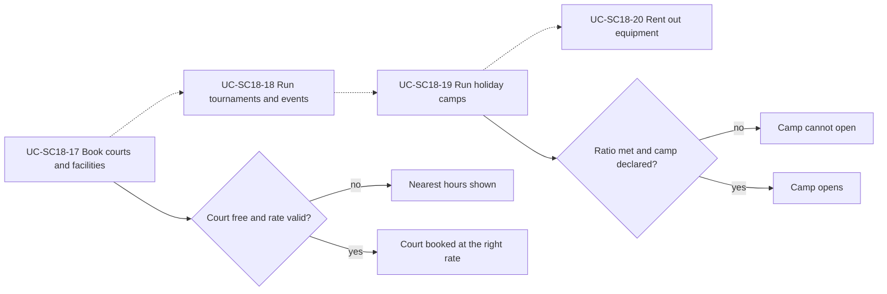
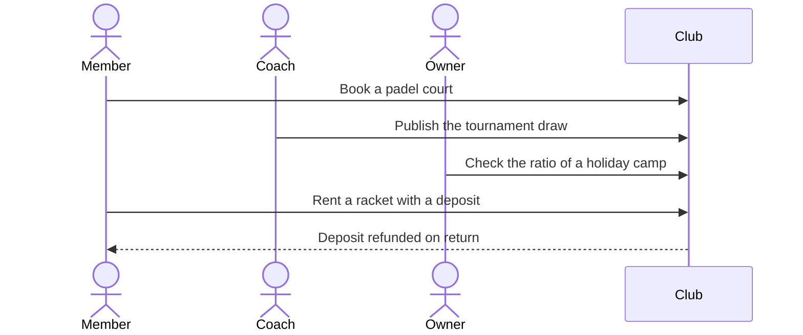

🏠 [Specs](../../../README.md) › 🏷️ [Sectors](../../README.md) › 🏋️ [SC18 Sports and fitness](../README.md) ›
🔀 [Flows](README.md) › 🔀 FL-SC18-05 Facilities, events, camps and rentals

# 🔀 FL-SC18-05 Facilities, events, camps and rentals

**Status:** ✅ specified

## Summary

Four situations the owner added to the club: booking courts and facilities, running tournaments and events, running
holiday camps, and renting out equipment
([D562](../../../06-decisions/sectors/d562-benchmark-gaps-sc18-sports-and-fitness.md)).

## Personas

- [U09 Customer](../../../01-users/personas/u09-customer.md), who books, enters and rents
- [U13 Owner](../../../01-users/personas/u13-owner.md), who runs courts and camps
- [U53 Coach](../../../01-users/personas/u53-coach.md), who runs tournaments and rentals

## Flowchart

## Sequence diagram

## Steps

| Step | Persona | Screen | Use case | What happens |
|---|---|---|---|---|
| 1 | [U09](../../../01-users/personas/u09-customer.md) | [S-SC18-17](../screens/05-facilities-events-camps-and-rentals/s-sc18-17-court-booking.md) | [UC-SC18-17](../use-cases/05-facilities-events-camps-and-rentals/uc-sc18-17-book-courts-and-facilities.md) | The member books a court by the hour at the members' rate if the membership is valid |
| 2 | [U53](../../../01-users/personas/u53-coach.md) | [S-SC18-18](../screens/05-facilities-events-camps-and-rentals/s-sc18-18-tournaments.md) | [UC-SC18-18](../use-cases/05-facilities-events-camps-and-rentals/uc-sc18-18-run-tournaments-and-events.md) | The coach opens entries, makes the draw and publishes it before the first match |
| 3 | [U13](../../../01-users/personas/u13-owner.md) | [S-SC18-19](../screens/05-facilities-events-camps-and-rentals/s-sc18-19-holiday-camps.md) | [UC-SC18-19](../use-cases/05-facilities-events-camps-and-rentals/uc-sc18-19-run-holiday-camps.md) | The owner registers the children and checks the supervision ratio before the camp opens |
| 4 | [U53](../../../01-users/personas/u53-coach.md) | [S-SC18-20](../screens/05-facilities-events-camps-and-rentals/s-sc18-20-equipment-rental.md) | [UC-SC18-20](../use-cases/05-facilities-events-camps-and-rentals/uc-sc18-20-rent-out-equipment.md) | The coach rents out an item against a deposit and refunds it when the item is back in good order |

### Entities and screens

| Entity | States in this flow | Shown at step and screen | Aggregated view |
|---|---|---|---|
| [E-SC18-13 Court booking](../data/e-sc18-13-court-booking.md) | Held, Confirmed, Cancelled, Used, No show | 1 [S-SC18-17](../screens/05-facilities-events-camps-and-rentals/s-sc18-17-court-booking.md) | Court bookings |
| [E-SC18-14 Tournament](../data/e-sc18-14-tournament.md) | Draft, Open, Closed, Drawn, Running, Finished, Cancelled | 2 [S-SC18-18](../screens/05-facilities-events-camps-and-rentals/s-sc18-18-tournaments.md) | Tournaments |
| [E-SC18-15 Camp registration](../data/e-sc18-15-camp-registration.md) | Registered, Confirmed, Waiting, Attended, Cancelled | 3 [S-SC18-19](../screens/05-facilities-events-camps-and-rentals/s-sc18-19-holiday-camps.md) | Camp registrations |
| [E-SC18-16 Rental item](../data/e-sc18-16-rental-item.md) | Available, Rented out, In repair, Retired | 4 [S-SC18-20](../screens/05-facilities-events-camps-and-rentals/s-sc18-20-equipment-rental.md) | Rental items |

## Errors

- **E1 The court is taken.** Another booking holds the hour: the member is refused and shown the nearest free hours
  ([BR-SC18-17](../business-rules/br-sc18-17-members-rates-apply-only-to-valid-members.md), step 1).

## Images

Every step and error, for each persona taking part, in light and dark mode (D120). Steps are numbered as in the Steps
table; E rows are the error cases.

| Step | Persona | Device | Light | Dark |
|---|---|---|---|---|
| 1 | U09 | phone | [light](../images/05-facilities-events-camps-and-rentals/u09-customer/1-court-booking-phone-light.png) | [dark](../images/05-facilities-events-camps-and-rentals/u09-customer/1-court-booking-phone-dark.png) |
| 1 | U13 | desktop | [light](../images/05-facilities-events-camps-and-rentals/u13-owner/1-court-booking-desktop-light.png) | [dark](../images/05-facilities-events-camps-and-rentals/u13-owner/1-court-booking-desktop-dark.png) |
| 2 | U53 | phone | [light](../images/05-facilities-events-camps-and-rentals/u53-coach/2-tournaments-phone-light.png) | [dark](../images/05-facilities-events-camps-and-rentals/u53-coach/2-tournaments-phone-dark.png) |
| 2 | U09 | phone | [light](../images/05-facilities-events-camps-and-rentals/u09-customer/2-tournaments-phone-light.png) | [dark](../images/05-facilities-events-camps-and-rentals/u09-customer/2-tournaments-phone-dark.png) |
| 3 | U13 | desktop | [light](../images/05-facilities-events-camps-and-rentals/u13-owner/3-holiday-camps-desktop-light.png) | [dark](../images/05-facilities-events-camps-and-rentals/u13-owner/3-holiday-camps-desktop-dark.png) |
| 3 | U09 | phone | [light](../images/05-facilities-events-camps-and-rentals/u09-customer/3-holiday-camps-phone-light.png) | [dark](../images/05-facilities-events-camps-and-rentals/u09-customer/3-holiday-camps-phone-dark.png) |
| 3 | U13 | phone | [light](../images/05-facilities-events-camps-and-rentals/u13-owner/3-holiday-camps-phone-light.png) | [dark](../images/05-facilities-events-camps-and-rentals/u13-owner/3-holiday-camps-phone-dark.png) |
| 4 | U53 | phone | [light](../images/05-facilities-events-camps-and-rentals/u53-coach/4-equipment-rental-phone-light.png) | [dark](../images/05-facilities-events-camps-and-rentals/u53-coach/4-equipment-rental-phone-dark.png) |
| 4 | U09 | phone | [light](../images/05-facilities-events-camps-and-rentals/u09-customer/4-equipment-rental-phone-light.png) | [dark](../images/05-facilities-events-camps-and-rentals/u09-customer/4-equipment-rental-phone-dark.png) |
| E1 | U09 | phone | [light](../images/05-facilities-events-camps-and-rentals/u09-customer/e1-the-court-is-taken-phone-light.png) | [dark](../images/05-facilities-events-camps-and-rentals/u09-customer/e1-the-court-is-taken-phone-dark.png) |

## Open questions

None.

---

⬅️ [FL-SC18-04 Personal training](fl-sc18-04-personal-training.md) · ⬆️ [Up](README.md)
