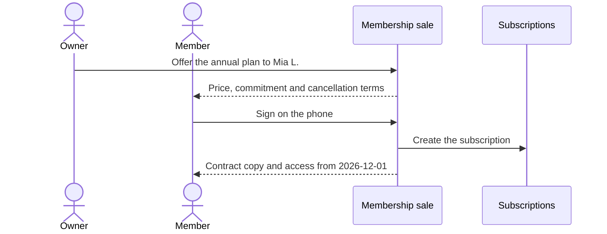

🏠 [Specs](../../../../README.md) › 🏷️ [Sectors](../../../README.md) › 🏋️ [SC18 Sports and fitness](../../README.md) ›
📝 [Use cases](../README.md) › 📝 [Use cases: FL-SC18-01 Memberships and access](README.md) ›
📝 UC-SC18-01 Sell a membership

# 📝 UC-SC18-01 Sell a membership

**Status:** ✅ specified

## Summary

A club or a gym signs up a member. The owner offers plans (monthly, annual, student, family, a club membership for an
association), the member chooses one and signs a contract that states the price, the length of commitment, how the
contract renews and how to cancel. The contract is billed as a subscription and gives the member access rights.

## Personas

- [U13 Owner](../../../../01-users/personas/u13-owner.md)
- [U09 Customer](../../../../01-users/personas/u09-customer.md)

## Goal

Every member signs a clear contract with the cancellation terms stated, and the club knows who may enter and until when.

## Trigger

A person asks to join, in the club, at the gym's desk or on the phone.

## Frequency

A few sign-ups a day in a gym; a rush at the start of a season in a club.

## Preconditions

- The membership plans and their terms are set.
- The member has a customer record
  ([E-F6-01](../../../../02-functional/f06-customers-and-sales/data/e-f06-01-customer-record.md)).
- The organisation kind (association or commercial gym) is set in the sector settings.

## Postconditions

- **Succeeded:** the membership is saved ([E-SC18-01 Club membership](../../data/e-sc18-01-club-membership.md)) on a
  subscription contract
  ([E-F6-07](../../../../02-functional/f06-customers-and-sales/data/e-f06-07-subscription-contract.md)) with the signed
  terms; the member has access from the start date.
- **Failed:** no membership starts; the missing signature, plan or payment method is shown.

## Main flow

1. The owner opens the membership sale screen
   ([S-SC18-01](../../screens/01-memberships-and-access/s-sc18-01-membership-sale.md)) and chooses or creates the
   member.
2. The owner chooses a plan; the screen shows the price, the commitment, the renewal and the cancellation terms in plain
   words ([BR-SC18-01](../../business-rules/br-sc18-01-contracts-state-the-cancellation-terms.md)).
3. The member reads the terms and signs on the phone or the tablet; the signature date is kept
   ([CR-FR-020](../../../../10-country-packs/france/invoicing/cr-fr-020-electronic-acceptance-and-signature.md)).
4. The member gives a payment method; if it is a direct debit, the mandate is taken
   ([UC-SC18-02](uc-sc18-02-collect-dues-by-direct-debit.md)).
5. The membership becomes Active at the start date and the member's access is opened
   ([UC-SC18-03](uc-sc18-03-control-access-at-the-door.md)).
6. The first due is billed and the member receives a copy of the contract.

## Alternative flows

- 2a. The member is a child: the parent's identity and signature are recorded.
- 2b. The organisation is an association: the membership is the yearly subscription and the licence may be asked with it
  ([UC-SC18-09](../03-licences-and-competitions/uc-sc18-09-issue-federation-licences.md)).
- 4a. The member pays the whole year at once: no direct debit is needed.

## Error flows

- 3e. The member does not sign: the membership is not started.
- 2e. The plan has no cancellation terms: the screen refuses to offer it.
- 4e. The first payment fails: the membership stays Offered and the access is not opened.
- Any step: a service does not answer; the call is retried first
  ([BR-F3-32](../../../../02-functional/f03-assistant/business-rules/br-f03-32-retry-before-an-error.md)), then the
  message follows the error pattern ([D122](../../../../06-decisions/ux/d122-error-message-standard.md)) and what the
  user typed stays on the screen.

## Business rules

- [BR-SC18-01](../../business-rules/br-sc18-01-contracts-state-the-cancellation-terms.md)
- [BR-SC18-04](../../business-rules/br-sc18-04-cancellation-follows-the-legal-notice-period.md)

## Entities

- [E-SC18-01 Club membership](../../data/e-sc18-01-club-membership.md): created, changed
- [E-F6-07](../../../../02-functional/f06-customers-and-sales/data/e-f06-07-subscription-contract.md): created, the
  subscription contract that bills the dues
- [E-F6-01](../../../../02-functional/f06-customers-and-sales/data/e-f06-01-customer-record.md): read and changed, the
  member as a customer
- [E-F6-06](../../../../02-functional/f06-customers-and-sales/data/e-f06-06-customer-payment.md): read, the first
  payment

## Permissions

Owner sells and changes memberships; the member reads their own contract and cancels from their phone
([UC-SC18-04](uc-sc18-04-freeze-or-cancel-a-membership.md)); the treasurer reads the dues.

## Notifications

The member, with their consent: a copy of the contract, the first due. The owner: a new member, a membership refused for
payment.

## Audit events

Each plan, sale, signature, start, renewal and end, with who, when and the terms shown.

## AI involvement

No AI step of its own. The AI assistant may open the screen and prefill it from the user's words; the user checks and
confirms
[BR-F3-07](../../../../02-functional/f03-assistant/business-rules/br-f03-07-no-deletes-no-irreversible-acts.md).

## API, MCP and A2A exposure

T5 operations of the capability for the personas above: create, read, update and list. The MCP tool of the
capability may read and propose, never confirm alone. No A2A skill.

## Screens

- [S-SC18-01](../../screens/01-memberships-and-access/s-sc18-01-membership-sale.md)

## Flowchart

See [FL-SC18-01 Memberships and access](../../flows/fl-sc18-01-memberships-and-access.md#flowchart).

## Sequence diagram

## Acceptance criteria

1. **Given** a plan with a commitment of 12 months and a notice of one month **when** the member signs **then** the
   contract shows both and the membership is Active at the start date.
2. **Given** a plan with no cancellation terms **when** the owner offers it **then** it is refused.
3. **Given** a first payment that fails **when** the owner confirms **then** the membership stays Offered and no access
   is opened.
4. **Given** a child member **when** the parent signs **then** the parent's identity is kept on the contract.

## Non-functional notes

The screen answers within 2 seconds for 10,000 records; every change is audited.

## Regulatory references

Before the contract is signed the member is told the price, the length of commitment, whether it renews
itself, and how and when to cancel; a contract made at a distance carries the withdrawal right
([CR-FR-036](../../../../10-country-packs/france/consumer/cr-fr-036-withdrawal-right.md)). An association's membership
follows its own statutes. The France-pack rules are [CR-FR-065 Information before an online order](../../../../10-country-packs/france/consumer/cr-fr-065-online-pre-contract-information.md), [CR-FR-263 Free trials of paid services](../../../../10-country-packs/france/consumer/cr-fr-263-free-trials-of-paid-services.md) (tacit renewal and online termination) and [CR-FR-036 Consumer withdrawal right](../../../../10-country-packs/france/consumer/cr-fr-036-withdrawal-right.md).

## Related use cases

- [UC-SC18-02 Collect dues by direct debit](uc-sc18-02-collect-dues-by-direct-debit.md)
- [UC-SC18-02 Collect dues by direct debit](uc-sc18-02-collect-dues-by-direct-debit.md)
- [UC-SC18-04 Freeze or cancel a membership](uc-sc18-04-freeze-or-cancel-a-membership.md)
- [UC-F6-10](../../../../02-functional/f06-customers-and-sales/use-cases/04-subscriptions/uc-f06-10-manage-subscriptions.md)

## Open questions

None.

---

⬆️ [Up](README.md) · ➡️ [UC-SC18-02 Collect dues by direct debit](uc-sc18-02-collect-dues-by-direct-debit.md)
