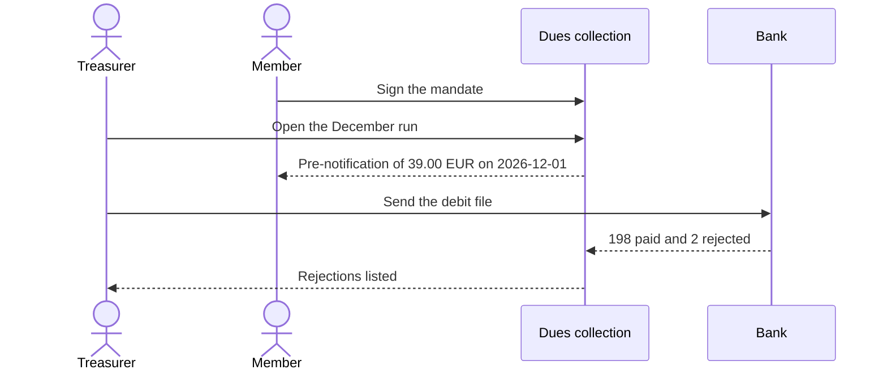

🏠 [Specs](../../../../README.md) › 🏷️ [Sectors](../../../README.md) › 🏋️ [SC18 Sports and fitness](../../README.md) ›
📝 [Use cases](../README.md) › 📝 [Use cases: FL-SC18-01 Memberships and access](README.md) ›
📝 UC-SC18-02 Collect dues by direct debit

# 📝 UC-SC18-02 Collect dues by direct debit

**Status:** ✅ specified

## Summary

The treasurer collects the dues of the members by direct debit. Each member signs a mandate that authorises the club to
debit their account; the club tells them each amount and date in advance, sends the debit file to the bank on the due
date and follows the rejected payments. A debit is never sent without a signed and active mandate.

## Personas

- [U31 Treasurer](../../../../01-users/personas/u31-treasurer.md)

## Goal

Dues are collected on time with no manual follow-up, and every debit rests on a mandate the member signed.

## Trigger

A member signs up with a direct debit, the monthly due date comes, or a payment is rejected.

## Frequency

One collection run a month; a few rejections a week.

## Preconditions

- The membership exists ([E-SC18-01 Club membership](../../data/e-sc18-01-club-membership.md)).
- The club has a creditor identifier and a bank account for the debits.
- The dues are invoiced ([E-F6-05 Invoice](../../../../02-functional/f06-customers-and-sales/data/e-f06-05-invoice.md)).

## Postconditions

- **Succeeded:** the mandate is saved ([E-SC18-02 Dues mandate](../../data/e-sc18-02-dues-mandate.md)) and the debit is
  sent; the payment is matched to the invoice
  ([E-F6-06](../../../../02-functional/f06-customers-and-sales/data/e-f06-06-customer-payment.md)).
- **Failed:** no debit is sent for a member with no active mandate; the member is listed to be contacted.

## Main flow

1. At sign-up, the member signs the mandate on the phone or the tablet; its reference and date are kept
   ([BR-SC18-02](../../business-rules/br-sc18-02-direct-debits-need-a-signed-mandate.md)).
2. The treasurer opens the dues collection screen
   ([S-SC18-02](../../screens/01-memberships-and-access/s-sc18-02-dues-collection.md)) before the due date.
3. simple-ERP lists the dues to collect, with members who have an active mandate and those who do not.
4. The member is told each amount and date in advance, in the delay the scheme sets.
5. The treasurer sends the debit file in the bank format
   ([CR-FR-023](../../../../10-country-packs/france/payments/cr-fr-023-sepa-formats.md)) on the due date.
6. The bank's answer arrives; paid dues are matched, rejected ones are listed with the reason.

## Alternative flows

- 2a. A new mandate replaces an old one when the member changes bank: the old mandate is Revoked and the new one Active.
- 6a. A rejected debit is retried once at the next date, then the member is contacted.
- 3a. A member pays by card or cash: no mandate is needed and the due is paid at the desk.

## Error flows

- 3e. A member has no signed mandate: the due is not in the file and the member is contacted.
- 6e. The bank rejects for insufficient funds: the due is Unpaid and the member's access is flagged after the delay of
  the contract.
- 6e. The member disputes the debit: the amount is refunded as the scheme requires and the reason kept.
- Any step: a service does not answer; the call is retried first
  ([BR-F3-32](../../../../02-functional/f03-assistant/business-rules/br-f03-32-retry-before-an-error.md)), then the
  message follows the error pattern ([D122](../../../../06-decisions/ux/d122-error-message-standard.md)) and what the
  user typed stays on the screen.

## Business rules

- [BR-SC18-02](../../business-rules/br-sc18-02-direct-debits-need-a-signed-mandate.md)
- [BR-SC18-01](../../business-rules/br-sc18-01-contracts-state-the-cancellation-terms.md)

## Entities

- [E-SC18-02 Dues mandate](../../data/e-sc18-02-dues-mandate.md): created, changed
- [E-SC18-01 Club membership](../../data/e-sc18-01-club-membership.md): read, the membership the mandate pays
- [E-F6-05 Invoice](../../../../02-functional/f06-customers-and-sales/data/e-f06-05-invoice.md): read, the invoices of
  the dues
- [E-F6-06](../../../../02-functional/f06-customers-and-sales/data/e-f06-06-customer-payment.md): created, the payments
  received

## Permissions

Treasurer collects, retries and refunds; owner reads the results; the member signs and revokes their own mandate.

## Notifications

The member, with their consent: the pre-notification of each debit, a rejected debit. The treasurer: the result of each
run.

## Audit events

Each mandate, pre-notification, debit file, payment, rejection, refund and revocation, with who and when.

## AI involvement

No AI step of its own. The AI assistant may open the screen and prefill it from the user's words; the user checks and
confirms
[BR-F3-07](../../../../02-functional/f03-assistant/business-rules/br-f03-07-no-deletes-no-irreversible-acts.md).

## API, MCP and A2A exposure

T5 operations of the capability for the personas above: create, read, update and list. The MCP tool of the
capability may read and propose, never confirm alone. No A2A skill.

## Screens

- [S-SC18-02](../../screens/01-memberships-and-access/s-sc18-02-dues-collection.md)

## Flowchart

See [FL-SC18-01 Memberships and access](../../flows/fl-sc18-01-memberships-and-access.md#flowchart).

## Sequence diagram

## Acceptance criteria

1. **Given** a member with an active mandate **when** the due date comes **then** the due is in the debit file.
2. **Given** a member with no mandate **when** the treasurer builds the file **then** the due is left out and the member
   is listed.
3. **Given** a rejected debit **when** the bank answers **then** the due is Unpaid with its reason.
4. **Given** a revoked mandate **when** the next run is built **then** no debit is sent for that member.

## Non-functional notes

The screen answers within 2 seconds for 10,000 records; every change is audited.

## Regulatory references

A direct debit rests on a mandate signed by the payer, who is told each amount and date in advance and may
have an unauthorised debit refunded within the delay the scheme sets. The SEPA formats are in
[CR-FR-023](../../../../10-country-packs/france/payments/cr-fr-023-sepa-formats.md). The France-pack rule is written
later.

## Related use cases

- [UC-SC18-01 Sell a membership](uc-sc18-01-sell-a-membership.md)
- [UC-SC18-03 Control access at the door](uc-sc18-03-control-access-at-the-door.md)
- [UC-SC18-01 Sell a membership](uc-sc18-01-sell-a-membership.md)
- [UC-SC18-04 Freeze or cancel a membership](uc-sc18-04-freeze-or-cancel-a-membership.md)

## Open questions

None.

---

⬅️ [UC-SC18-01 Sell a membership](uc-sc18-01-sell-a-membership.md) · ⬆️ [Up](README.md) ·
➡️ [UC-SC18-03 Control access at the door](uc-sc18-03-control-access-at-the-door.md)
