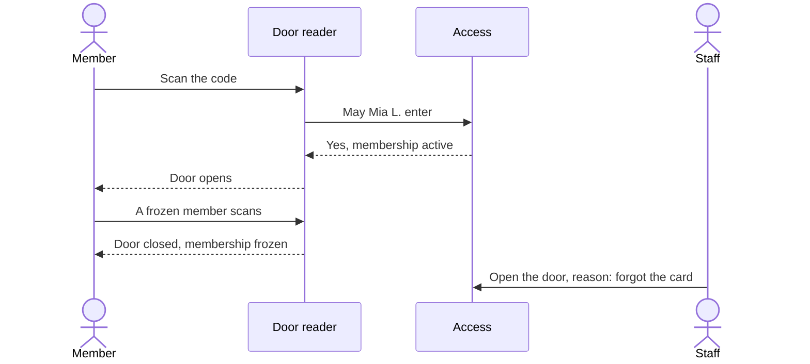

🏠 [Specs](../../../../README.md) › 🏷️ [Sectors](../../../README.md) › 🏋️ [SC18 Sports and fitness](../../README.md) ›
📝 [Use cases](../README.md) › 📝 [Use cases: FL-SC18-01 Memberships and access](README.md) ›
📝 UC-SC18-03 Control access at the door

# 📝 UC-SC18-03 Control access at the door

**Status:** ✅ specified

## Summary

A member enters the club or the gym by showing a code on their phone or a card at the door. The door reader asks
SimpleERP whether the member may enter: the membership must be Active and paid up, not frozen, and a required medical
certificate valid. Each entry is recorded, and a staff member can open the door for a member who is denied, with a
reason.

## Personas

- [U09 Customer](../../../../01-users/personas/u09-customer.md)

## Goal

Only people who may enter come in, entries are counted and no member is left outside for a mistake.

## Trigger

A member scans their code or card at the door.

## Frequency

Hundreds of entries a day in a gym.

## Preconditions

- The member has an Active membership ([E-SC18-01 Club membership](../../data/e-sc18-01-club-membership.md)).
- The door reader is connected to the club's access list.
- The member has a QR code in the app or a card.

## Postconditions

- **Succeeded:** the entry is saved ([E-SC18-03 Access event](../../data/e-sc18-03-access-event.md)) as Granted and the
  door opens.
- **Failed:** the door stays closed and the denial is saved with its reason.

## Main flow

1. The member scans the code or the card at the door.
2. The access screen ([S-SC18-03 Door access](../../screens/01-memberships-and-access/s-sc18-03-door-access.md)) is not
   needed for the member: the reader asks SimpleERP and the answer comes in a second.
3. SimpleERP checks the rule ([BR-SC18-03](../../business-rules/br-sc18-03-access-needs-a-valid-membership.md)):
   membership Active, dues not overdue beyond the delay, not frozen, certificate valid where required, inside the hours
   of the plan.
4. If the check passes the door opens and the entry is saved as Granted.
5. If it fails the door stays closed, the denial is saved with its reason and the member sees it on the phone.
6. A staff member may open the door for a denied member and records why; the entry becomes Overridden.

## Alternative flows

- 3a. The member is a guest of a member: a guest pass is read and the entry counts for the host.
- 3b. The member comes for a class: the class booking replaces the membership check for that hour
  ([UC-SC18-06](../02-classes-and-waiting-lists/uc-sc18-06-book-a-class.md)).
- 6a. The reader is offline: the last known list is used and the entries are sent when the link returns.

## Error flows

- 3e. The membership is frozen or ended: the door stays closed and the member is told why.
- 3e. The dues are overdue beyond the delay: the door stays closed and the member is shown the amount.
- 6e. A staff override is made with no reason: it is refused.
- Any step: a service does not answer; the call is retried first
  ([BR-F3-32](../../../../02-functional/f03-assistant/business-rules/br-f03-32-retry-before-an-error.md)), then the
  message follows the error pattern ([D122](../../../../06-decisions/ux/d122-error-message-standard.md)) and what the
  user typed stays on the screen.

## Business rules

- [BR-SC18-03](../../business-rules/br-sc18-03-access-needs-a-valid-membership.md)
- [BR-SC18-10](../../business-rules/br-sc18-10-competitions-need-a-valid-certificate.md)

## Entities

- [E-SC18-03 Access event](../../data/e-sc18-03-access-event.md): created
- [E-SC18-01 Club membership](../../data/e-sc18-01-club-membership.md): read, the membership and its state
- [E-SC18-07 Medical certificate](../../data/e-sc18-07-medical-certificate.md): read, the certificate where required
- [E-SC18-05 Class booking](../../data/e-sc18-05-class-booking.md): read, the class booking of the hour

## Permissions

The member uses their own code; staff override a denial with a reason; the owner reads the entries. Entry
data is personal data, shown to staff only for a stated need.

## Notifications

The member: the reason of a denial, on the phone. The owner: a surge of denials at a door.

## Audit events

Each entry, denial and override, with who, when, the door and the reason.

## AI involvement

No AI step of its own. The AI assistant may open the screen and prefill it from the user's words; the user checks and
confirms
[BR-F3-07](../../../../02-functional/f03-assistant/business-rules/br-f03-07-no-deletes-no-irreversible-acts.md).

## API, MCP and A2A exposure

T5 operations of the capability for the personas above: create, read, update and list. The MCP tool of the
capability may read and propose, never confirm alone. No A2A skill.

## Screens

- [S-SC18-03 Door access](../../screens/01-memberships-and-access/s-sc18-03-door-access.md)

## Flowchart

See [FL-SC18-01 Memberships and access](../../flows/fl-sc18-01-memberships-and-access.md#flowchart).

## Sequence diagram

## Acceptance criteria

1. **Given** an Active membership with dues up to date **when** the member scans at the door **then** the door opens and
   the entry is Granted.
2. **Given** a frozen membership **when** the member scans **then** the door stays closed and the entry is Denied.
3. **Given** a denied member and a staff override with a reason **when** the staff opens the door **then** the entry is
   Overridden with the reason.
4. **Given** a reader offline **when** a member scans **then** the last list is used and the entry is sent later.

## Non-functional notes

The screen answers within 2 seconds for 10,000 records; every change is audited.

## Regulatory references

The entries of a member are personal data: they are kept no longer than needed and used only to control
access and count attendance. A badge reading that identifies a person by their body is not used. The France-pack rule is
written later. Related:
[CR-FR-052](../../../../10-country-packs/france/data-protection/cr-fr-052-storage-limitation.md).

## Related use cases

- [UC-SC18-02 Collect dues by direct debit](uc-sc18-02-collect-dues-by-direct-debit.md)
- [UC-SC18-04 Freeze or cancel a membership](uc-sc18-04-freeze-or-cancel-a-membership.md)
- [UC-SC18-01 Sell a membership](uc-sc18-01-sell-a-membership.md)
- [UC-SC18-04 Freeze or cancel a membership](uc-sc18-04-freeze-or-cancel-a-membership.md)
- [UC-SC18-10](../03-licences-and-competitions/uc-sc18-10-check-medical-certificates.md)

## Open questions

None.

---

⬅️ [UC-SC18-02 Collect dues by direct debit](uc-sc18-02-collect-dues-by-direct-debit.md) · ⬆️ [Up](README.md) ·
➡️ [UC-SC18-04 Freeze or cancel a membership](uc-sc18-04-freeze-or-cancel-a-membership.md)
