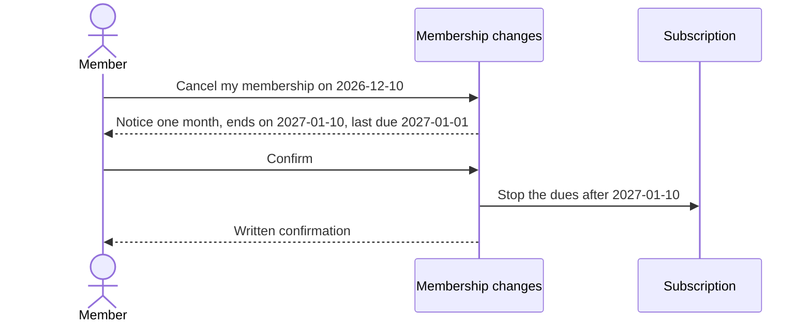

🏠 [Specs](../../../../README.md) › 🏷️ [Sectors](../../../README.md) › 🏋️ [SC18 Sports and fitness](../../README.md) ›
📝 [Use cases](../README.md) › 📝 [Use cases: FL-SC18-01 Memberships and access](README.md) ›
📝 UC-SC18-04 Freeze or cancel a membership

# 📝 UC-SC18-04 Freeze or cancel a membership

**Status:** ✅ specified

## Summary

A member asks to freeze or to end their membership, from the app or at the desk. A freeze stops the dues and the access
for a set time. A cancellation follows the notice the contract states and the legal notice period: the member sees the
date it takes effect and the last due, and the club never bills after that date.

## Personas

- [U13 Owner](../../../../01-users/personas/u13-owner.md)
- [U09 Customer](../../../../01-users/personas/u09-customer.md)

## Goal

A member can leave or pause as easily as they joined, and the club bills exactly what the contract and the law allow.

## Trigger

A member asks to freeze or cancel, or a notice period ends.

## Frequency

Several a week in a gym; a few at the end of a season in a club.

## Preconditions

- The membership is Active ([E-SC18-01 Club membership](../../data/e-sc18-01-club-membership.md)).
- The contract states its notice and its freeze rules.

## Postconditions

- **Succeeded:** the membership is Frozen or has Notice given and then Ended on the right date
  ([E-SC18-01 Club membership](../../data/e-sc18-01-club-membership.md)); the last due is the one before that date.
- **Failed:** no change is made; the reason (commitment not ended, notice too short) is shown with the date it would
  take effect.

## Main flow

1. The member opens the membership changes screen
   ([S-SC18-04](../../screens/01-memberships-and-access/s-sc18-04-membership-changes.md)) on the phone, or the owner
   opens it at the desk.
2. The member chooses Freeze or Cancel and sees the effect date, the last due and any fee the contract allows
   ([BR-SC18-04](../../business-rules/br-sc18-04-cancellation-follows-the-legal-notice-period.md)).
3. For a freeze, the member chooses the length within the allowed limit; dues and access stop for that time.
4. For a cancellation, the member confirms; the membership gets Notice given and ends on the date shown.
5. The member receives a written confirmation with the effect date.
6. At the effect date the membership is Ended, the access closes and no further due is billed.

## Alternative flows

- 2a. The contract has a commitment that has not ended: the screen shows the date it ends and, where the law allows
  early exit for a serious reason (a move, an illness), the proof to give.
- 3a. A freeze is asked for a medical reason: it may exceed the usual limit with a certificate.
- 4a. The member changes their mind during the notice: the cancellation is withdrawn before the date.

## Error flows

- 2e. The notice is too short for the date the member wants: the screen shows the earliest date.
- 4e. A cancellation asked by a parent for a child member: the parent's identity is checked.
- 6e. A due is billed after the end date: it is blocked and refunded if already paid.
- Any step: a service does not answer; the call is retried first
  ([BR-F3-32](../../../../02-functional/f03-assistant/business-rules/br-f03-32-retry-before-an-error.md)), then the
  message follows the error pattern ([D122](../../../../06-decisions/ux/d122-error-message-standard.md)) and what the
  user typed stays on the screen.

## Business rules

- [BR-SC18-04](../../business-rules/br-sc18-04-cancellation-follows-the-legal-notice-period.md)
- [BR-SC18-01](../../business-rules/br-sc18-01-contracts-state-the-cancellation-terms.md)

## Entities

- [E-SC18-01 Club membership](../../data/e-sc18-01-club-membership.md): read and changed, the membership and its state
- [E-F6-07](../../../../02-functional/f06-customers-and-sales/data/e-f06-07-subscription-contract.md): changed, the
  subscription
- [E-SC18-02 Dues mandate](../../data/e-sc18-02-dues-mandate.md): read, the mandate to stop

## Permissions

The member freezes and cancels their own membership; the owner does it for a member at the desk and may waive a fee.
Only the owner waives a fee.

## Notifications

The member, with their consent: the written confirmation with the effect date. The owner: each cancellation of the week.

## Audit events

Each freeze, cancellation, withdrawal, end date and waived fee, with who, when and the terms applied.

## AI involvement

No AI step of its own. The AI assistant may open the screen and prefill it from the user's words; the user checks and
confirms
[BR-F3-07](../../../../02-functional/f03-assistant/business-rules/br-f03-07-no-deletes-no-irreversible-acts.md).

## API, MCP and A2A exposure

T5 operations of the capability for the personas above: create, read, update and list. The MCP tool of the
capability may read and propose, never confirm alone. No A2A skill.

## Screens

- [S-SC18-04](../../screens/01-memberships-and-access/s-sc18-04-membership-changes.md)

## Flowchart

See [FL-SC18-01 Memberships and access](../../flows/fl-sc18-01-memberships-and-access.md#flowchart).

## Sequence diagram

## Acceptance criteria

1. **Given** a notice of one month **when** the member cancels on 2026-12-10 **then** the membership ends on 2027-01-10
   and no due is billed after it.
2. **Given** a commitment ending on 2027-06-30 **when** the member asks to leave in January **then** the earliest date
   is shown and the exit for a serious reason is offered.
3. **Given** a freeze of two months **when** the member confirms **then** the dues and the access stop for those months.
4. **Given** a due billed after the end date **when** the run is built **then** it is blocked.

## Non-functional notes

The screen answers within 2 seconds for 10,000 records; every change is audited.

## Regulatory references

A member may end a contract that renews itself under the conditions the law and the contract state, with the
notice written in the contract; the club tells the member in time before a renewal and does not bill after the end date.
Early exit for a serious reason may be allowed. The France-pack rule is written later. Related:
[CR-FR-036](../../../../10-country-packs/france/consumer/cr-fr-036-withdrawal-right.md).

## Related use cases

- [UC-SC18-03 Control access at the door](uc-sc18-03-control-access-at-the-door.md)
- [UC-SC18-01 Sell a membership](uc-sc18-01-sell-a-membership.md)
- [UC-SC18-02 Collect dues by direct debit](uc-sc18-02-collect-dues-by-direct-debit.md)
- [UC-SC18-03 Control access at the door](uc-sc18-03-control-access-at-the-door.md)

## Open questions

None.

---

⬅️ [UC-SC18-03 Control access at the door](uc-sc18-03-control-access-at-the-door.md) · ⬆️ [Up](README.md) ·
➡️ [UC-SC18-05 Publish the class timetable](../02-classes-and-waiting-lists/uc-sc18-05-publish-the-class-timetable.md)
