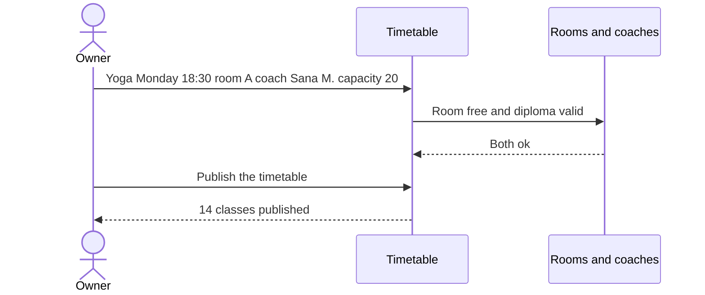

🏠 [Specs](../../../../README.md) › 🏷️ [Sectors](../../../README.md) › 🏋️ [SC18 Sports and fitness](../../README.md) ›
📝 [Use cases](../README.md) › 📝 [Use cases: FL-SC18-02 Classes and waiting lists](README.md) ›
📝 UC-SC18-05 Publish the class timetable

# 📝 UC-SC18-05 Publish the class timetable

**Status:** ✅ specified

## Summary

The owner publishes the timetable of classes: the activity, the coach, the room, the day and time, the capacity and the
level. A class can repeat every week. Members see the timetable in the app, and a class with too few registrations can
be cancelled in time, with the registered members told.

## Personas

- [U13 Owner](../../../../01-users/personas/u13-owner.md)

## Goal

Members always see the real timetable, no class is booked above its room's capacity, and a cancelled class is announced
in time.

## Trigger

A season or a week is planned, a coach changes, or a class must be cancelled.

## Frequency

A timetable per season, weekly adjustments.

## Preconditions

- The rooms are bookable resources
  ([E-F2-17](../../../../02-functional/f02-no-code-configuration/data/e-f02-17-bookable-resource-setting.md)).
- The coaches are employees with their diplomas
  ([E-F9-01](../../../../02-functional/f09-hr-and-projects/data/e-f09-01-employee-record.md),
  [E-F9-12](../../../../02-functional/f09-hr-and-projects/data/e-f09-12-certification.md)).
- The activities of the club are listed.

## Postconditions

- **Succeeded:** the class is saved ([E-SC18-04 Class](../../data/e-sc18-04-class.md)) with its coach, room, time and
  capacity and is visible in the app once Published.
- **Failed:** no class is published; the room taken or the coach without the diploma is shown.

## Main flow

1. The owner opens the timetable screen
   ([S-SC18-05](../../screens/02-classes-and-waiting-lists/s-sc18-05-class-timetable.md)) and creates a class: activity,
   coach, room, day, time, level, capacity and the weekly repeat.
2. simple-ERP checks the room is free and the coach holds the diploma for the activity
   ([BR-SC18-08](../../business-rules/br-sc18-08-coaches-hold-the-diploma-for-the-activity.md)).
3. The class is saved as Draft; the owner publishes the timetable and the classes become Published.
4. Members book the classes ([UC-SC18-06](uc-sc18-06-book-a-class.md)); the class becomes Full when it reaches its
   capacity ([BR-SC18-05 Classes have a capacity](../../business-rules/br-sc18-05-classes-have-a-capacity.md)).
5. Before the class, if the registrations are below the minimum, the owner may cancel it; the members are told.
6. After the class, it becomes Held and the attendance is recorded.

## Alternative flows

- 1a. A class repeats every week for the season: the series is created in one go and one date can be cancelled alone.
- 2a. The room is a court shared with bookings: the class takes the court from the booking calendar
  ([UC-SC18-17](../05-facilities-events-camps-and-rentals/uc-sc18-17-book-courts-and-facilities.md)).
- 5a. The coach is ill: a replacement with the diploma is proposed and the members are told.

## Error flows

- 2e. The room is taken at that time: the class is refused with the conflicting booking.
- 2e. The coach has no diploma for the activity: the class is refused ([UC-SC18-08](uc-sc18-08-plan-coaches.md)).
- 5e. A cancellation less than the set delay before the class: the owner confirms and the members are offered another
  class.
- Any step: a service does not answer; the call is retried first
  ([BR-F3-32](../../../../02-functional/f03-assistant/business-rules/br-f03-32-retry-before-an-error.md)), then the
  message follows the error pattern ([D122](../../../../06-decisions/ux/d122-error-message-standard.md)) and what the
  user typed stays on the screen.

## Business rules

- [BR-SC18-05 Classes have a capacity](../../business-rules/br-sc18-05-classes-have-a-capacity.md)
- [BR-SC18-08](../../business-rules/br-sc18-08-coaches-hold-the-diploma-for-the-activity.md)

## Entities

- [E-SC18-04 Class](../../data/e-sc18-04-class.md): created, changed
- [E-F2-17](../../../../02-functional/f02-no-code-configuration/data/e-f02-17-bookable-resource-setting.md): read, the
  room as a bookable resource
- [E-F9-12](../../../../02-functional/f09-hr-and-projects/data/e-f09-12-certification.md): read, the coach's diploma
- [E-F9-01](../../../../02-functional/f09-hr-and-projects/data/e-f09-01-employee-record.md): read, the coach

## Permissions

Owner creates and publishes classes; coaches read their own; members read the published timetable.

## Notifications

The members, with their consent: a class cancelled or moved. The coach: a new class assigned.

## Audit events

Each class created, changed, published, cancelled and held, with who and when.

## AI involvement

No AI step of its own. The AI assistant may open the screen and prefill it from the user's words; the user checks and
confirms
[BR-F3-07](../../../../02-functional/f03-assistant/business-rules/br-f03-07-no-deletes-no-irreversible-acts.md).

## API, MCP and A2A exposure

T5 operations of the capability for the personas above: create, read, update and list. The MCP tool of the
capability may read and propose, never confirm alone. No A2A skill.

## Screens

- [S-SC18-05](../../screens/02-classes-and-waiting-lists/s-sc18-05-class-timetable.md)

## Flowchart

See [FL-SC18-02 Classes and waiting lists](../../flows/fl-sc18-02-classes-and-waiting-lists.md#flowchart).

## Sequence diagram

## Acceptance criteria

1. **Given** a room of capacity 20 **when** the owner creates a class of capacity 25 **then** it is refused with the
   room's capacity.
2. **Given** a coach without the diploma **when** the owner assigns the class **then** it is refused.
3. **Given** a class with 3 registrations and a minimum of 5 **when** the owner cancels it in time **then** the 3
   members are told.
4. **Given** a published timetable **when** a member opens the app **then** the classes with their free places are
   shown.

## Non-functional notes

The screen answers within 2 seconds for 10,000 records; every change is audited.

## Regulatory references

A person who teaches a sport for pay holds the diploma and the professional card the law requires for that
activity; the club checks it before assigning a class
([CR-FR-210](../../../../10-country-packs/france/labour/cr-fr-210-qualifications-tied-to-tasks.md)). The France-pack
rule is written later.

## Related use cases

- [UC-SC18-06 Book a class](uc-sc18-06-book-a-class.md)
- [UC-SC18-06 Book a class](uc-sc18-06-book-a-class.md)
- [UC-SC18-08 Plan coaches](uc-sc18-08-plan-coaches.md)
- [UC-F2-18](../../../../02-functional/f02-no-code-configuration/use-cases/08-views-and-bookings/uc-f02-18-make-a-record-type-bookable.md)

## Open questions

None.

---

⬅️ [UC-SC18-04](../01-memberships-and-access/uc-sc18-04-freeze-or-cancel-a-membership.md) · ⬆️ [Up](README.md) ·
➡️ [UC-SC18-06 Book a class](uc-sc18-06-book-a-class.md)
