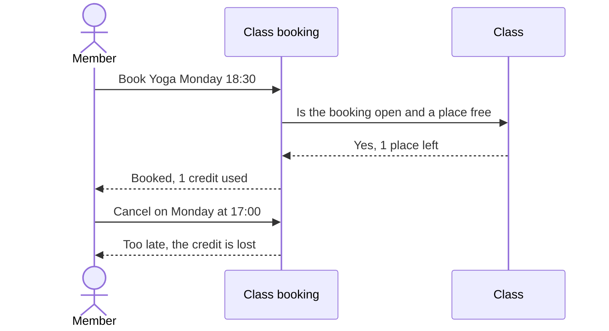

🏠 [Specs](../../../../README.md) › 🏷️ [Sectors](../../../README.md) › 🏋️ [SC18 Sports and fitness](../../README.md) ›
📝 [Use cases](../README.md) › 📝 [Use cases: FL-SC18-02 Classes and waiting lists](README.md) ›
📝 UC-SC18-06 Book a class

# 📝 UC-SC18-06 Book a class

**Status:** ✅ specified

## Summary

A member books a place in a class from the app, on a phone. The booking uses the member's plan (included classes, a pack
of entries or a drop-in price), is confirmed at once, and can be cancelled until the booking closes. A member who does
not come and did not cancel may lose a credit or pay a fee as the plan states.

## Personas

- [U09 Customer](../../../../01-users/personas/u09-customer.md)

## Goal

Members book a place in seconds, the class is never overbooked, and the coach knows who is coming.

## Trigger

A member opens the timetable and chooses a class.

## Frequency

Hundreds a day in a club with many classes.

## Preconditions

- The class is Published ([E-SC18-04 Class](../../data/e-sc18-04-class.md)).
- The member has an Active membership or a pack of entries
  ([E-SC18-01 Club membership](../../data/e-sc18-01-club-membership.md)).

## Postconditions

- **Succeeded:** the booking is saved ([E-SC18-05 Class booking](../../data/e-sc18-05-class-booking.md)) as Booked with
  the plan's credit used, and the member has a confirmation.
- **Failed:** no place is taken; the reason (full, closed, no credit) is shown with the waiting list offered.

## Main flow

1. The member opens the class booking screen
   ([S-SC18-06 Class booking](../../screens/02-classes-and-waiting-lists/s-sc18-06-class-booking.md)) and sees the
   classes with their free places.
2. The member chooses a class; simple-ERP checks the booking is still open
   ([BR-SC18-06](../../business-rules/br-sc18-06-bookings-close-before-the-class-starts.md)) and the plan allows the
   class.
3. If a place is free, the booking is Booked and one credit is used or the drop-in price is charged.
4. If the class is full, the member joins the waiting list ([UC-SC18-07](uc-sc18-07-handle-the-waiting-list.md)).
5. The member may cancel until the booking closes; the credit is returned.
6. At the class, the coach marks the member Attended or Missed.

## Alternative flows

- 2a. The member books a series of classes for the season: all are booked in one go and each can be cancelled alone.
- 3a. The member brings a guest: a guest place is booked and charged to the member's plan.
- 6a. The member did not come and did not cancel in time: the booking becomes Missed and the plan's rule applies.

## Error flows

- 2e. The booking is closed: it is refused and the next open class is shown.
- 3e. The member has no credit left: a pack or the drop-in price is offered.
- 2e. The member's membership is frozen or ended: no booking is taken.
- Any step: a service does not answer; the call is retried first
  ([BR-F3-32](../../../../02-functional/f03-assistant/business-rules/br-f03-32-retry-before-an-error.md)), then the
  message follows the error pattern ([D122](../../../../06-decisions/ux/d122-error-message-standard.md)) and what the
  user typed stays on the screen.

## Business rules

- [BR-SC18-06](../../business-rules/br-sc18-06-bookings-close-before-the-class-starts.md)
- [BR-SC18-05 Classes have a capacity](../../business-rules/br-sc18-05-classes-have-a-capacity.md)

## Entities

- [E-SC18-05 Class booking](../../data/e-sc18-05-class-booking.md): created, changed
- [E-SC18-04 Class](../../data/e-sc18-04-class.md): read and changed, the class and its places
- [E-SC18-01 Club membership](../../data/e-sc18-01-club-membership.md): read, the membership
- [E-F2-18](../../../../02-functional/f02-no-code-configuration/data/e-f02-18-resource-booking.md): created, the
  resource booking of the place

## Permissions

The member books and cancels their own places; the coach reads and marks attendance; the owner reads all bookings.

## Notifications

The member, with their consent: the confirmation, a reminder before the class, a freed place from the waiting list. The
coach: the list of the class.

## Audit events

Each booking, cancellation, attendance and missed class, with who, when and the credit used.

## AI involvement

No AI step of its own. The AI assistant may open the screen and prefill it from the user's words; the user checks and
confirms
[BR-F3-07](../../../../02-functional/f03-assistant/business-rules/br-f03-07-no-deletes-no-irreversible-acts.md).

## API, MCP and A2A exposure

T5 operations of the capability for the personas above: create, read, update and list. The MCP tool of the
capability may read and propose, never confirm alone. No A2A skill.

## Screens

- [S-SC18-06 Class booking](../../screens/02-classes-and-waiting-lists/s-sc18-06-class-booking.md)

## Flowchart

See [FL-SC18-02 Classes and waiting lists](../../flows/fl-sc18-02-classes-and-waiting-lists.md#flowchart).

## Sequence diagram

## Acceptance criteria

1. **Given** a class with 1 place left **when** a member books it **then** the booking is Booked and the class becomes
   Full.
2. **Given** a booking that closes 2 hours before the class **when** a member tries 1 hour before **then** it is
   refused.
3. **Given** a member with no credit **when** they book **then** a pack or the drop-in price is offered.
4. **Given** a member who cancels before the closing time **when** they cancel **then** the credit is returned.

## Non-functional notes

The screen answers within 2 seconds for 10,000 records; every change is audited.

## Regulatory references

None specific to this use case beyond the rules above.

## Related use cases

- [UC-SC18-05 Publish the class timetable](uc-sc18-05-publish-the-class-timetable.md)
- [UC-SC18-07 Handle the waiting list](uc-sc18-07-handle-the-waiting-list.md)
- [UC-SC18-05 Publish the class timetable](uc-sc18-05-publish-the-class-timetable.md)
- [UC-SC18-07 Handle the waiting list](uc-sc18-07-handle-the-waiting-list.md)
- [UC-F2-19](../../../../02-functional/f02-no-code-configuration/use-cases/08-views-and-bookings/uc-f02-19-book-a-resource.md)

## Open questions

None.

---

⬅️ [UC-SC18-05 Publish the class timetable](uc-sc18-05-publish-the-class-timetable.md) · ⬆️ [Up](README.md) ·
➡️ [UC-SC18-07 Handle the waiting list](uc-sc18-07-handle-the-waiting-list.md)
