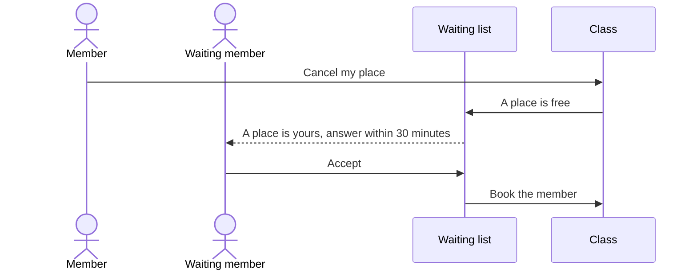

🏠 [Specs](../../../../README.md) › 🏷️ [Sectors](../../../README.md) › 🏋️ [SC18 Sports and fitness](../../README.md) ›
📝 [Use cases](../README.md) › 📝 [Use cases: FL-SC18-02 Classes and waiting lists](README.md) ›
📝 UC-SC18-07 Handle the waiting list

# 📝 UC-SC18-07 Handle the waiting list

**Status:** ✅ specified

## Summary

When a class is full, members join a waiting list. As soon as a place frees up (a cancellation, a larger room), the
first on the list is offered it, with a short time to accept, and the list moves on if they do not answer. The coach and
the member see the list in the app.

## Personas

- [U53 Coach](../../../../01-users/personas/u53-coach.md)
- [U09 Customer](../../../../01-users/personas/u09-customer.md)

## Goal

A freed place is never left empty, and the order of the list is fair and visible.

## Trigger

A member joins a full class, or a booked member cancels.

## Frequency

Several times a day in a busy club.

## Preconditions

- The class is Full ([E-SC18-04 Class](../../data/e-sc18-04-class.md)).
- Members are on the waiting list ([E-SC18-05 Class booking](../../data/e-sc18-05-class-booking.md)).

## Postconditions

- **Succeeded:** the first on the list becomes Booked and is told; the rest keep their order.
- **Failed:** no place is given; the list stays as it is.

## Main flow

1. A booked member cancels; the place is freed ([UC-SC18-06](uc-sc18-06-book-a-class.md)).
2. The waiting list screen
   ([S-SC18-07 Waiting list](../../screens/02-classes-and-waiting-lists/s-sc18-07-waiting-list.md)) shows the list in
   order; the first is offered the place
   ([BR-SC18-07](../../business-rules/br-sc18-07-freed-places-go-to-the-first-on-the-list.md)).
3. The member is told on the phone and has a short time to accept (by default 30 minutes, or until the closing time).
4. If the member accepts, the booking becomes Booked and the credit is used.
5. If the member does not answer, the offer goes to the next on the list.
6. The coach sees the list and the place status on the phone.

## Alternative flows

- 3a. The class is about to close: the offer lasts only until the closing time.
- 2a. Several places free at once: the first members of the list are offered one each.
- 6a. The coach adds a member by hand who has a reason: the position is recorded.

## Error flows

- 3e. The first on the list has no credit: they are skipped and told, and the next is offered the place.
- 4e. The place is taken by a booking in the meantime: the offer is withdrawn.
- 5e. Nobody on the list accepts: the place stays free and the class stays Published.
- Any step: a service does not answer; the call is retried first
  ([BR-F3-32](../../../../02-functional/f03-assistant/business-rules/br-f03-32-retry-before-an-error.md)), then the
  message follows the error pattern ([D122](../../../../06-decisions/ux/d122-error-message-standard.md)) and what the
  user typed stays on the screen.

## Business rules

- [BR-SC18-07](../../business-rules/br-sc18-07-freed-places-go-to-the-first-on-the-list.md)
- [BR-SC18-06](../../business-rules/br-sc18-06-bookings-close-before-the-class-starts.md)

## Entities

- [E-SC18-05 Class booking](../../data/e-sc18-05-class-booking.md): read and changed, the bookings and their order
- [E-SC18-04 Class](../../data/e-sc18-04-class.md): read and changed, the class and its state

## Permissions

Members see their own position; the coach and the owner read the list and add a member with a reason.

## Notifications

The member, with their consent: a place is offered, with the time left to accept. The coach: a place taken from the
list.

## Audit events

Each offer, acceptance, skip and manual addition, with who, when and the position.

## AI involvement

No AI step of its own. The AI assistant may open the screen and prefill it from the user's words; the user checks and
confirms
[BR-F3-07](../../../../02-functional/f03-assistant/business-rules/br-f03-07-no-deletes-no-irreversible-acts.md).

## API, MCP and A2A exposure

T5 operations of the capability for the personas above: create, read, update and list. The MCP tool of the
capability may read and propose, never confirm alone. No A2A skill.

## Screens

- [S-SC18-07 Waiting list](../../screens/02-classes-and-waiting-lists/s-sc18-07-waiting-list.md)

## Flowchart

See [FL-SC18-02 Classes and waiting lists](../../flows/fl-sc18-02-classes-and-waiting-lists.md#flowchart).

## Sequence diagram

## Acceptance criteria

1. **Given** a full class with three on the list **when** a place is freed **then** the first on the list is offered it.
2. **Given** an offer not answered in 30 minutes **when** the time passes **then** the next member is offered the place.
3. **Given** a first member with no credit **when** the place is offered **then** they are skipped and told.
4. **Given** a class closing soon **when** a place is freed **then** the offer lasts only until the closing time.

## Non-functional notes

The screen answers within 2 seconds for 10,000 records; every change is audited.

## Regulatory references

None specific to this use case beyond the rules above.

## Related use cases

- [UC-SC18-06 Book a class](uc-sc18-06-book-a-class.md)
- [UC-SC18-08 Plan coaches](uc-sc18-08-plan-coaches.md)
- [UC-SC18-05 Publish the class timetable](uc-sc18-05-publish-the-class-timetable.md)
- [UC-SC18-06 Book a class](uc-sc18-06-book-a-class.md)

## Open questions

None.

---

⬅️ [UC-SC18-06 Book a class](uc-sc18-06-book-a-class.md) · ⬆️ [Up](README.md) ·
➡️ [UC-SC18-08 Plan coaches](uc-sc18-08-plan-coaches.md)
