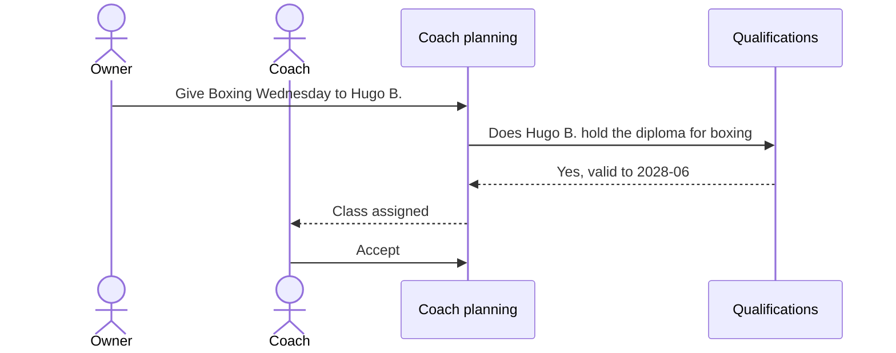

🏠 [Specs](../../../../README.md) › 🏷️ [Sectors](../../../README.md) › 🏋️ [SC18 Sports and fitness](../../README.md) ›
📝 [Use cases](../README.md) › 📝 [Use cases: FL-SC18-02 Classes and waiting lists](README.md) ›
📝 UC-SC18-08 Plan coaches

# 📝 UC-SC18-08 Plan coaches

**Status:** ✅ specified

## Summary

The owner plans which coach teaches which class and checks that each coach holds the diploma and, where the law asks for
it, the professional card for the activity. The planner shows each coach's week, their free times, their hours against
the contract, and flags a class assigned to a coach without the right qualification.

## Personas

- [U13 Owner](../../../../01-users/personas/u13-owner.md)
- [U53 Coach](../../../../01-users/personas/u53-coach.md)

## Goal

Every class is taught by someone who may teach it, coaches do not exceed their hours, and a replacement is found fast
when a coach is away.

## Trigger

A timetable is planned, a coach is ill or on leave, or a qualification nears its end.

## Frequency

Weekly, with daily changes.

## Preconditions

- Coaches are employee records with qualifications
  ([E-F9-01](../../../../02-functional/f09-hr-and-projects/data/e-f09-01-employee-record.md),
  [E-F9-12](../../../../02-functional/f09-hr-and-projects/data/e-f09-12-certification.md)).
- The classes exist ([E-SC18-04 Class](../../data/e-sc18-04-class.md)).
- Shifts and leave are in the planner
  ([E-F9-16 Shift](../../../../02-functional/f09-hr-and-projects/data/e-f09-16-shift.md)).

## Postconditions

- **Succeeded:** each class has a qualified coach and the coaches' weeks fit their contracts.
- **Failed:** a class with no qualified coach is listed; no class is left assigned to an unqualified coach.

## Main flow

1. The owner opens the coach planning screen
   ([S-SC18-08](../../screens/02-classes-and-waiting-lists/s-sc18-08-coach-planning.md)) and sees each coach's week with
   the classes.
2. The screen checks, for each class, that the coach holds the diploma for the activity and that it is valid
   ([BR-SC18-08](../../business-rules/br-sc18-08-coaches-hold-the-diploma-for-the-activity.md)).
3. The owner moves a class to another coach; the checks run again.
4. The screen shows each coach's hours against the contract and the rest and leave rules
   [UC-F9-15](../../../../02-functional/f09-hr-and-projects/use-cases/06-plan-and-deliver-work/uc-f09-15-plan-shifts.md).
5. A coach reads their own week on the phone and accepts or declines a change.
6. A qualification ending within 60 days is flagged for the owner.

## Alternative flows

- 3a. A coach is ill: the screen proposes coaches with the diploma and free at that time.
- 5a. A coach declines a class: it returns to the owner with the proposal of another coach.
- 2a. A volunteer coach in an association: the same checks apply and no pay is computed.

## Error flows

- 2e. A class is assigned to a coach without the diploma: the assignment is refused and the diploma needed is named.
- 4e. A coach exceeds the weekly limit: the change is refused unless the rules allow it.
- 6e. A diploma expired: the coach's classes are flagged and cannot be kept without a valid one.
- Any step: a service does not answer; the call is retried first
  ([BR-F3-32](../../../../02-functional/f03-assistant/business-rules/br-f03-32-retry-before-an-error.md)), then the
  message follows the error pattern ([D122](../../../../06-decisions/ux/d122-error-message-standard.md)) and what the
  user typed stays on the screen.

## Business rules

- [BR-SC18-08](../../business-rules/br-sc18-08-coaches-hold-the-diploma-for-the-activity.md)
- [BR-SC18-05 Classes have a capacity](../../business-rules/br-sc18-05-classes-have-a-capacity.md)

## Entities

- [E-F9-12](../../../../02-functional/f09-hr-and-projects/data/e-f09-12-certification.md): read, the coaches' diplomas
  and cards
- [E-F9-16 Shift](../../../../02-functional/f09-hr-and-projects/data/e-f09-16-shift.md): read and changed, the coaches'
  shifts
- [E-SC18-04 Class](../../data/e-sc18-04-class.md): read and changed, the classes

## Permissions

Owner plans and assigns; the coach reads and answers their own week. The check on the diploma cannot be
bypassed by the planner.

## Notifications

The coach, in the app: a class assigned, moved or cancelled. The owner: a class with no qualified coach, a diploma
ending.

## Audit events

Each assignment, move, refusal and check, with who and when and the qualification checked.

## AI involvement

No AI step of its own. The AI assistant may open the screen and prefill it from the user's words; the user checks and
confirms
[BR-F3-07](../../../../02-functional/f03-assistant/business-rules/br-f03-07-no-deletes-no-irreversible-acts.md).

## API, MCP and A2A exposure

T5 operations of the capability for the personas above: create, read, update and list. The MCP tool of the
capability may read and propose, never confirm alone. No A2A skill.

## Screens

- [S-SC18-08](../../screens/02-classes-and-waiting-lists/s-sc18-08-coach-planning.md)

## Flowchart

See [FL-SC18-02 Classes and waiting lists](../../flows/fl-sc18-02-classes-and-waiting-lists.md#flowchart).

## Sequence diagram

## Acceptance criteria

1. **Given** a coach with the diploma valid **when** the owner assigns the class **then** it is accepted.
2. **Given** a coach with no diploma for the activity **when** the owner assigns the class **then** it is refused and
   the diploma is named.
3. **Given** a diploma ending in 40 days **when** the owner opens the planning **then** it is flagged.
4. **Given** a coach who exceeds the weekly limit **when** the owner adds a class **then** the change is refused.

## Non-functional notes

The screen answers within 2 seconds for 10,000 records; every change is audited.

## Regulatory references

A person who teaches a sport for pay holds the diploma and the professional card the law requires for that
activity, declared to the authority; the club checks them before each assignment
([CR-FR-210](../../../../10-country-packs/france/labour/cr-fr-210-qualifications-tied-to-tasks.md)). The France-pack
rule is written later.

## Related use cases

- [UC-SC18-07 Handle the waiting list](uc-sc18-07-handle-the-waiting-list.md)
- [UC-SC18-05 Publish the class timetable](uc-sc18-05-publish-the-class-timetable.md)
- [UC-F9-15](../../../../02-functional/f09-hr-and-projects/use-cases/06-plan-and-deliver-work/uc-f09-15-plan-shifts.md)

## Open questions

None.

---

⬅️ [UC-SC18-07 Handle the waiting list](uc-sc18-07-handle-the-waiting-list.md) · ⬆️ [Up](README.md) ·
➡️ [UC-SC18-09 Issue federation licences](../03-licences-and-competitions/uc-sc18-09-issue-federation-licences.md)
