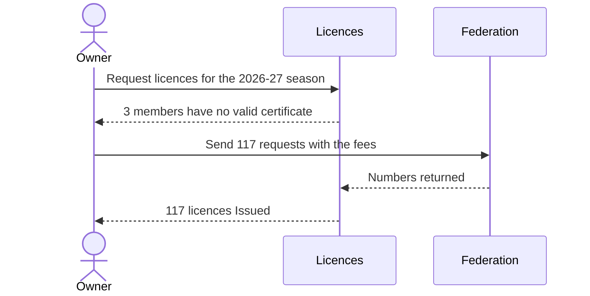

🏠 [Specs](../../../../README.md) › 🏷️ [Sectors](../../../README.md) › 🏋️ [SC18 Sports and fitness](../../README.md) ›
📝 [Use cases](../README.md) › 📝 [Use cases: FL-SC18-03 Licences and competitions](README.md) ›
📝 UC-SC18-09 Issue federation licences

# 📝 UC-SC18-09 Issue federation licences

**Status:** ✅ specified

## Summary

An association affiliated to a sports federation issues its members' licences each season. The owner asks the member for
the identity, the category and, where the federation asks for it, a medical certificate, collects the licence fee for
the federation, sends the request to the federation and records the number it returns. A licence is issued once a season
per member.

## Personas

- [U13 Owner](../../../../01-users/personas/u13-owner.md)
- [U09 Customer](../../../../01-users/personas/u09-customer.md)

## Goal

Every member who plays in a competition holds a valid licence for the season and the right category, and the club's fees
to the federation are correct.

## Trigger

A season opens, a member joins, or a licence must be renewed.

## Frequency

A rush at the start of each season; a few a week after.

## Preconditions

- The federation, the season and the categories are set.
- The member has a membership ([E-SC18-01 Club membership](../../data/e-sc18-01-club-membership.md)).
- The medical certificate is valid where required
  ([E-SC18-07 Medical certificate](../../data/e-sc18-07-medical-certificate.md)).

## Postconditions

- **Succeeded:** the licence is saved ([E-SC18-06 Licence](../../data/e-sc18-06-licence.md)) with its number, season and
  category, and the fee is invoiced with the membership
  ([E-F6-05 Invoice](../../../../02-functional/f06-customers-and-sales/data/e-f06-05-invoice.md)).
- **Failed:** no licence is issued; the missing certificate, category or fee is shown.

## Main flow

1. The owner opens the licences screen
   ([S-SC18-09](../../screens/03-licences-and-competitions/s-sc18-09-federation-licences.md)) for the new season and
   chooses the members who need a licence.
2. SimpleERP proposes the category from the birth year and checks that the member has no licence yet for the season
   ([BR-SC18-09](../../business-rules/br-sc18-09-a-licence-is-issued-once-a-year-per-member.md)).
3. The screen checks the medical certificate where the federation asks for it
   ([UC-SC18-10](uc-sc18-10-check-medical-certificates.md)).
4. The owner sends the requests to the federation, with the fee collected; the federation returns the licence numbers.
5. Each licence becomes Issued with its number and valid dates; the member sees it in the app.
6. At the end of the season the licences become Expired and the renewal is proposed.

## Alternative flows

- 2a. A member changes category during the season (a transfer): a new licence is issued with the federation's rule, and
  the old one is Cancelled.
- 4a. The federation has an online service: the requests are sent through it and the numbers return automatically.
- 3a. The federation accepts a questionnaire in place of a certificate: the answer is kept instead.

## Error flows

- 2e. The member already holds a licence for the season: a second one is refused.
- 3e. The certificate is missing or expired: the request is held and the member is asked for it.
- 4e. The federation refuses a request: the reason is shown and the fee is held.
- Any step: a service does not answer; the call is retried first
  ([BR-F3-32](../../../../02-functional/f03-assistant/business-rules/br-f03-32-retry-before-an-error.md)), then the
  message follows the error pattern ([D122](../../../../06-decisions/ux/d122-error-message-standard.md)) and what the
  user typed stays on the screen.

## Business rules

- [BR-SC18-09](../../business-rules/br-sc18-09-a-licence-is-issued-once-a-year-per-member.md)
- [BR-SC18-10](../../business-rules/br-sc18-10-competitions-need-a-valid-certificate.md)

## Entities

- [E-SC18-06 Licence](../../data/e-sc18-06-licence.md): created, changed
- [E-SC18-01 Club membership](../../data/e-sc18-01-club-membership.md): read, the membership
- [E-SC18-07 Medical certificate](../../data/e-sc18-07-medical-certificate.md): read, the medical certificate
- [E-F6-05 Invoice](../../../../02-functional/f06-customers-and-sales/data/e-f06-05-invoice.md): created, the invoice of
  the licence fee

## Permissions

Owner issues and renews licences; the member reads their own; the treasurer reads the fees. A licence holds
only the data the federation needs.

## Notifications

The member, with their consent: the licence number, a renewal in 30 days. The owner: the requests the federation
refused.

## Audit events

Each request, licence, number, refusal, transfer and expiry, with who and when.

## AI involvement

No AI step of its own. The AI assistant may open the screen and prefill it from the user's words; the user checks and
confirms
[BR-F3-07](../../../../02-functional/f03-assistant/business-rules/br-f03-07-no-deletes-no-irreversible-acts.md).

## API, MCP and A2A exposure

T5 operations of the capability for the personas above: create, read, update and list. The MCP tool of the
capability may read and propose, never confirm alone. No A2A skill.

## Screens

- [S-SC18-09](../../screens/03-licences-and-competitions/s-sc18-09-federation-licences.md)

## Flowchart

See [FL-SC18-03 Licences and competitions](../../flows/fl-sc18-03-licences-and-competitions.md#flowchart).

## Sequence diagram

## Acceptance criteria

1. **Given** a member with no licence for the season **when** the owner requests one **then** it is sent to the
   federation.
2. **Given** a member who already holds one for the season **when** the owner requests another **then** it is refused.
3. **Given** a member with no valid certificate where required **when** the owner requests **then** it is held until the
   certificate is recorded.
4. **Given** a season that ends **when** the date passes **then** the licences become Expired.

## Non-functional notes

The screen answers within 2 seconds for 10,000 records; every change is audited.

## Regulatory references

A licence is issued by the federation once a season for a member, in a category, and may require a medical
certificate or questionnaire; the club collects the fee and passes it on. The France-pack rule is written later.

## Related use cases

- [UC-SC18-10 Check medical certificates](uc-sc18-10-check-medical-certificates.md)
- [UC-SC18-10 Check medical certificates](uc-sc18-10-check-medical-certificates.md)
- [UC-SC18-11 Run teams and competitions](uc-sc18-11-run-teams-and-competitions.md)

## Open questions

None.

---

⬅️ [UC-SC18-08 Plan coaches](../02-classes-and-waiting-lists/uc-sc18-08-plan-coaches.md) · ⬆️ [Up](README.md) ·
➡️ [UC-SC18-10 Check medical certificates](uc-sc18-10-check-medical-certificates.md)
