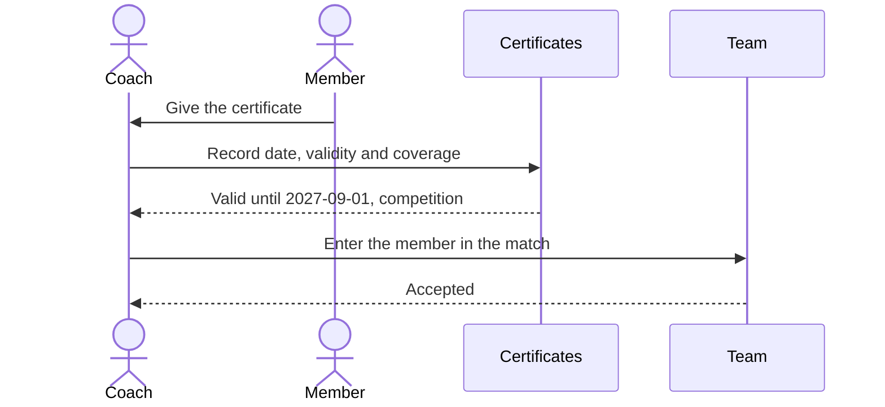

🏠 [Specs](../../../../README.md) › 🏷️ [Sectors](../../../README.md) › 🏋️ [SC18 Sports and fitness](../../README.md) ›
📝 [Use cases](../README.md) › 📝 [Use cases: FL-SC18-03 Licences and competitions](README.md) ›
📝 UC-SC18-10 Check medical certificates

# 📝 UC-SC18-10 Check medical certificates

**Status:** ✅ specified

## Summary

The coach checks the medical certificates of the players. A certificate has a date, a validity and the practice it
covers (sport, or competition), and is needed before a competition or, for some activities, before a licence. The screen
shows who is covered and whose certificate ends soon, and keeps only what is needed: the date, the validity and whether
the person is fit, never the medical details.

## Personas

- [U53 Coach](../../../../01-users/personas/u53-coach.md)

## Goal

Nobody plays a competition without a valid certificate, and the club keeps the minimum health data.

## Trigger

A season starts, a competition is announced, or a certificate nears its end.

## Frequency

A burst at the start of a season; daily checks before competitions.

## Preconditions

- The member exists ([E-F6-01](../../../../02-functional/f06-customers-and-sales/data/e-f06-01-customer-record.md)).
- The competitions that need a certificate are marked.

## Postconditions

- **Succeeded:** the certificate is saved ([E-SC18-07 Medical certificate](../../data/e-sc18-07-medical-certificate.md))
  with its date, validity and coverage; the member is shown as covered or not.
- **Failed:** a member without a valid certificate cannot be entered in a competition; the missing certificate is shown.

## Main flow

1. The coach opens the certificates screen
   ([S-SC18-10](../../screens/03-licences-and-competitions/s-sc18-10-medical-certificates.md)) on the phone and sees the
   team's members with their certificate status.
2. A member gives a certificate (a photo or a scan); the coach records its date, its validity and the practice it covers
   ([BR-SC18-10](../../business-rules/br-sc18-10-competitions-need-a-valid-certificate.md)).
3. The screen shows only fit or not fit and the validity; the document is stored with limited access.
4. Before a competition the coach sees who is not covered.
5. A certificate ending in 30 days is flagged and the member is asked for a new one.
6. An expired certificate removes the member from the competition lists.

## Alternative flows

- 2a. The federation accepts a health questionnaire: the answer is recorded in place of a certificate.
- 2b. The certificate covers the sport but not the competition: the member can train but not compete.
- 5a. The member is a minor: the parents are asked.

## Error flows

- 2e. The certificate has no date or no practice: it is refused.
- 4e. A member with no valid certificate is entered in a competition: the entry is blocked.
- 3e. A person tries to read the document with no right: access is refused and logged.
- Any step: a service does not answer; the call is retried first
  ([BR-F3-32](../../../../02-functional/f03-assistant/business-rules/br-f03-32-retry-before-an-error.md)), then the
  message follows the error pattern ([D122](../../../../06-decisions/ux/d122-error-message-standard.md)) and what the
  user typed stays on the screen.

## Business rules

- [BR-SC18-10](../../business-rules/br-sc18-10-competitions-need-a-valid-certificate.md)
- [BR-SC18-09](../../business-rules/br-sc18-09-a-licence-is-issued-once-a-year-per-member.md)

## Entities

- [E-SC18-07 Medical certificate](../../data/e-sc18-07-medical-certificate.md): created, changed
- [E-SC18-06 Licence](../../data/e-sc18-06-licence.md): read, the licence that needs the certificate
- [E-SC18-08 Sports team](../../data/e-sc18-08-team.md): read, the team and its competitions
- [E-F2-13](../../../../02-functional/f02-no-code-configuration/data/e-f02-13-document.md): created, the stored document

## Permissions

Coach and owner read the status; the document is read by the owner only. The member reads their own
certificate.

## Notifications

The member, with their consent: a certificate ends in 30 days. The coach: members not covered before a competition.

## Audit events

Each certificate recorded, read, expired or refused, with who and when.

## AI involvement

No AI step of its own. The AI assistant may open the screen and prefill it from the user's words; the user checks and
confirms
[BR-F3-07](../../../../02-functional/f03-assistant/business-rules/br-f03-07-no-deletes-no-irreversible-acts.md).

## API, MCP and A2A exposure

T5 operations of the capability for the personas above: create, read, update and list. The MCP tool of the
capability may read and propose, never confirm alone. No A2A skill.

## Screens

- [S-SC18-10](../../screens/03-licences-and-competitions/s-sc18-10-medical-certificates.md)

## Flowchart

See [FL-SC18-03 Licences and competitions](../../flows/fl-sc18-03-licences-and-competitions.md#flowchart).

## Sequence diagram

## Acceptance criteria

1. **Given** a certificate valid until 2027-09-01 covering competition **when** the coach enters the member in a match
   **then** the entry is accepted.
2. **Given** a certificate that covers only training **when** the coach enters a competition **then** it is blocked.
3. **Given** a certificate ending in 20 days **when** the coach opens the list **then** it is flagged.
4. **Given** a certificate with no date **when** the coach saves it **then** it is refused.

## Non-functional notes

The screen answers within 2 seconds for 10,000 records; every change is audited.

## Regulatory references

For some sports and for competition, a licence or an entry needs a medical certificate or a questionnaire,
and its validity depends on the federation and the practice. Only what is needed is kept: the date, the validity and
whether the person is fit; the health data is protected
([CR-FR-055](../../../../10-country-packs/france/data-protection/cr-fr-055-health-data-hosting.md)). The France-pack
rule is written later.

## Related use cases

- [UC-SC18-09 Issue federation licences](uc-sc18-09-issue-federation-licences.md)
- [UC-SC18-11 Run teams and competitions](uc-sc18-11-run-teams-and-competitions.md)
- [UC-SC18-09 Issue federation licences](uc-sc18-09-issue-federation-licences.md)
- [UC-SC18-11 Run teams and competitions](uc-sc18-11-run-teams-and-competitions.md)
- [UC-SC18-03](../01-memberships-and-access/uc-sc18-03-control-access-at-the-door.md)

## Open questions

None.

---

⬅️ [UC-SC18-09 Issue federation licences](uc-sc18-09-issue-federation-licences.md) · ⬆️ [Up](README.md) ·
➡️ [UC-SC18-11 Run teams and competitions](uc-sc18-11-run-teams-and-competitions.md)
