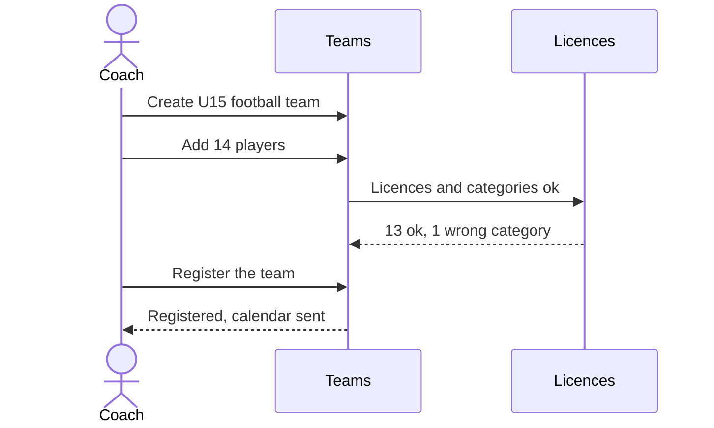

🏠 [Specs](../../../../README.md) › 🏷️ [Sectors](../../../README.md) › 🏋️ [SC18 Sports and fitness](../../README.md) ›
📝 [Use cases](../README.md) › 📝 [Use cases: FL-SC18-03 Licences and competitions](README.md) ›
📝 UC-SC18-11 Run teams and competitions

# 📝 UC-SC18-11 Run teams and competitions

**Status:** ✅ specified

## Summary

The coach builds a team for a competition: the players, the category, the captain and the matches of the season. A team
can only list players with a licence for the right category and, where needed, a valid certificate. The coach registers
the team in a competition and sends the calendar to the players.

## Personas

- [U53 Coach](../../../../01-users/personas/u53-coach.md)

## Goal

Every team is made of licensed players of the right category, registered in time, and every player knows the calendar.

## Trigger

A season starts, a competition is announced, or a player joins or leaves a team.

## Frequency

A few teams per section, adjusted weekly.

## Preconditions

- The players hold licences ([E-SC18-06 Licence](../../data/e-sc18-06-licence.md)).
- Certificates are valid where required ([E-SC18-07 Medical certificate](../../data/e-sc18-07-medical-certificate.md)).
- The competition is open for registration.

## Postconditions

- **Succeeded:** the team is saved ([E-SC18-08 Sports team](../../data/e-sc18-08-team.md)) with its players and
  registered in the competition; the calendar reaches the players.
- **Failed:** the team is not registered; the player with no licence or in the wrong category is shown.

## Main flow

1. The coach opens the teams screen
   ([S-SC18-11](../../screens/03-licences-and-competitions/s-sc18-11-teams-and-competitions.md)) and creates a team with
   its category and competition.
2. The coach adds players from the club's list; simple-ERP checks each licence and category
   ([BR-SC18-11](../../business-rules/br-sc18-11-players-are-licensed-for-their-category.md)) and certificate.
3. The coach names the captain and the substitutes.
4. The team is registered in the competition and becomes Registered.
5. The calendar of the matches is sent to the players and the parents.
6. A player who leaves is removed; the team is checked again against the minimum size.

## Alternative flows

- 2a. A player is one category above: the screen allows it only where the federation's rules allow, with the rule named.
- 5a. A match is moved: the calendar is updated and the players are told.
- 6a. The team withdraws from the competition: it becomes Withdrawn and the fees follow the rules.

## Error flows

- 2e. A player has no licence for the season: they cannot be added.
- 2e. A player's category is not allowed in the team: they cannot be added.
- 4e. The team is under the minimum size: the registration is refused.
- Any step: a service does not answer; the call is retried first
  ([BR-F3-32](../../../../02-functional/f03-assistant/business-rules/br-f03-32-retry-before-an-error.md)), then the
  message follows the error pattern ([D122](../../../../06-decisions/ux/d122-error-message-standard.md)) and what the
  user typed stays on the screen.

## Business rules

- [BR-SC18-11](../../business-rules/br-sc18-11-players-are-licensed-for-their-category.md)
- [BR-SC18-12](../../business-rules/br-sc18-12-results-are-published-once-validated.md)

## Entities

- [E-SC18-08 Sports team](../../data/e-sc18-08-team.md): created, changed
- [E-SC18-06 Licence](../../data/e-sc18-06-licence.md): read, the players' licences
- [E-SC18-07 Medical certificate](../../data/e-sc18-07-medical-certificate.md): read, the certificates
- [E-SC18-09 Result](../../data/e-sc18-09-result.md): read, the results of the team

## Permissions

Coach creates and changes teams; the owner reads all; the players and parents read their own team and calendar.

## Notifications

The players and parents, with their consent: the calendar, a changed match. The coach: a player's licence or certificate
ending.

## Audit events

Each team, player added or removed, registration, withdrawal and calendar change, with who and when.

## AI involvement

No AI step of its own. The AI assistant may open the screen and prefill it from the user's words; the user checks and
confirms
[BR-F3-07](../../../../02-functional/f03-assistant/business-rules/br-f03-07-no-deletes-no-irreversible-acts.md).

## API, MCP and A2A exposure

T5 operations of the capability for the personas above: create, read, update and list. The MCP tool of the
capability may read and propose, never confirm alone. No A2A skill.

## Screens

- [S-SC18-11](../../screens/03-licences-and-competitions/s-sc18-11-teams-and-competitions.md)

## Flowchart

See [FL-SC18-03 Licences and competitions](../../flows/fl-sc18-03-licences-and-competitions.md#flowchart).

## Sequence diagram

## Acceptance criteria

1. **Given** a player with a licence for the category **when** the coach adds them **then** they join the team.
2. **Given** a player with no licence **when** the coach adds them **then** it is refused.
3. **Given** a team under the minimum size **when** the coach registers it **then** it is refused.
4. **Given** a match moved **when** the coach changes the date **then** the players are told.

## Non-functional notes

The screen answers within 2 seconds for 10,000 records; every change is audited.

## Regulatory references

A player takes part in a competition only with a valid licence for the category and, where the federation
asks for it, a valid certificate; the club registers teams by the federation's rules. The France-pack rule is written
later.

## Related use cases

- [UC-SC18-10 Check medical certificates](uc-sc18-10-check-medical-certificates.md)
- [UC-SC18-12 Record results](uc-sc18-12-record-results.md)
- [UC-SC18-09 Issue federation licences](uc-sc18-09-issue-federation-licences.md)
- [UC-SC18-10 Check medical certificates](uc-sc18-10-check-medical-certificates.md)
- [UC-SC18-12 Record results](uc-sc18-12-record-results.md)

## Open questions

None.

---

⬅️ [UC-SC18-10 Check medical certificates](uc-sc18-10-check-medical-certificates.md) · ⬆️ [Up](README.md) ·
➡️ [UC-SC18-12 Record results](uc-sc18-12-record-results.md)
