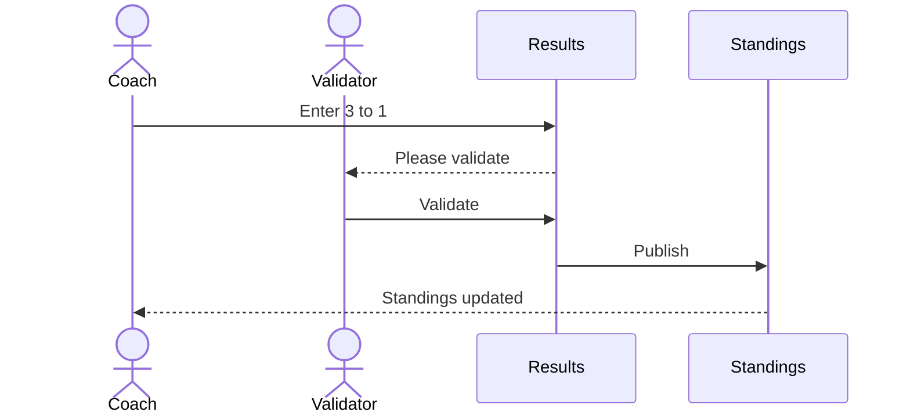

🏠 [Specs](../../../../README.md) › 🏷️ [Sectors](../../../README.md) › 🏋️ [SC18 Sports and fitness](../../README.md) ›
📝 [Use cases](../README.md) › 📝 [Use cases: FL-SC18-03 Licences and competitions](README.md) ›
📝 UC-SC18-12 Record results

# 📝 UC-SC18-12 Record results

**Status:** ✅ specified

## Summary

After a match or an event, the coach enters the result: the score, the scorers or the times, and the notes. A second
person (the coach of the other team, the referee or the owner) validates it; only a validated result is published on the
club's site and in the app. A contested result can be corrected and validated again.

## Personas

- [U53 Coach](../../../../01-users/personas/u53-coach.md)

## Goal

Results are recorded once, checked by a second person and published only when correct, so the standings and the club's
page are trusted.

## Trigger

A match ends, or a result is contested.

## Frequency

Several a week in a season.

## Preconditions

- The team is registered ([E-SC18-08 Sports team](../../data/e-sc18-08-team.md)).
- The match exists in the competition calendar.

## Postconditions

- **Succeeded:** the result is saved ([E-SC18-09 Result](../../data/e-sc18-09-result.md)) and, once validated, published
  in the standings and the app.
- **Failed:** the result stays unpublished; the missing validation or the disagreement is shown.

## Main flow

1. The coach opens the results screen
   ([S-SC18-12 Results](../../screens/03-licences-and-competitions/s-sc18-12-results.md)) on the phone after the match
   and enters the score and the notes.
2. The result becomes Entered and is sent for validation to the second person.
3. The second person checks and validates; the result becomes Validated
   ([BR-SC18-12](../../business-rules/br-sc18-12-results-are-published-once-validated.md)).
4. The owner or the coach publishes it; the result becomes Published in the standings and the app.
5. The standings are updated from the published results.
6. A team that contests a result opens a dispute; the result becomes Contested until it is settled.

## Alternative flows

- 3a. The two persons disagree: the result stays Entered and the owner decides.
- 6a. The federation corrects a result: the new score is entered and validated again.
- 2a. An individual event (a race): the times and ranks replace the score.

## Error flows

- 3e. Nobody validates before the delay: the owner is reminded and the result stays unpublished.
- 4e. A result is published without validation: it is refused.
- 6e. A result is changed after publication without a reason: it is refused.
- Any step: a service does not answer; the call is retried first
  ([BR-F3-32](../../../../02-functional/f03-assistant/business-rules/br-f03-32-retry-before-an-error.md)), then the
  message follows the error pattern ([D122](../../../../06-decisions/ux/d122-error-message-standard.md)) and what the
  user typed stays on the screen.

## Business rules

- [BR-SC18-12](../../business-rules/br-sc18-12-results-are-published-once-validated.md)
- [BR-SC18-11](../../business-rules/br-sc18-11-players-are-licensed-for-their-category.md)

## Entities

- [E-SC18-09 Result](../../data/e-sc18-09-result.md): created, changed
- [E-SC18-08 Sports team](../../data/e-sc18-08-team.md): read, the team and its calendar
- [E-SC18-14 Tournament](../../data/e-sc18-14-tournament.md): read, the tournament of an event

## Permissions

Coach enters; a second person validates; owner publishes and settles disputes. The members read published results.

## Notifications

The validator: a result to check. The members, with their consent: a published result.

## Audit events

Each result entered, validated, published, contested and corrected, with who, when and the old score.

## AI involvement

No AI step of its own. The AI assistant may open the screen and prefill it from the user's words; the user checks and
confirms
[BR-F3-07](../../../../02-functional/f03-assistant/business-rules/br-f03-07-no-deletes-no-irreversible-acts.md).

## API, MCP and A2A exposure

T5 operations of the capability for the personas above: create, read, update and list. The MCP tool of the
capability may read and propose, never confirm alone. No A2A skill.

## Screens

- [S-SC18-12 Results](../../screens/03-licences-and-competitions/s-sc18-12-results.md)

## Flowchart

See [FL-SC18-03 Licences and competitions](../../flows/fl-sc18-03-licences-and-competitions.md#flowchart).

## Sequence diagram

## Acceptance criteria

1. **Given** a result entered by the coach **when** no second person has validated it **then** it is not published.
2. **Given** a validated result **when** the owner publishes it **then** the standings are updated.
3. **Given** a result changed after publication with no reason **when** the coach saves **then** it is refused.
4. **Given** a contested result **when** the dispute is opened **then** the result is Contested until it is settled.

## Non-functional notes

The screen answers within 2 seconds for 10,000 records; every change is audited.

## Regulatory references

None specific to this use case beyond the rules above.

## Related use cases

- [UC-SC18-11 Run teams and competitions](uc-sc18-11-run-teams-and-competitions.md)
- [UC-SC18-11 Run teams and competitions](uc-sc18-11-run-teams-and-competitions.md)
- [UC-SC18-18](../05-facilities-events-camps-and-rentals/uc-sc18-18-run-tournaments-and-events.md)

## Open questions

None.

---

⬅️ [UC-SC18-11 Run teams and competitions](uc-sc18-11-run-teams-and-competitions.md) · ⬆️ [Up](README.md) ·
➡️ [UC-SC18-13 Sell coaching packages](../04-personal-training/uc-sc18-13-sell-coaching-packages.md)
