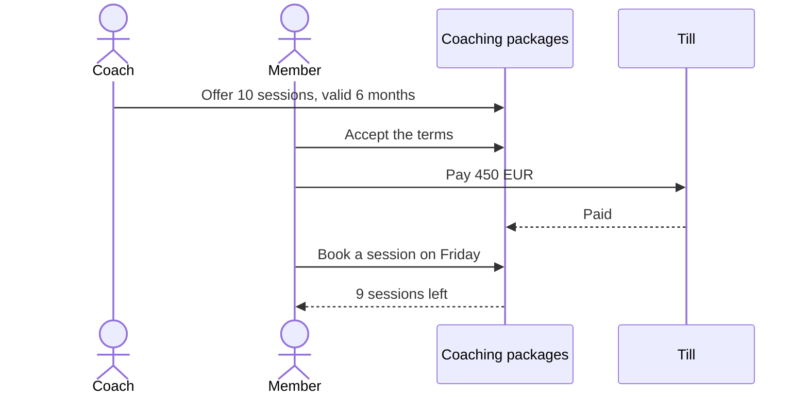

🏠 [Specs](../../../../README.md) › 🏷️ [Sectors](../../../README.md) › 🏋️ [SC18 Sports and fitness](../../README.md) ›
📝 [Use cases](../README.md) › 📝 [Use cases: FL-SC18-04 Personal training](README.md) ›
📝 UC-SC18-13 Sell coaching packages

# 📝 UC-SC18-13 Sell coaching packages

**Status:** ✅ specified

## Summary

A coach sells personal training sessions in packages (ten sessions, a trial of three). The package has a price, a number
of sessions and a time within which they must be used. Each session is booked with the coach, and a session not used
before the end of the package is lost as the terms say, never sooner.

## Personas

- [U53 Coach](../../../../01-users/personas/u53-coach.md)
- [U09 Customer](../../../../01-users/personas/u09-customer.md)

## Goal

Members buy sessions at a fair price and use them over time, the coach is paid for the sessions given, and the terms on
expiry are clear before the sale.

## Trigger

A member wants a coach, or a package nears its end.

## Frequency

Several a week per coach.

## Preconditions

- The coach is an employee or an independent coach
  ([E-F9-01](../../../../02-functional/f09-hr-and-projects/data/e-f09-01-employee-record.md)).
- The member has a customer record
  ([E-F6-01](../../../../02-functional/f06-customers-and-sales/data/e-f06-01-customer-record.md)).
- The package terms are set by the owner.

## Postconditions

- **Succeeded:** the package is saved ([E-SC18-10 Coaching package](../../data/e-sc18-10-coaching-package.md)) with its
  sessions and end date, paid at the till; each session booked uses one.
- **Failed:** no package is sold; the missing terms or payment is shown.

## Main flow

1. The coach opens the coaching packages screen
   ([S-SC18-13 Coaching packages](../../screens/04-personal-training/s-sc18-13-coaching-packages.md)) on the phone and
   chooses the member and the package.
2. The screen shows the price, the sessions, the validity and the expiry terms; the member accepts.
3. The member pays on the phone or at the desk; the package becomes Active.
4. Each session is booked with the coach and takes one session
   ([UC-SC18-06](../02-classes-and-waiting-lists/uc-sc18-06-book-a-class.md)).
5. The coach and the member see the sessions left and the end date.
6. A session not used before the end date is lost as the terms say, and the package becomes Expired
   ([BR-SC18-13](../../business-rules/br-sc18-13-sessions-expire-per-the-package-terms.md)).

## Alternative flows

- 3a. The member pays in instalments: the package starts at the first payment and the rest follows the plan
  ([E-F6-16](../../../../02-functional/f06-customers-and-sales/data/e-f06-16-instalment-plan.md)).
- 5a. The member is ill: the coach extends the package with a reason, within the terms.
- 4a. A session is cancelled by the coach: it is returned to the package.

## Error flows

- 2e. The terms on expiry are not shown: the sale is blocked.
- 4e. The package is Expired: no session is booked and a new package is offered.
- 4e. The coach is not free: the session is proposed at another time.
- Any step: a service does not answer; the call is retried first
  ([BR-F3-32](../../../../02-functional/f03-assistant/business-rules/br-f03-32-retry-before-an-error.md)), then the
  message follows the error pattern ([D122](../../../../06-decisions/ux/d122-error-message-standard.md)) and what the
  user typed stays on the screen.

## Business rules

- [BR-SC18-13](../../business-rules/br-sc18-13-sessions-expire-per-the-package-terms.md)
- [BR-SC18-14](../../business-rules/br-sc18-14-programmes-respect-declared-health-limits.md)

## Entities

- [E-SC18-10 Coaching package](../../data/e-sc18-10-coaching-package.md): created, changed
- [E-F10-03](../../../../02-functional/f10-point-of-sale/data/e-f10-03-point-of-sale-order.md): created, the sale of the
  package
- [E-F6-01](../../../../02-functional/f06-customers-and-sales/data/e-f06-01-customer-record.md): read, the member
- [E-F2-18](../../../../02-functional/f02-no-code-configuration/data/e-f02-18-resource-booking.md): created, the booking
  of each session

## Permissions

Coach sells and books sessions; the owner sets terms and may extend; the member reads their own packages.

## Notifications

The member, with their consent: the sessions left after each session, an end date in 30 days. The coach: a package
ending.

## Audit events

Each sale, session, extension, expiry and refund, with who, when and the terms shown.

## AI involvement

No AI step of its own. The AI assistant may open the screen and prefill it from the user's words; the user checks and
confirms
[BR-F3-07](../../../../02-functional/f03-assistant/business-rules/br-f03-07-no-deletes-no-irreversible-acts.md).

## API, MCP and A2A exposure

T5 operations of the capability for the personas above: create, read, update and list. The MCP tool of the
capability may read and propose, never confirm alone. No A2A skill.

## Screens

- [S-SC18-13 Coaching packages](../../screens/04-personal-training/s-sc18-13-coaching-packages.md)

## Flowchart

See [FL-SC18-04 Personal training](../../flows/fl-sc18-04-personal-training.md#flowchart).

## Sequence diagram

## Acceptance criteria

1. **Given** a package of 10 sessions valid 6 months **when** a session is given **then** 9 sessions are left and the
   end date is shown.
2. **Given** a package past its end date **when** a session is booked **then** it is refused and a new package is
   offered.
3. **Given** terms on expiry not shown **when** the coach sells **then** the sale is blocked.
4. **Given** a session cancelled by the coach **when** the coach cancels **then** the session returns to the package.

## Non-functional notes

The screen answers within 2 seconds for 10,000 records; every change is audited.

## Regulatory references

A package of sessions is a prepaid service: its price, the number of sessions and the validity are shown
before the sale, and the terms for unused sessions are those the member accepted
([CR-FR-036](../../../../10-country-packs/france/consumer/cr-fr-036-withdrawal-right.md)). The France-pack rule is
written later.

## Related use cases

- [UC-SC18-14 Plan a training programme](uc-sc18-14-plan-a-training-programme.md)
- [UC-SC18-14 Plan a training programme](uc-sc18-14-plan-a-training-programme.md)
- [UC-SC18-15 Follow progress](uc-sc18-15-follow-progress.md)
- [UC-SC17-05](../../../sc17-beauty-and-wellness/use-cases/02-packages-and-memberships/uc-sc17-05-sell-packages-and-prepaid-sessions.md)

## Open questions

None.

---

⬅️ [UC-SC18-12 Record results](../03-licences-and-competitions/uc-sc18-12-record-results.md) · ⬆️ [Up](README.md) ·
➡️ [UC-SC18-14 Plan a training programme](uc-sc18-14-plan-a-training-programme.md)
