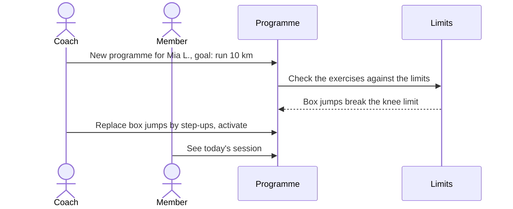

🏠 [Specs](../../../../README.md) › 🏷️ [Sectors](../../../README.md) › 🏋️ [SC18 Sports and fitness](../../README.md) ›
📝 [Use cases](../README.md) › 📝 [Use cases: FL-SC18-04 Personal training](README.md) ›
📝 UC-SC18-14 Plan a training programme

# 📝 UC-SC18-14 Plan a training programme

**Status:** ✅ specified

## Summary

The coach writes a training programme for a member: the goal, the weeks, the sessions and the exercises with their load.
Before writing it the coach records the member's declared health limits (an injury, a condition the doctor mentioned),
and the programme cannot include an exercise that the limits forbid. The member follows the programme on their phone.

## Personas

- [U53 Coach](../../../../01-users/personas/u53-coach.md)

## Goal

Each programme fits the member's goal and respects their declared limits, and the member sees what to do each day.

## Trigger

A member starts personal training or a programme ends.

## Frequency

A new programme every few weeks per member.

## Preconditions

- The member has a coaching package ([E-SC18-10 Coaching package](../../data/e-sc18-10-coaching-package.md)).
- The member has declared their health limits and the coach has them
  ([E-SC18-12 Progress record](../../data/e-sc18-12-progress-record.md)).

## Postconditions

- **Succeeded:** the programme is saved ([E-SC18-11 Training programme](../../data/e-sc18-11-training-programme.md))
  with its weeks and exercises and is Active for the member.
- **Failed:** no programme is activated; the exercise that breaks a limit is shown.

## Main flow

1. The coach opens the programme screen
   ([S-SC18-14](../../screens/04-personal-training/s-sc18-14-training-programme.md)) and records the goal and the
   declared health limits of the member.
2. The coach builds the weeks: sessions, exercises, sets, repeats and rest, from the club's library.
3. simple-ERP checks each exercise against the declared limits
   ([BR-SC18-14](../../business-rules/br-sc18-14-programmes-respect-declared-health-limits.md)) and flags any that
   breaks one.
4. The coach corrects the flagged exercises and activates the programme.
5. The member sees the day's session on the phone and ticks what they did.
6. At the end of the programme, the coach reviews the progress ([UC-SC18-15](uc-sc18-15-follow-progress.md)) and writes
   the next one.

## Alternative flows

- 2a. A programme template is reused for another member: the limits of that member are checked again.
- 3a. The member declares a new limit during the programme: the programme is checked again and the coach is told.
- 5a. A group programme is built for a team: the limits of every member are checked.

## Error flows

- 3e. An exercise breaks a declared limit: it cannot be kept without the coach's written reason and the member's
  agreement.
- 1e. The member has declared no limits: the coach must record that none were declared.
- 5e. The member's package has expired: the programme is kept but no session can be booked.
- Any step: a service does not answer; the call is retried first
  ([BR-F3-32](../../../../02-functional/f03-assistant/business-rules/br-f03-32-retry-before-an-error.md)), then the
  message follows the error pattern ([D122](../../../../06-decisions/ux/d122-error-message-standard.md)) and what the
  user typed stays on the screen.

## Business rules

- [BR-SC18-14](../../business-rules/br-sc18-14-programmes-respect-declared-health-limits.md)
- [BR-SC18-15](../../business-rules/br-sc18-15-health-data-stays-with-the-member-and-coach.md)

## Entities

- [E-SC18-11 Training programme](../../data/e-sc18-11-training-programme.md): created, changed
- [E-SC18-10 Coaching package](../../data/e-sc18-10-coaching-package.md): read, the package the sessions come from
- [E-SC18-12 Progress record](../../data/e-sc18-12-progress-record.md): read, the health limits and the progress
- [E-F6-01](../../../../02-functional/f06-customers-and-sales/data/e-f06-01-customer-record.md): read, the member

## Permissions

Coach writes and activates programmes; the member reads their own and ticks what they did; the owner reads none.
Health limits are shown to the member and the coach only.

## Notifications

The member, with their consent: the day's session, a changed programme. The coach: a new limit declared.

## Audit events

Each programme, limit, exercise, check, override and activation, with who and when.

## AI involvement

No AI step of its own. The AI assistant may open the screen and prefill it from the user's words; the user checks and
confirms
[BR-F3-07](../../../../02-functional/f03-assistant/business-rules/br-f03-07-no-deletes-no-irreversible-acts.md).

## API, MCP and A2A exposure

T5 operations of the capability for the personas above: create, read, update and list. The MCP tool of the
capability may read and propose, never confirm alone. No A2A skill.

## Screens

- [S-SC18-14](../../screens/04-personal-training/s-sc18-14-training-programme.md)

## Flowchart

See [FL-SC18-04 Personal training](../../flows/fl-sc18-04-personal-training.md#flowchart).

## Sequence diagram

## Acceptance criteria

1. **Given** a declared knee limit **when** the coach adds box jumps **then** the exercise is flagged and cannot be
   kept.
2. **Given** a member who declared no limit **when** the coach writes a programme **then** the coach must record that
   none were declared.
3. **Given** a new limit declared during the programme **when** the member saves it **then** the programme is checked
   again.
4. **Given** a programme activated **when** the member opens the app **then** today's session is shown.

## Non-functional notes

The screen answers within 2 seconds for 10,000 records; every change is audited.

## Regulatory references

A coach adapts the training to the person's health and does not give medical advice; health information is
kept only as needed, with the member's agreement, and protected
([CR-FR-055](../../../../10-country-packs/france/data-protection/cr-fr-055-health-data-hosting.md)). The France-pack
rule is written later.

## Related use cases

- [UC-SC18-13 Sell coaching packages](uc-sc18-13-sell-coaching-packages.md)
- [UC-SC18-15 Follow progress](uc-sc18-15-follow-progress.md)
- [UC-SC18-13 Sell coaching packages](uc-sc18-13-sell-coaching-packages.md)
- [UC-SC18-15 Follow progress](uc-sc18-15-follow-progress.md)

## Open questions

None.

---

⬅️ [UC-SC18-13 Sell coaching packages](uc-sc18-13-sell-coaching-packages.md) · ⬆️ [Up](README.md) ·
➡️ [UC-SC18-15 Follow progress](uc-sc18-15-follow-progress.md)
