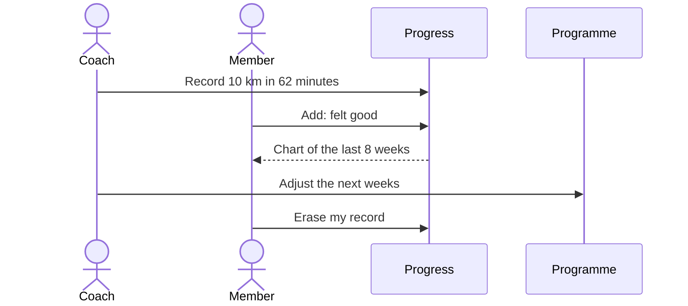

🏠 [Specs](../../../../README.md) › 🏷️ [Sectors](../../../README.md) › 🏋️ [SC18 Sports and fitness](../../README.md) ›
📝 [Use cases](../README.md) › 📝 [Use cases: FL-SC18-04 Personal training](README.md) › 📝 UC-SC18-15 Follow progress

# 📝 UC-SC18-15 Follow progress

**Status:** ✅ specified

## Summary

The coach records the member's progress: measures (weight, times, loads), how they feel and notes. The member sees their
own progress on the phone and may share it with the coach only. These are health data: they stay with the member and the
coach, never shown to the club's other staff, and are erased on request.

## Personas

- [U53 Coach](../../../../01-users/personas/u53-coach.md)
- [U09 Customer](../../../../01-users/personas/u09-customer.md)

## Goal

The coach adapts the programme to real progress, the member sees how far they have come, and no health data leaves the
two people it belongs to.

## Trigger

A session ends, a measure is taken, or the member asks for their data.

## Frequency

Weekly per member.

## Preconditions

- The member has a programme ([E-SC18-11 Training programme](../../data/e-sc18-11-training-programme.md)).
- The member agreed to the recording of their progress.

## Postconditions

- **Succeeded:** the progress record is saved ([E-SC18-12 Progress record](../../data/e-sc18-12-progress-record.md))
  with its measures and notes, visible to the member and the coach only.
- **Failed:** nothing is recorded; the missing agreement is shown.

## Main flow

1. After a session, the coach opens the progress screen
   ([S-SC18-15 Progress](../../screens/04-personal-training/s-sc18-15-progress.md)) on the phone and records the
   measures and notes.
2. The member may add their own measures and how they feel.
3. simple-ERP shows the evolution against the programme's goal on a simple chart.
4. Only the member and the coach see the record
   ([BR-SC18-15](../../business-rules/br-sc18-15-health-data-stays-with-the-member-and-coach.md)).
5. The coach adjusts the programme from the progress ([UC-SC18-14](uc-sc18-14-plan-a-training-programme.md)).
6. At the end of the follow-up the record is archived; on request it is exported to the member or erased.

## Alternative flows

- 2a. The member uses a connected watch: the measures arrive by import and are marked as imported.
- 6a. The member leaves the club: the record is archived and erased after the delay.
- 1a. A coach leaves: the records are handed to another coach with the member's agreement.

## Error flows

- 1e. The member has not agreed: no record is made.
- 4e. A staff member with no link to the member tries to read it: access is refused and logged.
- 6e. An erasure is asked: the record is erased and a confirmation is given.
- Any step: a service does not answer; the call is retried first
  ([BR-F3-32](../../../../02-functional/f03-assistant/business-rules/br-f03-32-retry-before-an-error.md)), then the
  message follows the error pattern ([D122](../../../../06-decisions/ux/d122-error-message-standard.md)) and what the
  user typed stays on the screen.

## Business rules

- [BR-SC18-15](../../business-rules/br-sc18-15-health-data-stays-with-the-member-and-coach.md)
- [BR-SC18-14](../../business-rules/br-sc18-14-programmes-respect-declared-health-limits.md)

## Entities

- [E-SC18-12 Progress record](../../data/e-sc18-12-progress-record.md): created, changed
- [E-SC18-11 Training programme](../../data/e-sc18-11-training-programme.md): read, the programme and its goal
- [E-F6-01](../../../../02-functional/f06-customers-and-sales/data/e-f06-01-customer-record.md): read, the member
- [E-F5-10](../../../../02-functional/f05-social-media/data/e-f05-10-consent-and-suppression-record.md): read, the
  member's consent

## Permissions

The member and the coach read and write the record; nobody else reads it, the owner included. A club-wide
statistic is computed without names.

## Notifications

The member, with their consent: a new measure, a goal reached. The coach: a member who has not recorded for two weeks.

## Audit events

Each record, measure, reading, export, archive and erasure, with who and when.

## AI involvement

No AI step of its own. The AI assistant may open the screen and prefill it from the user's words; the user checks and
confirms
[BR-F3-07](../../../../02-functional/f03-assistant/business-rules/br-f03-07-no-deletes-no-irreversible-acts.md).

## API, MCP and A2A exposure

T5 operations of the capability for the personas above: create, read, update and list. The MCP tool of the
capability may read and propose, never confirm alone. No A2A skill.

## Screens

- [S-SC18-15 Progress](../../screens/04-personal-training/s-sc18-15-progress.md)

## Flowchart

See [FL-SC18-04 Personal training](../../flows/fl-sc18-04-personal-training.md#flowchart).

## Sequence diagram

## Acceptance criteria

1. **Given** a record of the member **when** a staff member with no link opens it **then** access is refused and logged.
2. **Given** a member who has not agreed **when** the coach tries to record **then** nothing is saved.
3. **Given** a request to erase **when** the member confirms **then** the record is erased.
4. **Given** measures over 8 weeks **when** the member opens the screen **then** the evolution is shown on a chart.

## Non-functional notes

The screen answers within 2 seconds for 10,000 records; every change is audited.

## Regulatory references

Measures of the body and notes on health are health data: they are kept only as needed, shown only to the
person and the coach, protected, and erased or exported on request
([CR-FR-051](../../../../10-country-packs/france/data-protection/cr-fr-051-access-and-erasure.md),
[CR-FR-055](../../../../10-country-packs/france/data-protection/cr-fr-055-health-data-hosting.md)). The France-pack rule
is written later.

## Related use cases

- [UC-SC18-14 Plan a training programme](uc-sc18-14-plan-a-training-programme.md)
- [UC-SC18-16 Ask the AI assistant about the club](uc-sc18-16-ask-the-assistant-about-the-club.md)
- [UC-SC18-14 Plan a training programme](uc-sc18-14-plan-a-training-programme.md)
- [UC-SC18-13 Sell coaching packages](uc-sc18-13-sell-coaching-packages.md)

## Open questions

None.

---

⬅️ [UC-SC18-14 Plan a training programme](uc-sc18-14-plan-a-training-programme.md) · ⬆️ [Up](README.md) ·
➡️ [UC-SC18-16 Ask the AI assistant about the club](uc-sc18-16-ask-the-assistant-about-the-club.md)
