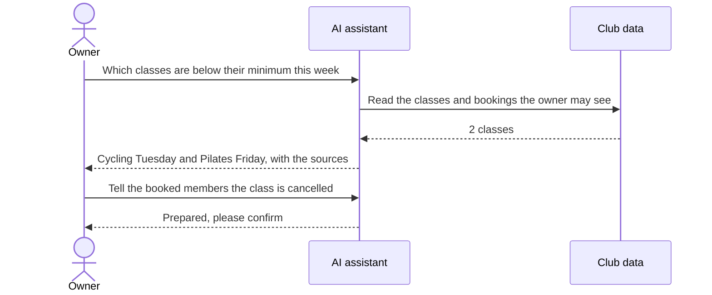

🏠 [Specs](../../../../README.md) › 🏷️ [Sectors](../../../README.md) › 🏋️ [SC18 Sports and fitness](../../README.md) ›
📝 [Use cases](../README.md) › 📝 [Use cases: FL-SC18-04 Personal training](README.md) ›
📝 UC-SC18-16 Ask the AI assistant about the club

# 📝 UC-SC18-16 Ask the AI assistant about the club

**Status:** ✅ specified

## Summary

The owner asks the AI assistant about the club from a phone and gets answers from the club's own data: members and
cancellations this month, entries today, classes below their minimum, licences and certificates due, camps with a ratio
problem. The AI assistant never shows data the asker may not see, and never shows a member's health data.

## Personas

- [U13 Owner](../../../../01-users/personas/u13-owner.md)

## Goal

The owner gets a clear answer in seconds, from real data, within the rights of their role.

## Trigger

The owner types or says a question.

## Frequency

Several times a day.

## Preconditions

- The owner is signed in with their role.
- The club's data is available ([E-SC18-01 Club membership](../../data/e-sc18-01-club-membership.md),
  [E-SC18-04 Class](../../data/e-sc18-04-class.md), [E-SC18-06 Licence](../../data/e-sc18-06-licence.md)).

## Postconditions

- **Succeeded:** the answer is shown with its sources, and a prepared action waits for the owner's confirmation.
- **Failed:** no answer is shown; the reason (no right, no data) is given.

## Main flow

1. The owner opens the AI assistant screen
   ([S-SC18-16 Club AI assistant](../../screens/04-personal-training/s-sc18-16-club-assistant.md)) and asks, for
   example, 'which members have an expired certificate before Saturday's match'.
2. The AI assistant reads only the data the owner may read
   ([BR-SC18-16](../../business-rules/br-sc18-16-answers-follow-the-askers-rights.md),
   [BR-F3-07](../../../../02-functional/f03-assistant/business-rules/br-f03-07-no-deletes-no-irreversible-acts.md)).
3. The answer appears with the list or the figure and its sources.
4. The owner asks for an action (message the members, move a class): the AI assistant prepares it.
5. The owner checks and confirms; nothing is done without that confirmation.
6. The question and the answer are kept in the audit.

## Alternative flows

- 1a. The question covers several sites: the answer is split by site.
- 4a. The owner asks for a report: the AI assistant saves it as a view.
- 2a. A coach asks: the AI assistant answers about their own classes and members only.

## Error flows

- 2e. The owner asks for a member's progress record: the AI assistant refuses, it is health data kept for the member and
  their coach.
- 3e. The AI assistant cannot find the answer: it says so rather than guess.
- 5e. The action fails: the owner is told and nothing is changed.
- Any step: a service does not answer; the call is retried first
  ([BR-F3-32](../../../../02-functional/f03-assistant/business-rules/br-f03-32-retry-before-an-error.md)), then the
  message follows the error pattern ([D122](../../../../06-decisions/ux/d122-error-message-standard.md)) and what the
  user typed stays on the screen.

## Business rules

- [BR-SC18-16](../../business-rules/br-sc18-16-answers-follow-the-askers-rights.md)
- [BR-F3-07](../../../../02-functional/f03-assistant/business-rules/br-f03-07-no-deletes-no-irreversible-acts.md)

## Entities

- [E-SC18-01 Club membership](../../data/e-sc18-01-club-membership.md): read, the memberships
- [E-SC18-04 Class](../../data/e-sc18-04-class.md): read, the classes
- [E-SC18-06 Licence](../../data/e-sc18-06-licence.md): read, the licences

## Permissions

Every answer follows the asker's own rights; an action is confirmed by a person who may do it.

## Notifications

None: the use case sends no message of its own.

## Audit events

Each question, answer, source and confirmed action, with who and when.

## AI involvement

No AI step of its own. The AI assistant may open the screen and prefill it from the user's words; the user checks and
confirms
[BR-F3-07](../../../../02-functional/f03-assistant/business-rules/br-f03-07-no-deletes-no-irreversible-acts.md).

## API, MCP and A2A exposure

T5 operations of the capability for the personas above: create, read, update and list. The MCP tool of the
capability may read and propose, never confirm alone. No A2A skill.

## Screens

- [S-SC18-16 Club AI assistant](../../screens/04-personal-training/s-sc18-16-club-assistant.md)

## Flowchart

See [FL-SC18-04 Personal training](../../flows/fl-sc18-04-personal-training.md#flowchart).

## Sequence diagram

## Acceptance criteria

1. **Given** an owner with the right to the classes **when** they ask which are below their minimum **then** the list is
   shown with its sources.
2. **Given** an owner who asks for a member's progress record **when** the AI assistant answers **then** it refuses and
   says why.
3. **Given** an action prepared **when** the owner does not confirm **then** nothing is sent.
4. **Given** a question with no data **when** the owner asks **then** the AI assistant says it cannot answer.

## Non-functional notes

The screen answers within 2 seconds for 10,000 records; every change is audited.

## Regulatory references

None specific to this use case beyond the rules above.

## Related use cases

- [UC-SC18-15 Follow progress](uc-sc18-15-follow-progress.md)
- [UC-SC18-15 Follow progress](uc-sc18-15-follow-progress.md)
- [UC-SC17-16](../../../sc17-beauty-and-wellness/use-cases/04-commissions-and-tips/uc-sc17-16-ask-the-assistant-about-the-salon.md)
- [UC-F3-01](../../../../02-functional/f03-assistant/use-cases/01-ask-the-assistant/uc-f03-01-ask-a-question-about-the-company-s-data.md)

## Open questions

None.

---

⬅️ [UC-SC18-15 Follow progress](uc-sc18-15-follow-progress.md) · ⬆️ [Up](README.md) ·
➡️ [UC-SC18-17](../05-facilities-events-camps-and-rentals/uc-sc18-17-book-courts-and-facilities.md)
