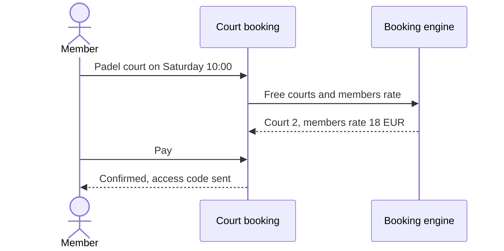

🏠 [Specs](../../../../README.md) › 🏷️ [Sectors](../../../README.md) › 🏋️ [SC18 Sports and fitness](../../README.md) ›
📝 [Use cases](../README.md) › 📝 [Use cases: FL-SC18-05 Facilities, events, camps and rentals](README.md) ›
📝 UC-SC18-17 Book courts and facilities

# 📝 UC-SC18-17 Book courts and facilities

**Status:** ✅ specified

## Summary

Members and visitors book courts and facilities (tennis, padel, squash, a hall, a pitch) by the hour from their phone.
The price depends on the time (peak or off-peak) and on whether the booker is a member: members' rates apply only to
members with a valid membership. The owner sees the occupation of each court and may block hours for classes, lessons
and maintenance.

## Personas

- [U09 Customer](../../../../01-users/personas/u09-customer.md)
- [U13 Owner](../../../../01-users/personas/u13-owner.md)

## Goal

Courts are full at peak times, members pay their rate and visitors the public rate, and nobody is double booked.

## Trigger

A member or a visitor opens the court calendar, or the owner blocks hours.

## Frequency

Dozens a day in a racket club.

## Preconditions

- The courts are bookable resources
  ([E-F2-17](../../../../02-functional/f02-no-code-configuration/data/e-f02-17-bookable-resource-setting.md)).
- The prices by hour and by type of booker are set by the owner.

## Postconditions

- **Succeeded:** the booking is saved ([E-SC18-13 Court booking](../../data/e-sc18-13-court-booking.md)) with its court,
  hour, price and payment; the court is shown taken in the calendar.
- **Failed:** no court is held; the reason (taken, closed, payment failed) is shown with the nearest hours.

## Main flow

1. The member opens the court booking screen
   ([S-SC18-17](../../screens/05-facilities-events-camps-and-rentals/s-sc18-17-court-booking.md)) and chooses the sport,
   the day and the hour.
2. SimpleERP shows the free courts with the price: the members' rate if the member's membership is valid
   ([BR-SC18-17](../../business-rules/br-sc18-17-members-rates-apply-only-to-valid-members.md)), otherwise the public
   rate.
3. The member takes a court; it is Held for ten minutes while they pay.
4. The payment is made on the phone or taken from a prepaid balance; the booking becomes Confirmed.
5. The court is shown taken; the player gets the access code or the door opens for them
   ([UC-SC18-03](../01-memberships-and-access/uc-sc18-03-control-access-at-the-door.md)).
6. After the hour, the booking is Used; if nobody came and the booking was not cancelled in time, it is marked No show.

## Alternative flows

- 2a. The booker invites another player: the invited person may pay a share, and a visitor pays the public rate.
- 6a. The booking is cancelled before the free cancellation time: the court is freed and the payment refunded.
- 2b. The owner blocks hours for a class or a lesson: the court is not shown free
  ([UC-SC18-05](../02-classes-and-waiting-lists/uc-sc18-05-publish-the-class-timetable.md)).

## Error flows

- 3e. The court is taken meanwhile: the member is shown the nearest free hours.
- 2e. The member's membership is frozen or ended: the public rate applies.
- 4e. The payment fails: the hold ends after ten minutes.
- Any step: a service does not answer; the call is retried first
  ([BR-F3-32](../../../../02-functional/f03-assistant/business-rules/br-f03-32-retry-before-an-error.md)), then the
  message follows the error pattern ([D122](../../../../06-decisions/ux/d122-error-message-standard.md)) and what the
  user typed stays on the screen.

## Business rules

- [BR-SC18-17](../../business-rules/br-sc18-17-members-rates-apply-only-to-valid-members.md)
- [BR-SC18-17](../../business-rules/br-sc18-17-members-rates-apply-only-to-valid-members.md)

## Entities

- [E-SC18-13 Court booking](../../data/e-sc18-13-court-booking.md): created, changed
- [E-F2-18](../../../../02-functional/f02-no-code-configuration/data/e-f02-18-resource-booking.md): created, the
  resource booking of the court
- [E-SC18-01 Club membership](../../data/e-sc18-01-club-membership.md): read, the membership for the rate
- [E-F6-06](../../../../02-functional/f06-customers-and-sales/data/e-f06-06-customer-payment.md): created, the payment

## Permissions

The member books and cancels their own bookings; the owner blocks hours and changes prices; visitors book as guests with
a payment.

## Notifications

The member, with their consent: the confirmation and a reminder before the hour. The owner: courts under 50 percent
occupied tomorrow.

## Audit events

Each booking, hold, payment, cancellation, no-show and block, with who and when.

## AI involvement

No AI step of its own. The AI assistant may open the screen and prefill it from the user's words; the user checks and
confirms
[BR-F3-07](../../../../02-functional/f03-assistant/business-rules/br-f03-07-no-deletes-no-irreversible-acts.md).

## API, MCP and A2A exposure

T5 operations of the capability for the personas above: create, read, update and list. The MCP tool of the
capability may read and propose, never confirm alone. No A2A skill.

## Screens

- [S-SC18-17](../../screens/05-facilities-events-camps-and-rentals/s-sc18-17-court-booking.md)

## Flowchart

See
[FL-SC18-05 Facilities, events, camps and rentals](../../flows/fl-sc18-05-facilities-events-camps-and-rentals.md#flowchart).

## Sequence diagram

## Acceptance criteria

1. **Given** a valid member **when** they book a court **then** the members' rate is shown and charged.
2. **Given** a member whose membership is frozen **when** they book **then** the public rate is charged.
3. **Given** a court taken meanwhile **when** the member pays **then** the booking is refused and the nearest hours are
   shown.
4. **Given** a booking cancelled before the free cancellation time **when** the member cancels **then** the court is
   freed and the payment refunded.

## Non-functional notes

The screen answers within 2 seconds for 10,000 records; every change is audited.

## Regulatory references

The price of a booking is shown with taxes before the member pays, and a member's rate is given only to the
people it was made for. The France-pack rule is [CR-FR-034 Consumers see prices including VAT](../../../../10-country-packs/france/consumer/cr-fr-034-prices-shown-including-vat.md).

## Related use cases

- [UC-SC18-18 Run tournaments and events](uc-sc18-18-run-tournaments-and-events.md)
- [UC-SC18-03](../01-memberships-and-access/uc-sc18-03-control-access-at-the-door.md)
- [UC-SC18-05](../02-classes-and-waiting-lists/uc-sc18-05-publish-the-class-timetable.md)
- [UC-F2-19](../../../../02-functional/f02-no-code-configuration/use-cases/08-views-and-bookings/uc-f02-19-book-a-resource.md)

## Open questions

None.

---

⬅️ [UC-SC18-16](../04-personal-training/uc-sc18-16-ask-the-assistant-about-the-club.md) · ⬆️ [Up](README.md) ·
➡️ [UC-SC18-18 Run tournaments and events](uc-sc18-18-run-tournaments-and-events.md)
