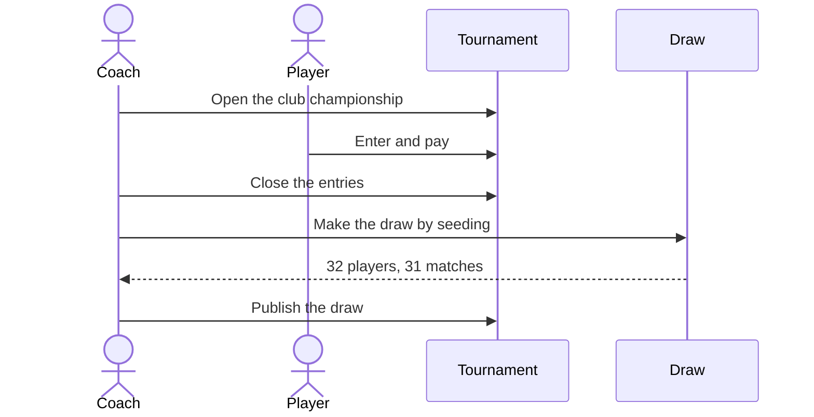

🏠 [Specs](../../../../README.md) › 🏷️ [Sectors](../../../README.md) › 🏋️ [SC18 Sports and fitness](../../README.md) ›
📝 [Use cases](../README.md) › 📝 [Use cases: FL-SC18-05 Facilities, events, camps and rentals](README.md) ›
📝 UC-SC18-18 Run tournaments and events

# 📝 UC-SC18-18 Run tournaments and events

**Status:** ✅ specified

## Summary

The coach runs a tournament or an event (a club championship, a youth day, a charity run). Players or teams enter and
pay, the coach closes the entries, makes the draw, publishes it before the first match, and follows the matches and
results. Spectator tickets and a bar may be added with the events and ticketing capability.

## Personas

- [U53 Coach](../../../../01-users/personas/u53-coach.md)
- [U09 Customer](../../../../01-users/personas/u09-customer.md)

## Goal

Entries, draw, schedule and results of a tournament are in one place and the draw is published to all players before the
first match.

## Trigger

The owner or the coach decides to hold an event, entries close, or a match is played.

## Frequency

A few events a year per section.

## Preconditions

- The courts or the pitch are bookable
  ([E-F2-17](../../../../02-functional/f02-no-code-configuration/data/e-f02-17-bookable-resource-setting.md)).
- The players have licences and certificates where needed ([E-SC18-06 Licence](../../data/e-sc18-06-licence.md),
  [E-SC18-07 Medical certificate](../../data/e-sc18-07-medical-certificate.md)).

## Postconditions

- **Succeeded:** the tournament is saved ([E-SC18-14 Tournament](../../data/e-sc18-14-tournament.md)) with its entries,
  draw, schedule and results; the draw is published before the first match.
- **Failed:** the tournament does not start; the missing entries, draw or court is shown.

## Main flow

1. The coach opens the tournaments screen
   ([S-SC18-18](../../screens/05-facilities-events-camps-and-rentals/s-sc18-18-tournaments.md)) and creates a
   tournament: sport, categories, dates, courts, entry fee and the limit of entries.
2. The tournament is Open; players or teams enter and pay on the phone.
3. The coach closes the entries; the tournament becomes Closed.
4. The coach makes the draw, by seeding or at random; the schedule is built from the courts and times; the tournament is
   Drawn.
5. The draw is published to all players before the first match
   ([BR-SC18-18](../../business-rules/br-sc18-18-draws-are-published-before-the-first-match.md)).
6. Matches are played, results are entered ([UC-SC18-12](../03-licences-and-competitions/uc-sc18-12-record-results.md))
   and the tournament becomes Finished.

## Alternative flows

- 1a. Spectators buy tickets: the event is set up with the shared ticketing
  [UC-F5-17](../../../../02-functional/f05-social-media/use-cases/07-events-and-ticketing/uc-f05-17-set-up-ticketing-for-an-event.md).
- 5a. A player withdraws after the draw: the draw is corrected and the players are told.
- 4a. A club championship has a second chance round: the draw includes a consolation table.

## Error flows

- 4e. Fewer entries than the minimum: the category is merged or cancelled and the entries refunded.
- 5e. The first match starts and the draw is not published: the start is blocked.
- 2e. A player has no valid licence or certificate: the entry is refused.
- Any step: a service does not answer; the call is retried first
  ([BR-F3-32](../../../../02-functional/f03-assistant/business-rules/br-f03-32-retry-before-an-error.md)), then the
  message follows the error pattern ([D122](../../../../06-decisions/ux/d122-error-message-standard.md)) and what the
  user typed stays on the screen.

## Business rules

- [BR-SC18-18](../../business-rules/br-sc18-18-draws-are-published-before-the-first-match.md)
- [BR-SC18-17](../../business-rules/br-sc18-17-members-rates-apply-only-to-valid-members.md)

## Entities

- [E-SC18-14 Tournament](../../data/e-sc18-14-tournament.md): created, changed
- [E-SC18-09 Result](../../data/e-sc18-09-result.md): read, the results of the matches
- [E-F5-12 Event ticket](../../../../02-functional/f05-social-media/data/e-f05-12-event-ticket.md): created, the
  spectator tickets
- [E-F2-18](../../../../02-functional/f02-no-code-configuration/data/e-f02-18-resource-booking.md): created, the court
  bookings of the matches

## Permissions

Coach and owner create and run tournaments; players enter their own; the public sees the published draw and results.

## Notifications

The players, with their consent: the entry confirmation, the published draw, the match times. The coach: entries closing
soon.

## Audit events

Each tournament, entry, payment, refund, draw, publication and result, with who and when.

## AI involvement

No AI step of its own. The AI assistant may open the screen and prefill it from the user's words; the user checks and
confirms
[BR-F3-07](../../../../02-functional/f03-assistant/business-rules/br-f03-07-no-deletes-no-irreversible-acts.md).

## API, MCP and A2A exposure

T5 operations of the capability for the personas above: create, read, update and list. The MCP tool of the
capability may read and propose, never confirm alone. No A2A skill.

## Screens

- [S-SC18-18](../../screens/05-facilities-events-camps-and-rentals/s-sc18-18-tournaments.md)

## Flowchart

See
[FL-SC18-05 Facilities, events, camps and rentals](../../flows/fl-sc18-05-facilities-events-camps-and-rentals.md#flowchart).

## Sequence diagram

## Acceptance criteria

1. **Given** a tournament with a minimum of 8 entries and 6 entered **when** the coach closes the entries **then** the
   category is merged or cancelled and the entries refunded.
2. **Given** a draw made **when** the first match is about to start **then** it is blocked until the draw is published.
3. **Given** a player without a valid licence **when** they enter **then** the entry is refused.
4. **Given** a player who withdraws after the draw **when** the coach records it **then** the draw is corrected and the
   players are told.

## Non-functional notes

The screen answers within 2 seconds for 10,000 records; every change is audited.

## Regulatory references

Players in an official competition hold a valid licence and, where required, a certificate; the rules of the
draw and the schedule are those of the federation. The France-pack rule is written later.

## Related use cases

- [UC-SC18-17 Book courts and facilities](uc-sc18-17-book-courts-and-facilities.md)
- [UC-SC18-19 Run holiday camps](uc-sc18-19-run-holiday-camps.md)
- [UC-SC18-11](../03-licences-and-competitions/uc-sc18-11-run-teams-and-competitions.md)
- [UC-SC18-12 Record results](../03-licences-and-competitions/uc-sc18-12-record-results.md)
- [UC-F5-17](../../../../02-functional/f05-social-media/use-cases/07-events-and-ticketing/uc-f05-17-set-up-ticketing-for-an-event.md)

## Open questions

None.

---

⬅️ [UC-SC18-17 Book courts and facilities](uc-sc18-17-book-courts-and-facilities.md) · ⬆️ [Up](README.md) ·
➡️ [UC-SC18-19 Run holiday camps](uc-sc18-19-run-holiday-camps.md)
