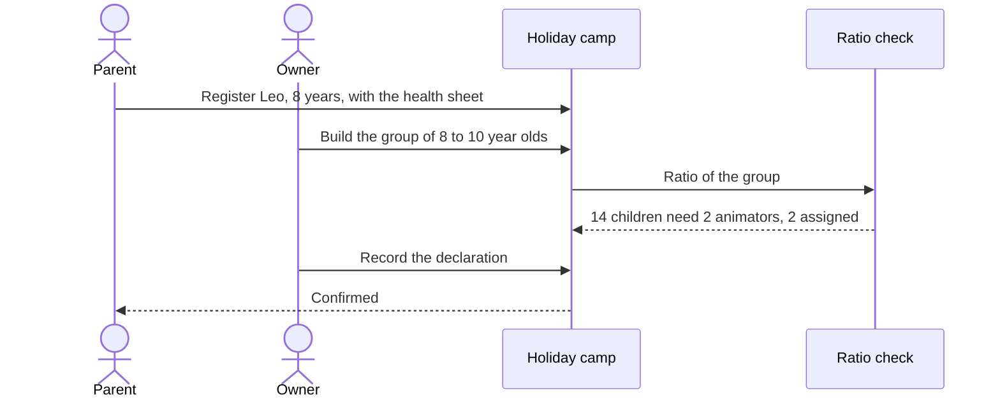

🏠 [Specs](../../../../README.md) › 🏷️ [Sectors](../../../README.md) › 🏋️ [SC18 Sports and fitness](../../README.md) ›
📝 [Use cases](../README.md) › 📝 [Use cases: FL-SC18-05 Facilities, events, camps and rentals](README.md) ›
📝 UC-SC18-19 Run holiday camps

# 📝 UC-SC18-19 Run holiday camps

**Status:** 🔄 waiting for the owner

## Summary

The club runs holiday camps for children. The owner creates a camp (dates, ages, places, price), parents register their
child and give the health sheet, the emergency contacts, the people allowed to collect the child and the photo consent,
and the owner builds groups with the number of qualified animators the child-to-adult ratio requires. A camp that is not
declared or whose ratio is not met cannot open.

## Personas

- [U13 Owner](../../../../01-users/personas/u13-owner.md)
- [U09 Customer](../../../../01-users/personas/u09-customer.md)

## Goal

Every child is registered with the information needed for their safety, every group has the supervision the rules
require, and the camp is declared before it opens.

## Trigger

The owner plans a camp, a parent registers a child, or the camp's day comes.

## Frequency

A few camps a year, each with dozens of children.

## Preconditions

- The camp's activities and dates are planned.
- The animators are employees with their qualifications
  ([E-F9-01](../../../../02-functional/f09-hr-and-projects/data/e-f09-01-employee-record.md),
  [E-F9-12](../../../../02-functional/f09-hr-and-projects/data/e-f09-12-certification.md)).
- The club has its place of camp declared.

## Postconditions

- **Succeeded:** each registration is saved ([E-SC18-15 Camp registration](../../data/e-sc18-15-camp-registration.md))
  with the health sheet and the people allowed to collect the child; the groups meet the ratios and the camp is
  declared.
- **Failed:** the camp does not open; the missing declaration, the ratio not met or the incomplete registration is
  shown.

## Main flow

1. The owner opens the holiday camps screen
   ([S-SC18-19](../../screens/05-facilities-events-camps-and-rentals/s-sc18-19-holiday-camps.md)) and creates a camp
   with its dates, age bands, places and price.
2. A parent registers a child, gives the health sheet, the emergency contacts, the people allowed to collect and the
   photo consent, and pays a deposit.
3. The owner builds the groups by age band and assigns the animators; the screen computes the ratio
   ([BR-SC18-19](../../business-rules/br-sc18-19-supervision-ratios-follow-the-youth-rules.md)).
4. The owner records the declaration of the camp with the authority and its reference.
5. Each morning the animators check the children in; each evening they check them out to a person allowed to collect.
6. After the camp, the registrations are archived and the health sheets are erased after the delay.

## Alternative flows

- 3a. The ratio is not met for a group: the screen lists the animators missing or the children to move.
- 2a. A child has an allergy or a treatment: it is shown to the animators with the emergency plan.
- 2b. The child comes for part of the camp: the registration covers only those days.

## Error flows

- 4e. The camp is not declared: it cannot open.
- 3e. An animator has no valid qualification for the age band: they cannot be assigned.
- 5e. A person not on the list tries to collect a child: the child is not released.
- Any step: a service does not answer; the call is retried first
  ([BR-F3-32](../../../../02-functional/f03-assistant/business-rules/br-f03-32-retry-before-an-error.md)), then the
  message follows the error pattern ([D122](../../../../06-decisions/ux/d122-error-message-standard.md)) and what the
  user typed stays on the screen.

## Business rules

- [BR-SC18-19](../../business-rules/br-sc18-19-supervision-ratios-follow-the-youth-rules.md)
- [BR-SC18-08](../../business-rules/br-sc18-08-coaches-hold-the-diploma-for-the-activity.md)

## Entities

- [E-SC18-15 Camp registration](../../data/e-sc18-15-camp-registration.md): created, changed
- [E-F9-12](../../../../02-functional/f09-hr-and-projects/data/e-f09-12-certification.md): read, the animators'
  qualifications
- [E-F9-16 Shift](../../../../02-functional/f09-hr-and-projects/data/e-f09-16-shift.md): read, the animators' shifts
- [E-F6-01](../../../../02-functional/f06-customers-and-sales/data/e-f06-01-customer-record.md): read, the parent

## Permissions

Owner runs the camp; animators read the sheets of their group only; the parent reads their own child's registration.
Health sheets are shown to those who need them for the child's care.

## Notifications

The parent, with their consent: the confirmation, the daily check-in and check-out. The owner: a ratio not met, an
incomplete registration.

## Audit events

Each camp, registration, health sheet reading, group, declaration, check-in, check-out and release, with who and when.

## AI involvement

No AI step of its own. The AI assistant may open the screen and prefill it from the user's words; the user checks and
confirms
[BR-F3-07](../../../../02-functional/f03-assistant/business-rules/br-f03-07-no-deletes-no-irreversible-acts.md).

## API, MCP and A2A exposure

T5 operations of the capability for the personas above: create, read, update and list. The MCP tool of the
capability may read and propose, never confirm alone. No A2A skill.

## Screens

- [S-SC18-19](../../screens/05-facilities-events-camps-and-rentals/s-sc18-19-holiday-camps.md)

## Flowchart

See
[FL-SC18-05 Facilities, events, camps and rentals](../../flows/fl-sc18-05-facilities-events-camps-and-rentals.md#flowchart).

## Sequence diagram

## Acceptance criteria

1. **Given** a group of 14 children aged 8 to 10 and a ratio of one animator for 8 **when** one animator is assigned
   **then** the group is flagged and the camp cannot open.
2. **Given** a camp not declared **when** the owner opens it **then** it is refused.
3. **Given** a person not on the list **when** they come to collect a child **then** the child is not released.
4. **Given** a child with an allergy **when** the animators open the group **then** the allergy and the plan are shown.

## Non-functional notes

The screen answers within 2 seconds for 10,000 records; every change is audited.

## Regulatory references

A holiday camp for minors is declared to the authority before it opens, its animators hold the required
qualifications, the number of children per animator follows the age of the children, and the children's health sheets
are kept private and for a short time
([CR-FR-055](../../../../10-country-packs/france/data-protection/cr-fr-055-health-data-hosting.md)). The values (ratios
by age band, the form of the declaration) are those of the France pack, written later. Related:
[CR-FR-208](../../../../10-country-packs/france/labour/cr-fr-208-young-workers-regulated-work.md).

- France-pack rule, (Proposed) until its law is read:
  [CR-FR-258 Youth holiday camps declaration](../../../../10-country-packs/france/education/cr-fr-258-youth-holiday-camps.md)

## Related use cases

- [UC-SC18-18 Run tournaments and events](uc-sc18-18-run-tournaments-and-events.md)
- [UC-SC18-20 Rent out equipment](uc-sc18-20-rent-out-equipment.md)
- [UC-SC18-17 Book courts and facilities](uc-sc18-17-book-courts-and-facilities.md)
- [UC-SC18-20 Rent out equipment](uc-sc18-20-rent-out-equipment.md)
- [UC-SC18-08 Plan coaches](../02-classes-and-waiting-lists/uc-sc18-08-plan-coaches.md)

## Open questions

None.

---

⬅️ [UC-SC18-18 Run tournaments and events](uc-sc18-18-run-tournaments-and-events.md) · ⬆️ [Up](README.md) ·
➡️ [UC-SC18-20 Rent out equipment](uc-sc18-20-rent-out-equipment.md)
