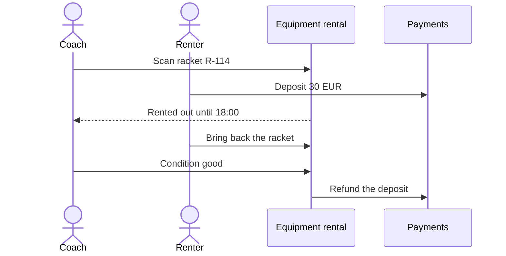

🏠 [Specs](../../../../README.md) › 🏷️ [Sectors](../../../README.md) › 🏋️ [SC18 Sports and fitness](../../README.md) ›
📝 [Use cases](../README.md) › 📝 [Use cases: FL-SC18-05 Facilities, events, camps and rentals](README.md) ›
📝 UC-SC18-20 Rent out equipment

# 📝 UC-SC18-20 Rent out equipment

**Status:** ✅ specified

## Summary

The club rents out equipment: rackets, bikes, skis, helmets, kayaks. Each item has a code, a condition and a price per
hour or day; a member or a visitor leaves a deposit, takes the item and brings it back, and the coach checks it. The
deposit is refunded on return in good order and kept for the damage found, with proof, as the terms say.

## Personas

- [U53 Coach](../../../../01-users/personas/u53-coach.md)
- [U09 Customer](../../../../01-users/personas/u09-customer.md)

## Goal

Equipment is available when needed, always known to be out or in, and the deposit is returned or kept fairly and with
proof.

## Trigger

A person asks to rent an item, or an item is brought back.

## Frequency

Dozens a day in a season.

## Preconditions

- The items exist as stock items with a code
  ([E-F7-06 Item](../../../../02-functional/f07-purchasing-and-stock/data/e-f07-06-item.md)).
- The prices and the deposit of each item are set.

## Postconditions

- **Succeeded:** the item is saved ([E-SC18-16 Rental item](../../data/e-sc18-16-rental-item.md)) with its state and
  each rental has its deposit; the deposit is refunded on a return in good order.
- **Failed:** no item is rented; the missing deposit, the item out of repair or the identity is shown.

## Main flow

1. The coach opens the rental screen
   ([S-SC18-20](../../screens/05-facilities-events-camps-and-rentals/s-sc18-20-equipment-rental.md)) on the phone, scans
   the item's code and sees its condition and price.
2. The person gives their identity; the deposit is taken by card hold or in cash
   ([E-F6-06](../../../../02-functional/f06-customers-and-sales/data/e-f06-06-customer-payment.md)).
3. The item becomes Rented out with its due time.
4. At the return, the coach checks the item and records its condition with photos if needed.
5. If the item is in good order, the deposit is refunded and the item is Available again
   ([BR-SC18-20](../../business-rules/br-sc18-20-deposits-are-refunded-on-return-in-good-order.md)).
6. If the item is damaged, the item goes to repair and the deposit is kept up to the cost, with the photos and the terms
   as proof.

## Alternative flows

- 3a. The item is for a child: the parent signs for the rental.
- 4a. The item is returned late: the extra time is charged at the price in the terms.
- 5a. The item is lost: the deposit is kept up to its value and the item is Retired.

## Error flows

- 2e. The deposit is not given: the item is not handed out.
- 4e. The item is damaged and the person disputes it: the deposit is held until the owner decides, within the delay the
  terms set.
- 3e. The item is in repair or Retired: it is not offered.
- Any step: a service does not answer; the call is retried first
  ([BR-F3-32](../../../../02-functional/f03-assistant/business-rules/br-f03-32-retry-before-an-error.md)), then the
  message follows the error pattern ([D122](../../../../06-decisions/ux/d122-error-message-standard.md)) and what the
  user typed stays on the screen.

## Business rules

- [BR-SC18-20](../../business-rules/br-sc18-20-deposits-are-refunded-on-return-in-good-order.md)
- [BR-SC18-17](../../business-rules/br-sc18-17-members-rates-apply-only-to-valid-members.md)

## Entities

- [E-SC18-16 Rental item](../../data/e-sc18-16-rental-item.md): created, changed
- [E-F7-06 Item](../../../../02-functional/f07-purchasing-and-stock/data/e-f07-06-item.md): read, the item as a stock
  item
- [E-F6-06](../../../../02-functional/f06-customers-and-sales/data/e-f06-06-customer-payment.md): created, the deposit
  and the rental payment
- [E-F7-14](../../../../02-functional/f07-purchasing-and-stock/data/e-f07-14-repair-order.md): created, the repair order
  of a damaged item

## Permissions

Coach and owner rent out and take back; the owner decides a disputed deposit; the renter reads their own rental and
receipt.

## Notifications

The renter, with their consent: the receipt, a reminder before the due time, the refund. The owner: items not returned.

## Audit events

Each rental, deposit, return, condition, photo, repair and refund, with who and when.

## AI involvement

No AI step of its own. The AI assistant may open the screen and prefill it from the user's words; the user checks and
confirms
[BR-F3-07](../../../../02-functional/f03-assistant/business-rules/br-f03-07-no-deletes-no-irreversible-acts.md).

## API, MCP and A2A exposure

T5 operations of the capability for the personas above: create, read, update and list. The MCP tool of the
capability may read and propose, never confirm alone. No A2A skill.

## Screens

- [S-SC18-20](../../screens/05-facilities-events-camps-and-rentals/s-sc18-20-equipment-rental.md)

## Flowchart

See
[FL-SC18-05 Facilities, events, camps and rentals](../../flows/fl-sc18-05-facilities-events-camps-and-rentals.md#flowchart).

## Sequence diagram

## Acceptance criteria

1. **Given** an item in good order brought back **when** the coach checks it **then** the deposit is refunded and the
   item is Available.
2. **Given** a damaged item **when** the coach records the damage with photos **then** the item goes to repair and the
   deposit is kept up to the cost.
3. **Given** no deposit given **when** the coach tries to hand out the item **then** it is refused.
4. **Given** an item in repair **when** it is searched for rental **then** it is not offered.

## Non-functional notes

The screen answers within 2 seconds for 10,000 records; every change is audited.

## Regulatory references

A deposit taken for a rental is a security: it is returned when the item is brought back in the condition the
terms describe, and only the proven damage may be kept; the terms are shown before the rental
([CR-FR-036](../../../../10-country-packs/france/consumer/cr-fr-036-withdrawal-right.md)). The France-pack rule is
written later.

## Related use cases

- [UC-SC18-19 Run holiday camps](uc-sc18-19-run-holiday-camps.md)
- [UC-SC18-17 Book courts and facilities](uc-sc18-17-book-courts-and-facilities.md)
- [UC-SC18-19 Run holiday camps](uc-sc18-19-run-holiday-camps.md)
- [UC-F7-14](../../../../02-functional/f07-purchasing-and-stock/use-cases/06-benchmark-additions/uc-f07-14-run-a-call-for-tenders-and-rate-suppliers.md)

## Open questions

None.

---

⬅️ [UC-SC18-19 Run holiday camps](uc-sc18-19-run-holiday-camps.md) · ⬆️ [Up](README.md)
