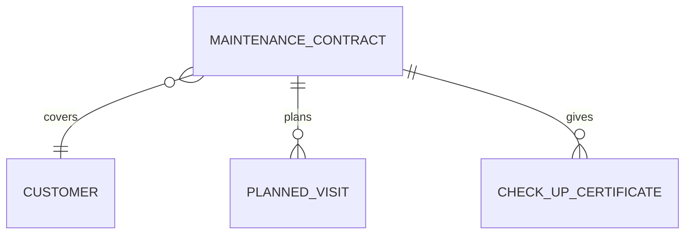
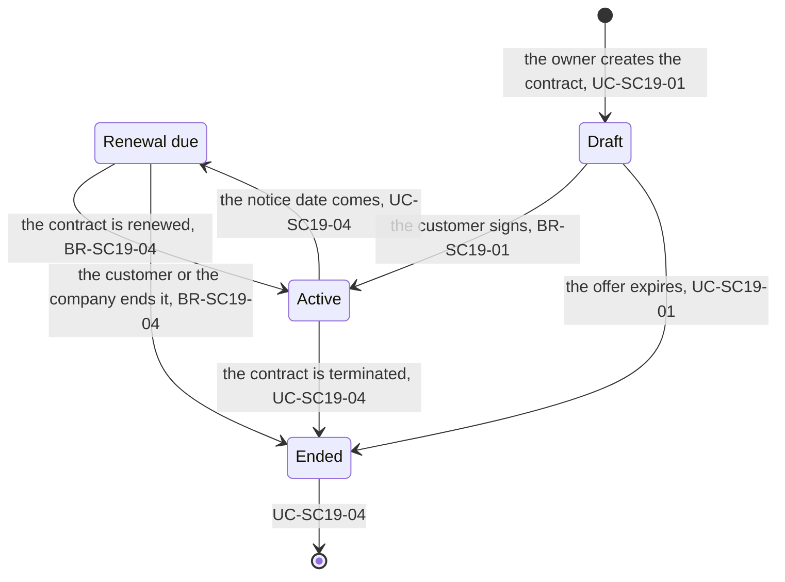

🏠 [Specs](../../../README.md) › 🏷️ [Sectors](../../README.md) › 🔧 [SC19 Trades and home services](../README.md) ›
🗃️ [Data](README.md) › 🗃️ E-SC19-01 Maintenance contract

# 🗃️ E-SC19-01 Maintenance contract

**Status:** ✅ specified

## Purpose

A yearly contract for the equipment of one customer, with its legal check-ups, price, visits and dates
([D563](../../../06-decisions/sectors/d563-benchmark-gaps-sc19-trades-and-home-services.md)). It is not the subscription
contract of billing ([E-F6-07](../../../02-functional/f06-customers-and-sales/data/e-f06-07-subscription-contract.md)),
which only repeats an invoice: it adds the equipment, the legal check-ups and the visits that the invoice pays for.

## Fields

| Name | Type | Required | Validation | Default | Example | Personal data | Custom fields |
|---|---|---|---|---|---|---|---|
| customer | customer (E-F6-01) | yes | a customer of the company | - | Martin household | no | no |
| equipment | lines of kind, make, serial and place | yes | at least one line | - | Gas boiler, Atlas, B-77120, Cellar | no | no |
| legal check-up | text | yes | from the equipment kind of the pack | from the kind | Yearly check-up | no | no |
| yearly price | amount | yes | 0 or more | - | 260.00 EUR | no | no |
| visits per year | number | yes | 1 or more | 1 | 2 | no | no |
| response time | number in hours | no | above 0 | - | 48 | no | no |
| index clause | yes or no | no | - | no | yes | no | no |
| start date | date | yes | not before today for a new contract | today | 2026-12-01 | no | no |
| end date | date | no | after the start date | - | 2027-11-30 | no | no |
| state | Draft, Active, Renewal due, Ended | yes | the lifecycle below | Draft | Active | no | no |
| owner | user | yes | a user of the company | the creator | Claire P. | yes | no |

## Relations

- [E-F6-01](../../../02-functional/f06-customers-and-sales/data/e-f06-01-customer-record.md)
- [E-F6-07](../../../02-functional/f06-customers-and-sales/data/e-f06-07-subscription-contract.md)
- [E-SC19-02 Planned visit](e-sc19-02-planned-visit.md)
- [E-SC19-03 Check-up certificate](e-sc19-03-check-up-certificate.md)

## Lifecycle

## Indexes and search

By customer, equipment kind, state, end date and legal check-up.

## Retention

Kept five years after the end of the contract, and the invoices ten years
([CR-FR-002](../../../10-country-packs/france/accounting/cr-fr-002-accounting-records-kept-ten-years.md)).

## Audit

Every change of equipment, check-up, price, visits and state, with who, when and the old and new value.

## Import and export

Export of the contract as PDF; import of equipment lines from CSV.

## Used by

- [UC-SC19-01](../use-cases/01-maintenance-contracts/uc-sc19-01-sell-a-maintenance-contract.md)
- [UC-SC19-02](../use-cases/01-maintenance-contracts/uc-sc19-02-generate-recurring-visits.md)
- [UC-SC19-04](../use-cases/01-maintenance-contracts/uc-sc19-04-renew-and-index-contracts.md)

## Open questions

None.

---

⬆️ [Up](README.md) · ➡️ [E-SC19-02 Planned visit](e-sc19-02-planned-visit.md)
