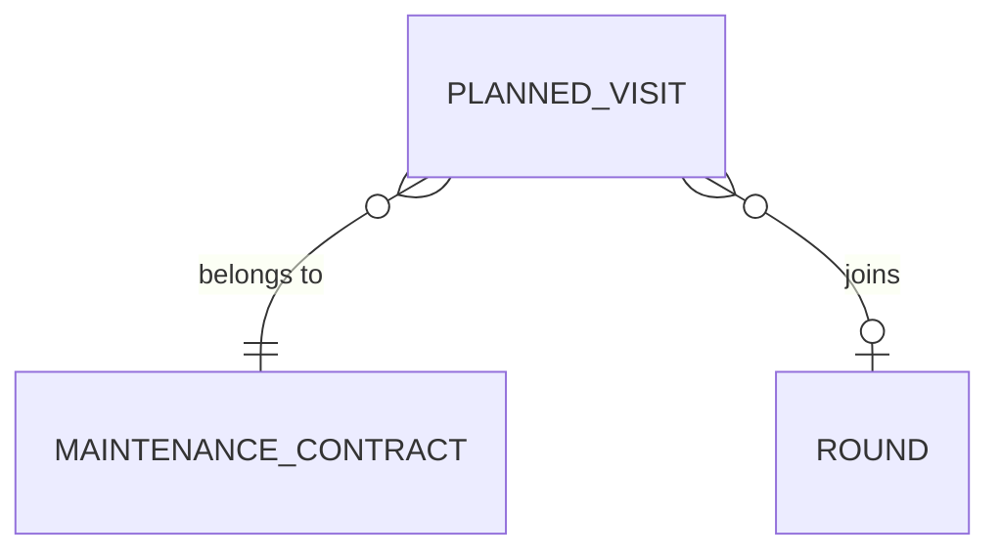
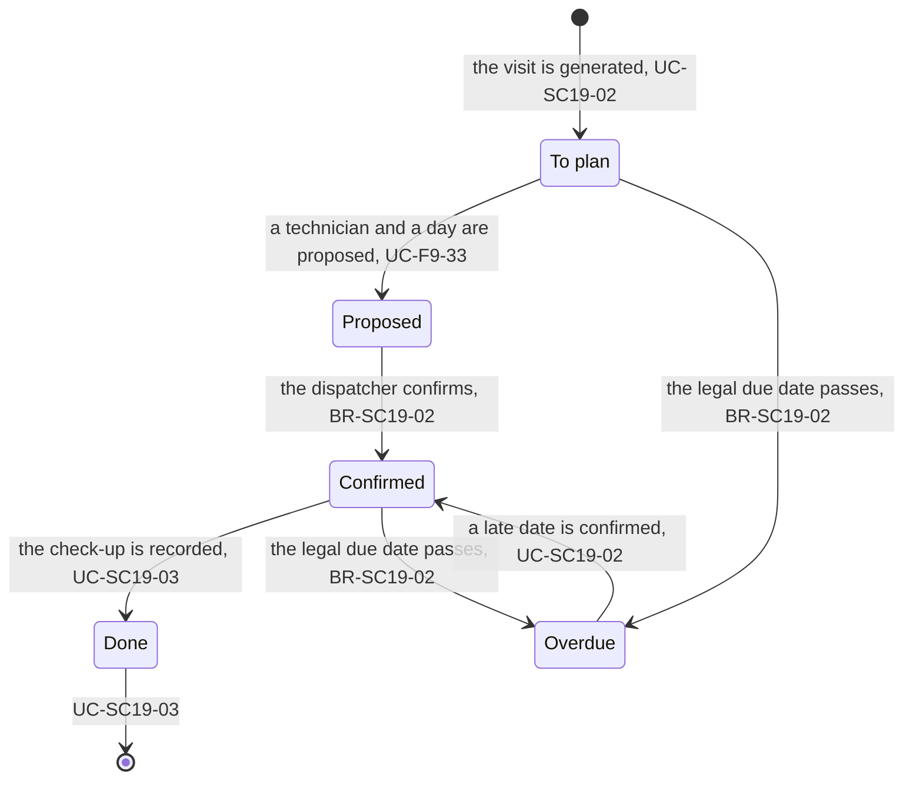

🏠 [Specs](../../../README.md) › 🏷️ [Sectors](../../README.md) › 🔧 [SC19 Trades and home services](../README.md) ›
🗃️ [Data](README.md) › 🗃️ E-SC19-02 Planned visit

# 🗃️ E-SC19-02 Planned visit

**Status:** ✅ specified

## Purpose

One visit to maintain equipment under a contract: its window, its legal due date, its technician and its state
([D563](../../../06-decisions/sectors/d563-benchmark-gaps-sc19-trades-and-home-services.md)). It is not a stop of a
round ([E-F9-26 Round](../../../02-functional/f09-hr-and-projects/data/e-f09-26-round.md)): it keeps the legal due date
the round does not know and joins a round only once confirmed.

## Fields

| Name | Type | Required | Validation | Default | Example | Personal data | Custom fields |
|---|---|---|---|---|---|---|---|
| contract | maintenance contract (E-SC19-01) | yes | an active contract | - | C-0412 | no | no |
| equipment | text | yes | an equipment of the contract | - | Gas boiler | no | no |
| window start | date | yes | not after the window end | - | 2027-04-01 | no | no |
| window end | date | yes | not after the legal due date | - | 2027-04-15 | no | no |
| legal due | date | yes | from the check-up interval | computed | 2027-04-30 | no | no |
| technician | user | no | holds the qualification | - | Leroy | no | no |
| visit date | date and time | no | inside the window | - | 2027-04-09 09:00 | no | no |
| state | To plan, Proposed, Confirmed, Done, Overdue | yes | the lifecycle below | To plan | Proposed | no | no |
| owner | user | yes | a user of the company | the creator | Claire P. | yes | no |

## Relations

- [E-SC19-01 Maintenance contract](e-sc19-01-maintenance-contract.md)
- [E-F9-26 Round](../../../02-functional/f09-hr-and-projects/data/e-f09-26-round.md)
- [E-F9-12](../../../02-functional/f09-hr-and-projects/data/e-f09-12-certification.md)

## Lifecycle

## Indexes and search

By contract, technician, window, legal due date and state.

## Retention

Kept five years after the visit date, like the contract.

## Audit

Every generation, proposal, confirmation, move and missed date, with who, when and the old and new value.

## Import and export

Export of the month's visits as CSV; import of an external planning as CSV.

## Used by

- [UC-SC19-02](../use-cases/01-maintenance-contracts/uc-sc19-02-generate-recurring-visits.md)
- [UC-SC19-01](../use-cases/01-maintenance-contracts/uc-sc19-01-sell-a-maintenance-contract.md)

## Open questions

None.

---

⬅️ [E-SC19-01 Maintenance contract](e-sc19-01-maintenance-contract.md) · ⬆️ [Up](README.md) ·
➡️ [E-SC19-03 Check-up certificate](e-sc19-03-check-up-certificate.md)
