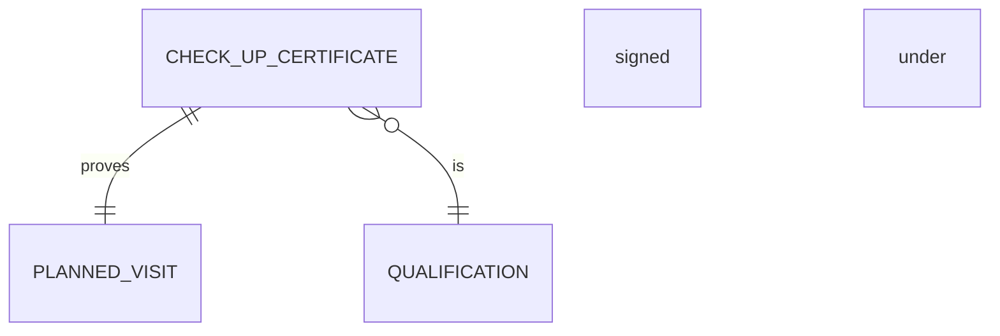
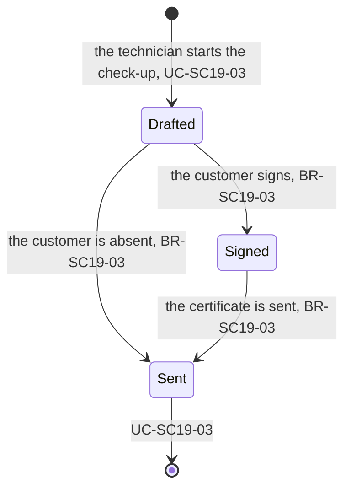

🏠 [Specs](../../../README.md) › 🏷️ [Sectors](../../README.md) › 🔧 [SC19 Trades and home services](../README.md) ›
🗃️ [Data](README.md) › 🗃️ E-SC19-03 Check-up certificate

# 🗃️ E-SC19-03 Check-up certificate

**Status:** ✅ specified

## Purpose

The certificate of one legal check-up: readings, result, remarks and the technician's and customer's signatures
([D563](../../../06-decisions/sectors/d563-benchmark-gaps-sc19-trades-and-home-services.md)). It is not the quality
certificate of an audit ([E-SC03-19 Certificate](../../sc03-services/data/e-sc03-19-certificate.md)): it proves a legal
check-up of one customer's equipment.

## Fields

| Name | Type | Required | Validation | Default | Example | Personal data | Custom fields |
|---|---|---|---|---|---|---|---|
| visit | planned visit (E-SC19-02) | yes | a confirmed visit | - | V-1204 | no | no |
| readings | list of name and value | yes | every reading of the form | - | CO 18 ppm | no | no |
| result | text | yes | compliant, compliant with remarks or not compliant | - | Compliant with remarks | no | no |
| remarks | text | no | - | - | Expansion vessel to recheck | no | no |
| technician | user | yes | holds the qualification | the user | Leroy | no | no |
| customer signature | signature | no | - | - | signed on the phone | no | no |
| sent on | date | no | not before the check-up | - | 2027-04-09 | no | no |
| state | Drafted, Signed, Sent | yes | the lifecycle below | Drafted | Signed | no | no |
| owner | user | yes | a user of the company | the creator | Claire P. | yes | no |

## Relations

- [E-SC19-02 Planned visit](e-sc19-02-planned-visit.md)
- [E-F9-12](../../../02-functional/f09-hr-and-projects/data/e-f09-12-certification.md)
- [E-SC03-19 Certificate](../../sc03-services/data/e-sc03-19-certificate.md)

## Lifecycle

## Indexes and search

By customer, equipment, result, technician and date.

## Retention

Kept five years, and as long as the customer's claim may run.

## Audit

Every reading, result, signature and sending, with who, when and the old and new value.

## Import and export

Export of the certificate as PDF; no import.

## Used by

- [UC-SC19-03](../use-cases/01-maintenance-contracts/uc-sc19-03-record-legal-check-ups.md)
- [UC-SC19-02](../use-cases/01-maintenance-contracts/uc-sc19-02-generate-recurring-visits.md)

## Open questions

None.

---

⬅️ [E-SC19-02 Planned visit](e-sc19-02-planned-visit.md) · ⬆️ [Up](README.md) ·
➡️ [E-SC19-04 Intervention](e-sc19-04-intervention.md)
