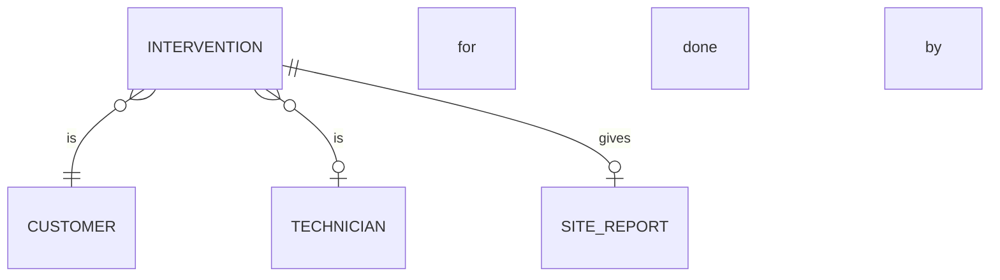
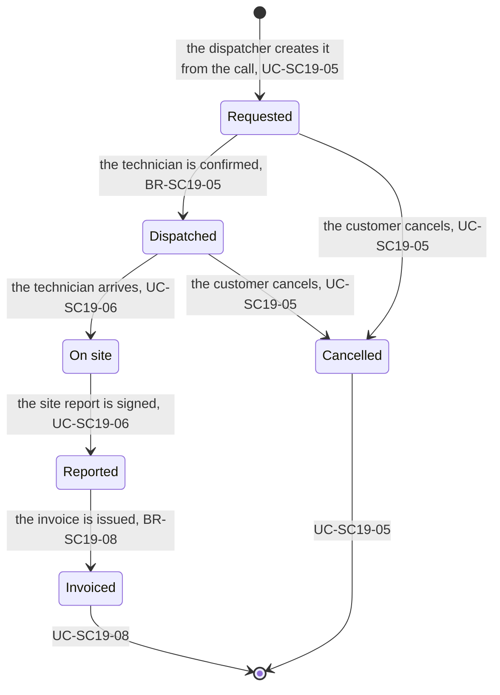

🏠 [Specs](../../../README.md) › 🏷️ [Sectors](../../README.md) › 🔧 [SC19 Trades and home services](../README.md) ›
🗃️ [Data](README.md) › 🗃️ E-SC19-04 Intervention

# 🗃️ E-SC19-04 Intervention

**Status:** ✅ specified

## Purpose

One job at a customer's home: the request, the trade, the technician, the terms and the state from the call to the
invoice ([D563](../../../06-decisions/sectors/d563-benchmark-gaps-sc19-trades-and-home-services.md)). It is not the
field worksheet of the technician
([E-F9-37](../../../02-functional/f09-hr-and-projects/data/e-f09-37-field-worksheet.md)): the worksheet is what the
technician fills on site, while the intervention is the job that the dispatcher follows and that holds the call-out
terms.

## Fields

| Name | Type | Required | Validation | Default | Example | Personal data | Custom fields |
|---|---|---|---|---|---|---|---|
| customer | customer (E-F6-01) | yes | a customer of the company | - | Garcia | no | no |
| address | address | yes | a valid address | the customer's | 12 rue des Lilas, Tours | no | no |
| trade | text | yes | a trade switched on | - | Plumbing | no | no |
| problem | text | yes | - | - | Leak under the sink | no | no |
| emergency | yes or no | no | - | no | yes | no | no |
| technician | user | no | holds the qualification | - | Leroy | no | no |
| announced arrival | date and time | no | - | - | 2027-01-12 10:25 | no | no |
| call-out terms | text | yes | from the sector pack | the pack's | Call-out 60 EUR | no | no |
| state | Requested, Dispatched, On site, Reported, Invoiced, Cancelled | yes | the lifecycle below | Requested | Dispatched | no | no |
| owner | user | yes | a user of the company | the creator | Claire P. | yes | no |

## Relations

- [E-F6-01](../../../02-functional/f06-customers-and-sales/data/e-f06-01-customer-record.md)
- [E-F9-37](../../../02-functional/f09-hr-and-projects/data/e-f09-37-field-worksheet.md)
- [E-F9-12](../../../02-functional/f09-hr-and-projects/data/e-f09-12-certification.md)
- [E-SC19-05 Site report](e-sc19-05-site-report.md)

## Lifecycle

## Indexes and search

By customer, trade, technician, state and date.

## Retention

Kept ten years with the invoice
([CR-FR-002](../../../10-country-packs/france/accounting/cr-fr-002-accounting-records-kept-ten-years.md)).

## Audit

Every request, proposal, override, dispatch, arrival, cancellation and invoice, with who, when and the old and new
value.

## Import and export

Export of the day's interventions as CSV; no import.

## Used by

- [UC-SC19-05](../use-cases/02-on-site-intervention/uc-sc19-05-dispatch-an-intervention.md)
- [UC-SC19-06](../use-cases/02-on-site-intervention/uc-sc19-06-report-on-site-with-photos.md)
- [UC-SC19-08](../use-cases/02-on-site-intervention/uc-sc19-08-sign-and-invoice-on-the-spot.md)
- [UC-SC19-17](../use-cases/05-on-call-warranties-van-stock-and-site-quotes/uc-sc19-17-run-the-emergency-on-call-service.md)

## Open questions

None.

---

⬅️ [E-SC19-03 Check-up certificate](e-sc19-03-check-up-certificate.md) · ⬆️ [Up](README.md) ·
➡️ [E-SC19-05 Site report](e-sc19-05-site-report.md)
