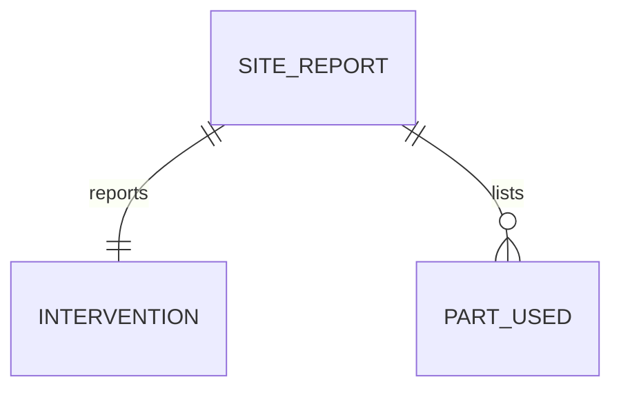
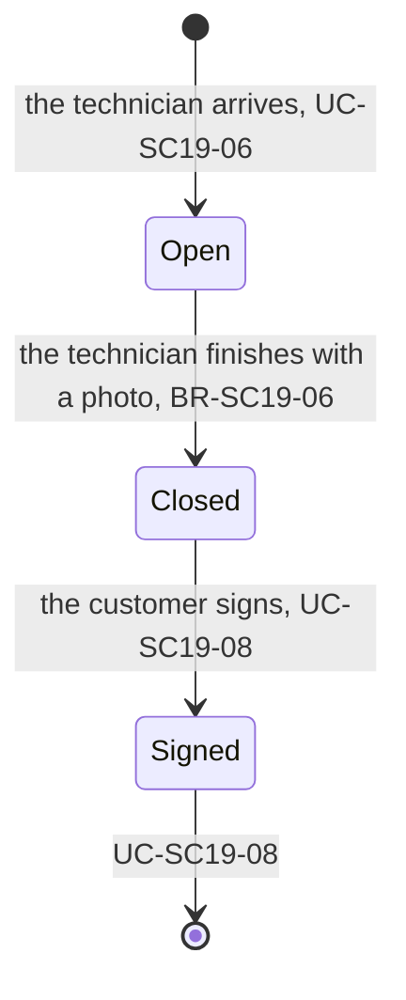

🏠 [Specs](../../../README.md) › 🏷️ [Sectors](../../README.md) › 🔧 [SC19 Trades and home services](../README.md) ›
🗃️ [Data](README.md) › 🗃️ E-SC19-05 Site report

# 🗃️ E-SC19-05 Site report

**Status:** ✅ specified

## Purpose

The report of one intervention: times, place, photos, cause, work and signature
([D563](../../../06-decisions/sectors/d563-benchmark-gaps-sc19-trades-and-home-services.md)). It is the part of the
technician's worksheet ([E-F9-37](../../../02-functional/f09-hr-and-projects/data/e-f09-37-field-worksheet.md)) that the
invoice and a dispute rely on, and it adds the place check and the compulsory photo.

## Fields

| Name | Type | Required | Validation | Default | Example | Personal data | Custom fields |
|---|---|---|---|---|---|---|---|
| intervention | intervention (E-SC19-04) | yes | a dispatched intervention | - | I-3305 | no | no |
| arrived | date and time | yes | - | now | 2027-01-12 10:22 | no | no |
| place | distance in metres | yes | 0 or more | computed | 40 | no | no |
| photos | images with a label | yes | at least one | - | 3 photos | no | no |
| cause | text | yes | - | - | Worn seal under the sink | no | no |
| work | text | yes | - | - | Seal replaced | no | no |
| left | date and time | no | after arrival | - | 2027-01-12 11:05 | no | no |
| customer signature | signature | no | - | - | signed on the phone | no | no |
| state | Open, Closed, Signed | yes | the lifecycle below | Open | Closed | no | no |
| owner | user | yes | a user of the company | the creator | Claire P. | yes | no |

## Relations

- [E-SC19-04 Intervention](e-sc19-04-intervention.md)
- [E-F9-37](../../../02-functional/f09-hr-and-projects/data/e-f09-37-field-worksheet.md)

## Lifecycle

## Indexes and search

By intervention, technician, date and state.

## Retention

Kept ten years with the invoice
([CR-FR-002](../../../10-country-packs/france/accounting/cr-fr-002-accounting-records-kept-ten-years.md)); photos five
years.

## Audit

Every arrival, photo, place check, edit, departure and signature, with who, when and the old and new value.

## Import and export

Export of the report as PDF; no import.

## Used by

- [UC-SC19-06](../use-cases/02-on-site-intervention/uc-sc19-06-report-on-site-with-photos.md)
- [UC-SC19-08](../use-cases/02-on-site-intervention/uc-sc19-08-sign-and-invoice-on-the-spot.md)

## Open questions

None.

---

⬅️ [E-SC19-04 Intervention](e-sc19-04-intervention.md) · ⬆️ [Up](README.md) ·
➡️ [E-SC19-06 Household contract](e-sc19-06-household-contract.md)
