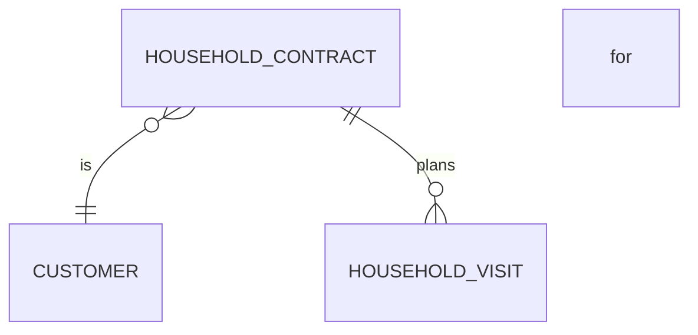
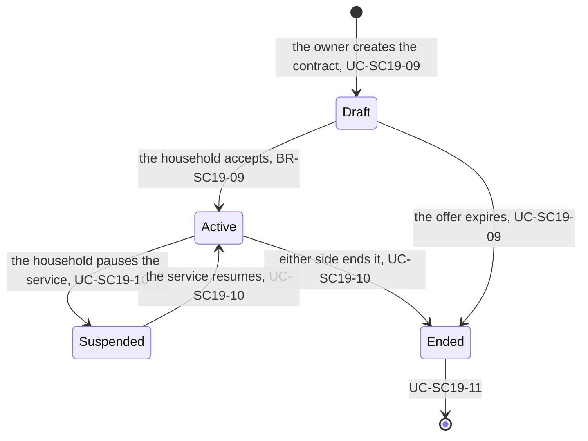

🏠 [Specs](../../../README.md) › 🏷️ [Sectors](../../README.md) › 🔧 [SC19 Trades and home services](../README.md) ›
🗃️ [Data](README.md) › 🗃️ E-SC19-06 Household contract

# 🗃️ E-SC19-06 Household contract

**Status:** ✅ specified

## Purpose

The contract of one household for recurring services: services, frequency, hours, price and eligibility of each
([D563](../../../06-decisions/sectors/d563-benchmark-gaps-sc19-trades-and-home-services.md)). It is not the mandate of
home care ([E-SC04-16 Mandate](../../sc04-home-care/data/e-sc04-16-mandate.md)), which authorises an agent to act for a
person: the household contract is a service contract and keeps the eligibility of each line.

## Fields

| Name | Type | Required | Validation | Default | Example | Personal data | Custom fields |
|---|---|---|---|---|---|---|---|
| household | customer (E-F6-01) | yes | a private customer | - | Lambert | no | no |
| services | lines of service, frequency, hours and price | yes | at least one line | - | Cleaning, weekly, 3 h, 26.00 | no | no |
| eligible | yes or no per line | yes | from the catalogue | from the catalogue | yes | no | no |
| advance | text | no | asked or declined | declined | asked | no | no |
| start date | date | yes | not in the past for a new contract | today | 2027-01-04 | no | no |
| end date | date | no | after the start date | - | - | no | no |
| state | Draft, Active, Suspended, Ended | yes | the lifecycle below | Draft | Active | no | no |
| owner | user | yes | a user of the company | the creator | Claire P. | yes | no |

## Relations

- [E-F6-01](../../../02-functional/f06-customers-and-sales/data/e-f06-01-customer-record.md)
- [E-SC04-16 Mandate](../../sc04-home-care/data/e-sc04-16-mandate.md)
- [E-SC04-09](../../sc04-home-care/data/e-sc04-09-tax-credit-certificate.md)

## Lifecycle

## Indexes and search

By household, service, state, start date and advance.

## Retention

Kept five years after the end, and the certificates ten years
([CR-FR-002](../../../10-country-packs/france/accounting/cr-fr-002-accounting-records-kept-ten-years.md)).

## Audit

Every change of service, eligibility, frequency, price and state, with who, when and the old and new value.

## Import and export

Export of the contract as PDF; import of households from CSV.

## Used by

- [UC-SC19-09](../use-cases/03-home-services-tax-credit/uc-sc19-09-sell-cleaning-and-gardening-to-households.md)
- [UC-SC19-10](../use-cases/03-home-services-tax-credit/uc-sc19-10-plan-recurring-household-visits.md)
- [UC-SC19-11](../use-cases/03-home-services-tax-credit/uc-sc19-11-issue-the-tax-credit-certificate.md)

## Open questions

None.

---

⬅️ [E-SC19-05 Site report](e-sc19-05-site-report.md) · ⬆️ [Up](README.md) ·
➡️ [E-SC19-07 Installation](e-sc19-07-installation.md)
