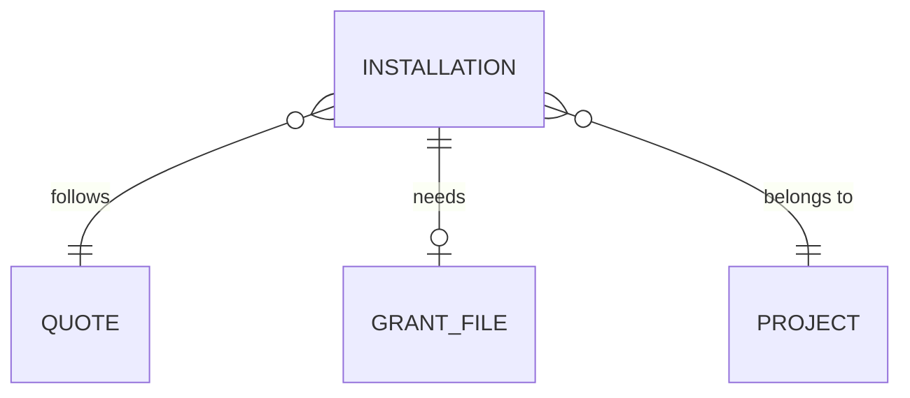
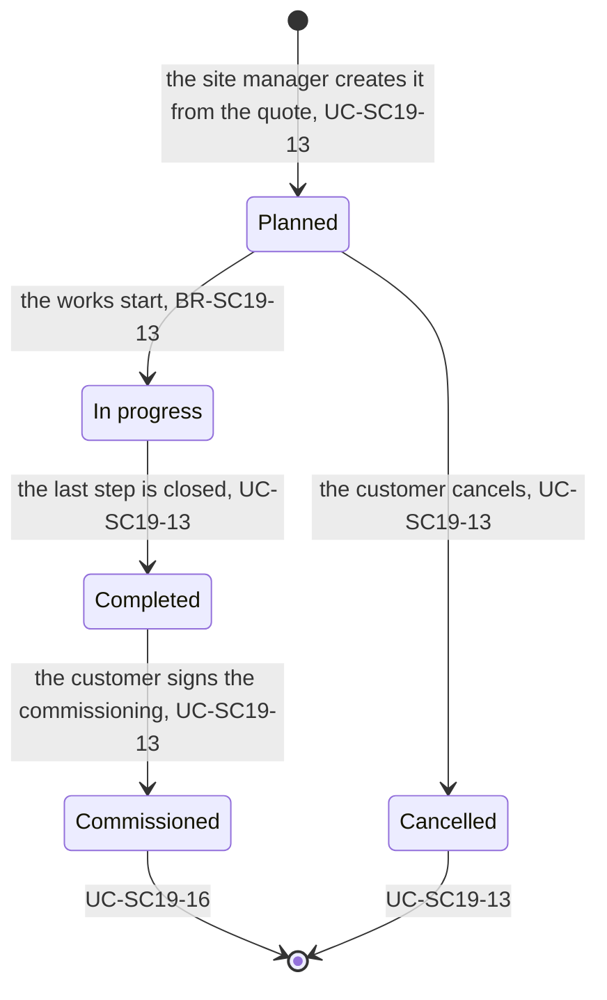

🏠 [Specs](../../../README.md) › 🏷️ [Sectors](../../README.md) › 🔧 [SC19 Trades and home services](../README.md) ›
🗃️ [Data](README.md) › 🗃️ E-SC19-07 Installation

# 🗃️ E-SC19-07 Installation

**Status:** ✅ specified

## Purpose

One installation of equipment at a customer's home, with its steps, technicians, dates, documents and commissioning
([D563](../../../06-decisions/sectors/d563-benchmark-gaps-sc19-trades-and-home-services.md)). It is not the project of
F9 ([E-F9-18](../../../02-functional/f09-hr-and-projects/data/e-f09-18-project-and-task.md)), which plans tasks and
hours: it adds the ordered steps of an installation kind and the grant check before works.

## Fields

| Name | Type | Required | Validation | Default | Example | Personal data | Custom fields |
|---|---|---|---|---|---|---|---|
| quote | quote (E-F6-03) | yes | an accepted quote | - | Q-5521 | no | no |
| kind | text | yes | a kind of the sector pack | - | Heat pump | no | no |
| steps | list of name, technician, date, documents and state | yes | the kind's steps | the kind's steps | Survey, grant request, works | no | no |
| grant | grant file (E-SC19-08) | no | a grant file of the same customer | - | G-0118 | no | no |
| without grant | yes or no | no | - | no | no | no | no |
| commissioned on | date | no | after the last step | - | 2027-02-22 | no | no |
| customer signature | signature | no | - | - | signed on the phone | no | no |
| state | Planned, In progress, Completed, Commissioned, Cancelled | yes | the lifecycle below | Planned | In progress | no | no |
| owner | user | yes | a user of the company | the creator | Claire P. | yes | no |

## Relations

- [E-F6-03 Quote](../../../02-functional/f06-customers-and-sales/data/e-f06-03-quote.md)
- [E-F9-18](../../../02-functional/f09-hr-and-projects/data/e-f09-18-project-and-task.md)
- [E-SC19-08 Grant file](e-sc19-08-grant-file.md)

## Lifecycle

## Indexes and search

By customer, kind, technician, state and commissioning date.

## Retention

Kept ten years, as long as the builder's and installer's liabilities run
([CR-FR-090](../../../10-country-packs/france/construction/cr-fr-090-builders-warranties.md)).

## Audit

Every step, document, assignment, grant check and signature, with who, when and the old and new value.

## Import and export

Export of the commissioning report as PDF; no import.

## Used by

- [UC-SC19-13](../use-cases/04-installations-and-labels/uc-sc19-13-run-an-installation-project.md)
- [UC-SC19-14](../use-cases/04-installations-and-labels/uc-sc19-14-file-grants-and-certificates.md)
- [UC-SC19-16](../use-cases/04-installations-and-labels/uc-sc19-16-keep-refrigerant-and-grid-connection-records.md)

## Open questions

None.

---

⬅️ [E-SC19-06 Household contract](e-sc19-06-household-contract.md) · ⬆️ [Up](README.md) ·
➡️ [E-SC19-08 Grant file](e-sc19-08-grant-file.md)
