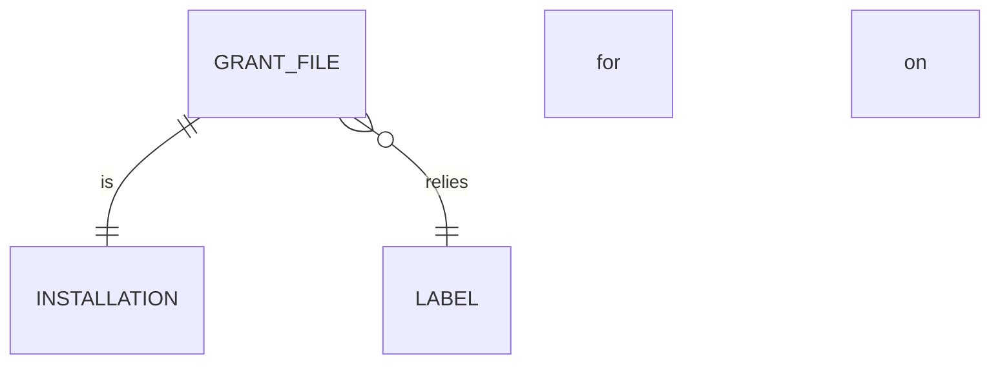
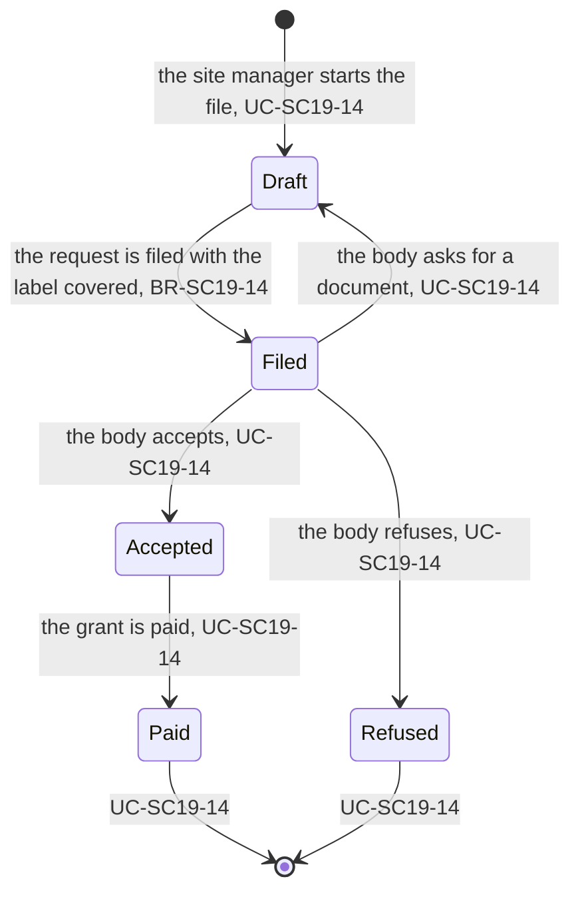

🏠 [Specs](../../../README.md) › 🏷️ [Sectors](../../README.md) › 🔧 [SC19 Trades and home services](../README.md) ›
🗃️ [Data](README.md) › 🗃️ E-SC19-08 Grant file

# 🗃️ E-SC19-08 Grant file

**Status:** ✅ specified

## Purpose

The grant file of one installation: its grants, the label check, the documents, the filing and the answer
([D563](../../../06-decisions/sectors/d563-benchmark-gaps-sc19-trades-and-home-services.md)). It follows the pattern of
the builder's grant file ([E-SC01-18 Grant file](../../sc01-construction/data/e-sc01-18-grant-file.md)) but is for the
installation of a trade, which adds the energy-savings bonus and the installer's commissioning report; the amount to
account for is the grant of accounting ([E-F8-18 Grant](../../../02-functional/f08-accounting/data/e-f08-18-grant.md)).

## Fields

| Name | Type | Required | Validation | Default | Example | Personal data | Custom fields |
|---|---|---|---|---|---|---|---|
| installation | installation (E-SC19-07) | yes | an installation of the company | - | N-0210 | no | no |
| grants | list of grant, body and amount | yes | from the pack | from the pack | Renovation grant, 4,000 | no | no |
| label check | text | yes | covered or not covered | computed | Covered | no | no |
| documents | list with state | yes | every document of the grants | the pack's list | Tax notice, received | no | no |
| filed on | date | no | not before the quote | - | 2027-02-08 | no | no |
| receipt | document | no | - | - | receipt.pdf | no | no |
| paid on | date | no | after the answer | - | 2027-04-10 | no | no |
| state | Draft, Filed, Accepted, Refused, Paid | yes | the lifecycle below | Draft | Filed | no | no |
| owner | user | yes | a user of the company | the creator | Claire P. | yes | no |

## Relations

- [E-SC19-07 Installation](e-sc19-07-installation.md)
- [E-SC19-09 Label](e-sc19-09-label.md)
- [E-SC01-18 Grant file](../../sc01-construction/data/e-sc01-18-grant-file.md)
- [E-F8-18 Grant](../../../02-functional/f08-accounting/data/e-f08-18-grant.md)

## Lifecycle

## Indexes and search

By installation, grant, body, state and filing date.

## Retention

Kept ten years, and the customer's personal documents only as long as the request needs them
([CR-FR-052](../../../10-country-packs/france/data-protection/cr-fr-052-storage-limitation.md)).

## Audit

Every grant, document, label check, filing, answer and payment, with who, when and the old and new value.

## Import and export

Export of the file as a zip of its documents; no import.

## Used by

- [UC-SC19-14](../use-cases/04-installations-and-labels/uc-sc19-14-file-grants-and-certificates.md)
- [UC-SC19-13](../use-cases/04-installations-and-labels/uc-sc19-13-run-an-installation-project.md)
- [UC-SC19-15](../use-cases/04-installations-and-labels/uc-sc19-15-keep-the-rge-label-evidence.md)

## Open questions

None.

---

⬅️ [E-SC19-07 Installation](e-sc19-07-installation.md) · ⬆️ [Up](README.md) · ➡️ [E-SC19-09 Label](e-sc19-09-label.md)
