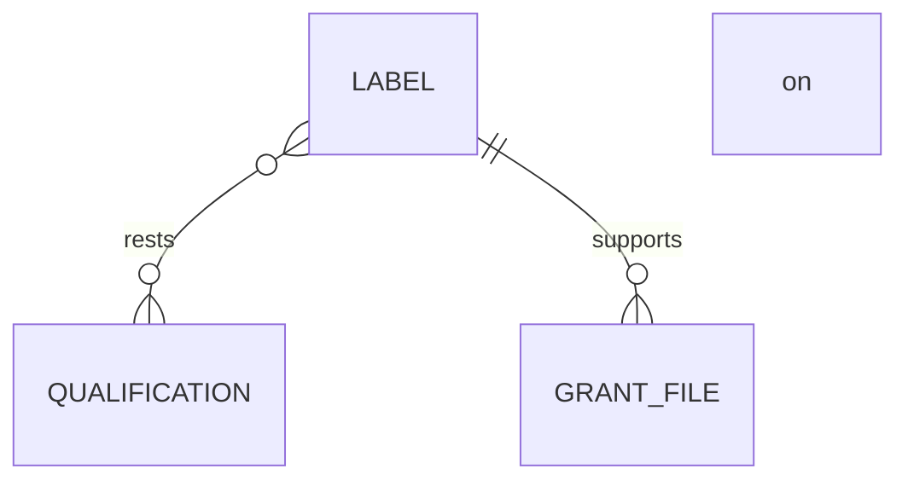
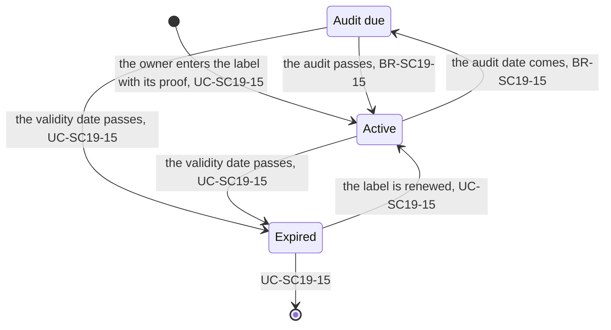

🏠 [Specs](../../../README.md) › 🏷️ [Sectors](../../README.md) › 🔧 [SC19 Trades and home services](../README.md) ›
🗃️ [Data](README.md) › 🗃️ E-SC19-09 Label

# 🗃️ E-SC19-09 Label

**Status:** ✅ specified

## Purpose

The company's environmental label with its body, number, scopes, validity, people and audit dates
([D563](../../../06-decisions/sectors/d563-benchmark-gaps-sc19-trades-and-home-services.md)). It is not the
qualification of one employee ([E-F9-12](../../../02-functional/f09-hr-and-projects/data/e-f09-12-certification.md)): it
is held by the company and rests on those qualifications.

## Fields

| Name | Type | Required | Validation | Default | Example | Personal data | Custom fields |
|---|---|---|---|---|---|---|---|
| name | text | yes | - | - | Env-Heat | no | no |
| body | text | yes | a label body of the pack | - | Body A | no | no |
| number | text | yes | - | - | H-42817 | no | no |
| scopes | list from the pack | yes | at least one | - | Heat pump, boiler | no | no |
| people | users with a qualification | yes | at least one per scope | - | Leroy, Petit | no | no |
| valid until | date | yes | after the start | - | 2028-06-30 | no | no |
| next audit | date | no | before the valid until date | computed | 2028-04-30 | no | no |
| state | Active, Audit due, Expired | yes | the lifecycle below | Active | Audit due | no | no |
| owner | user | yes | a user of the company | the creator | Claire P. | yes | no |

## Relations

- [E-F9-12](../../../02-functional/f09-hr-and-projects/data/e-f09-12-certification.md)
- [E-SC19-08 Grant file](e-sc19-08-grant-file.md)

## Lifecycle

## Indexes and search

By body, scope, validity and state.

## Retention

Kept ten years after expiry, as the grants relying on it may be checked.

## Audit

Every label, scope, person, audit and renewal, with who, when and the old and new value.

## Import and export

Export of the label sheet as PDF; no import.

## Used by

- [UC-SC19-15](../use-cases/04-installations-and-labels/uc-sc19-15-keep-the-rge-label-evidence.md)
- [UC-SC19-14](../use-cases/04-installations-and-labels/uc-sc19-14-file-grants-and-certificates.md)

## Open questions

None.

---

⬅️ [E-SC19-08 Grant file](e-sc19-08-grant-file.md) · ⬆️ [Up](README.md) ·
➡️ [E-SC19-10 Regulated record](e-sc19-10-regulated-record.md)
