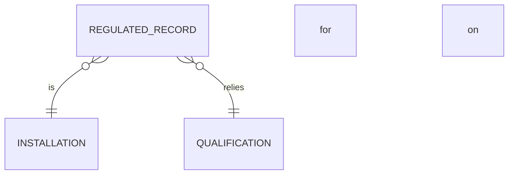
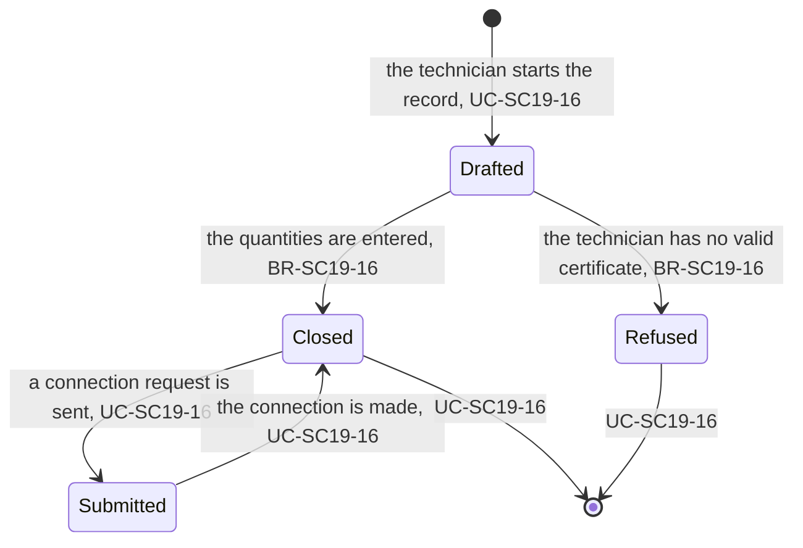

🏠 [Specs](../../../README.md) › 🏷️ [Sectors](../../README.md) › 🔧 [SC19 Trades and home services](../README.md) ›
🗃️ [Data](README.md) › 🗃️ E-SC19-10 Regulated record

# 🗃️ E-SC19-10 Regulated record

**Status:** ✅ specified

## Purpose

One regulated record of an installation: a refrigerant handling, a leak check or a grid connection, with the certificate
behind it ([D563](../../../06-decisions/sectors/d563-benchmark-gaps-sc19-trades-and-home-services.md)). It is not the
qualification itself ([E-F9-12](../../../02-functional/f09-hr-and-projects/data/e-f09-12-certification.md)): it proves
one act done under it.

## Fields

| Name | Type | Required | Validation | Default | Example | Personal data | Custom fields |
|---|---|---|---|---|---|---|---|
| installation | installation (E-SC19-07) | yes | an installation of the company | - | N-0210 | no | no |
| kind | text | yes | refrigerant, leak check or grid connection | - | Refrigerant | no | no |
| equipment | text | yes | - | - | Heat pump Nordic, 2.4 kg | no | no |
| quantity | number in kilograms | no | 0 or more | - | 2.4 | no | no |
| technician | user | yes | holds the certificate | the user | Leroy | no | no |
| certificate | qualification (E-F9-12) | yes | valid at the date | - | Cert. 2028 | no | no |
| done on | date | yes | not in the future | today | 2027-02-05 | no | no |
| conformity | document | no | required for a connection | - | conformity.pdf | no | no |
| state | Drafted, Closed, Refused, Submitted | yes | the lifecycle below | Drafted | Closed | no | no |
| owner | user | yes | a user of the company | the creator | Claire P. | yes | no |

## Relations

- [E-SC19-07 Installation](e-sc19-07-installation.md)
- [E-F9-12](../../../02-functional/f09-hr-and-projects/data/e-f09-12-certification.md)

## Lifecycle

## Indexes and search

By installation, kind, technician, date and state.

## Retention

Kept for the years the France pack sets for refrigerant and electrical records.

## Audit

Every record, correction, certificate check, quantity and submission, with who, when and the old and new value.

## Import and export

Export of the register as CSV or PDF for an inspector; no import.

## Used by

- [UC-SC19-16](../use-cases/04-installations-and-labels/uc-sc19-16-keep-refrigerant-and-grid-connection-records.md)
- [UC-SC19-13](../use-cases/04-installations-and-labels/uc-sc19-13-run-an-installation-project.md)

## Open questions

None.

---

⬅️ [E-SC19-09 Label](e-sc19-09-label.md) · ⬆️ [Up](README.md) · ➡️ [E-SC19-11 On-call rota](e-sc19-11-on-call-rota.md)
