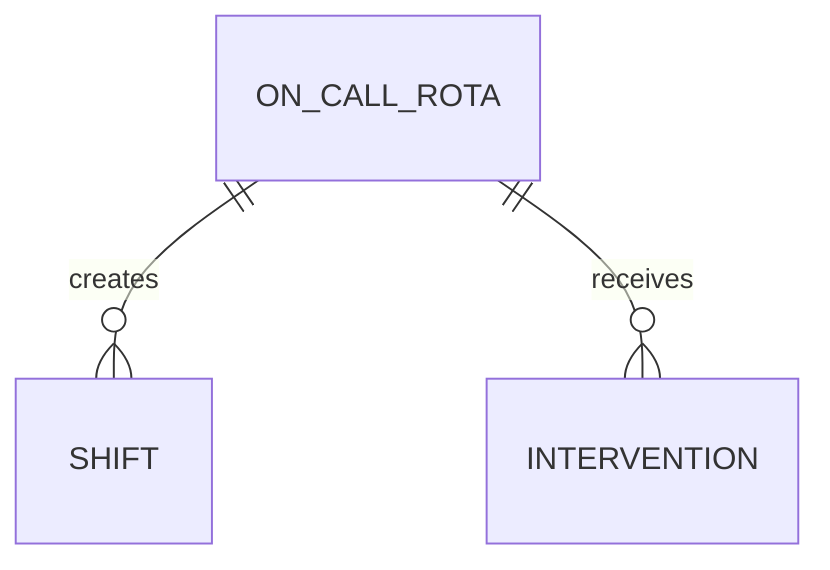
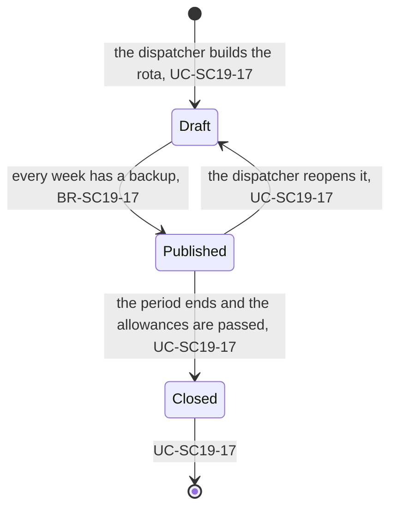

🏠 [Specs](../../../README.md) › 🏷️ [Sectors](../../README.md) › 🔧 [SC19 Trades and home services](../README.md) ›
🗃️ [Data](README.md) › 🗃️ E-SC19-11 On-call rota

# 🗃️ E-SC19-11 On-call rota

**Status:** ✅ specified

## Purpose

The on-call rota of one trade for a period: who is on call, the backup, the hour bands and their surcharges
([D563](../../../06-decisions/sectors/d563-benchmark-gaps-sc19-trades-and-home-services.md)). It is not a shift
([E-F9-16 Shift](../../../02-functional/f09-hr-and-projects/data/e-f09-16-shift.md)): it keeps the backup and the
surcharge the customer is shown, and creates the shifts and the pay inputs.

## Fields

| Name | Type | Required | Validation | Default | Example | Personal data | Custom fields |
|---|---|---|---|---|---|---|---|
| period | date range | yes | a month or a week | - | March 2027 | no | no |
| trade | text | yes | a trade switched on | - | Plumbing | no | no |
| weeks | list of week, technician and backup | yes | every week covered | - | 10, Leroy, Petit | no | no |
| surcharges | list of hour band and amount | yes | from the sector pack | the pack's | Night 90.00 | no | no |
| call-out terms | text | yes | - | the pack's | Call-out 60 EUR | no | no |
| state | Draft, Published, Closed | yes | the lifecycle below | Draft | Published | no | no |
| owner | user | yes | a user of the company | the creator | Claire P. | yes | no |

## Relations

- [E-F9-16 Shift](../../../02-functional/f09-hr-and-projects/data/e-f09-16-shift.md)
- [E-SC19-04 Intervention](e-sc19-04-intervention.md)
- [E-F13-03 Pay input](../../../02-functional/f13-payroll/data/e-f13-03-pay-input.md)

## Lifecycle

## Indexes and search

By trade, period, technician and state.

## Retention

Kept five years, like the payslips it feeds
([CR-FR-182 The payslip](../../../10-country-packs/france/payroll/cr-fr-182-payslip.md)).

## Audit

Every rota, swap, publication, surcharge and allowance, with who, when and the old and new value.

## Import and export

Export of the rota as PDF; import of a rota from CSV.

## Used by

- [UC-SC19-17](../use-cases/05-on-call-warranties-van-stock-and-site-quotes/uc-sc19-17-run-the-emergency-on-call-service.md)
- [UC-SC19-05](../use-cases/02-on-site-intervention/uc-sc19-05-dispatch-an-intervention.md)

## Open questions

None.

---

⬅️ [E-SC19-10 Regulated record](e-sc19-10-regulated-record.md) · ⬆️ [Up](README.md) ·
➡️ [E-SC19-12 Warranty certificate](e-sc19-12-warranty-certificate.md)
