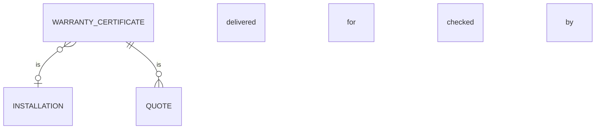
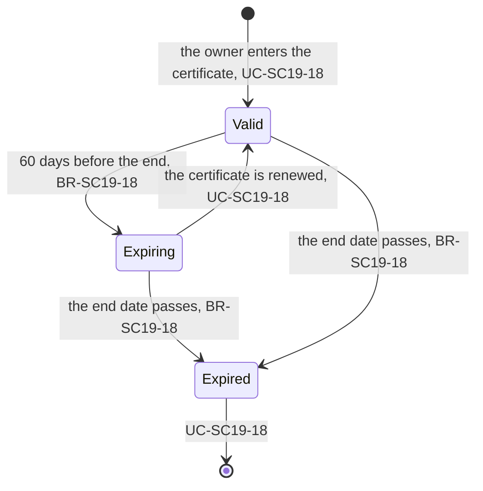

🏠 [Specs](../../../README.md) › 🏷️ [Sectors](../../README.md) › 🔧 [SC19 Trades and home services](../README.md) ›
🗃️ [Data](README.md) › 🗃️ E-SC19-12 Warranty certificate

# 🗃️ E-SC19-12 Warranty certificate

**Status:** ✅ specified

## Purpose

The insurance certificate of the company for its trades and the warranty terms delivered at a handover
([D563](../../../06-decisions/sectors/d563-benchmark-gaps-sc19-trades-and-home-services.md)). It is not the warranty
running on a builder's site ([E-SC01-11 Warranty](../../sc01-construction/data/e-sc01-11-warranty.md)) nor the warranty
of a sold item ([E-F6-27 Warranty](../../../02-functional/f06-customers-and-sales/data/e-f06-27-warranty.md)): it is the
company's proof of cover that the quotes check, and the document the customer keeps.

## Fields

| Name | Type | Required | Validation | Default | Example | Personal data | Custom fields |
|---|---|---|---|---|---|---|---|
| insurer | text | yes | - | - | Insurer One | no | no |
| policy | text | yes | - | - | P-90412 | no | no |
| activities | list of trades | yes | trades switched on | - | Heating, plumbing | no | no |
| valid from | date | yes | - | - | 2027-01-01 | no | no |
| valid until | date | yes | after the start | - | 2027-12-31 | no | no |
| handover | installation (E-SC19-07) | no | a commissioned installation | - | N-0210 | no | no |
| warranties | list of kind and end date | no | from the handover date | from the pack | Structure, 2037-02-22 | no | no |
| state | Valid, Expiring, Expired | yes | the lifecycle below | Valid | Expiring | no | no |
| owner | user | yes | a user of the company | the creator | Claire P. | yes | no |

## Relations

- [E-SC01-11 Warranty](../../sc01-construction/data/e-sc01-11-warranty.md)
- [E-F6-27 Warranty](../../../02-functional/f06-customers-and-sales/data/e-f06-27-warranty.md)
- [E-F6-03 Quote](../../../02-functional/f06-customers-and-sales/data/e-f06-03-quote.md)
- [E-SC19-07 Installation](e-sc19-07-installation.md)

## Lifecycle

## Indexes and search

By insurer, activity, validity and state.

## Retention

Kept for ten years after the last handover it covers
([CR-FR-082](../../../10-country-packs/france/construction/cr-fr-082-ten-year-insurance.md)).

## Audit

Every certificate, renewal, handover and warranty date, with who, when and the old and new value.

## Import and export

Export of the warranty certificate as PDF; no import.

## Used by

- [UC-SC19-18](../use-cases/05-on-call-warranties-van-stock-and-site-quotes/uc-sc19-18-keep-builders-warranties-and-certificates.md)
- [UC-SC19-13](../use-cases/04-installations-and-labels/uc-sc19-13-run-an-installation-project.md)

## Open questions

None.

---

⬅️ [E-SC19-11 On-call rota](e-sc19-11-on-call-rota.md) · ⬆️ [Up](README.md) ·
➡️ [E-SC19-13 Van stock](e-sc19-13-van-stock.md)
