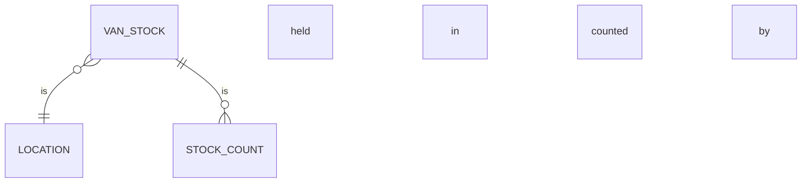
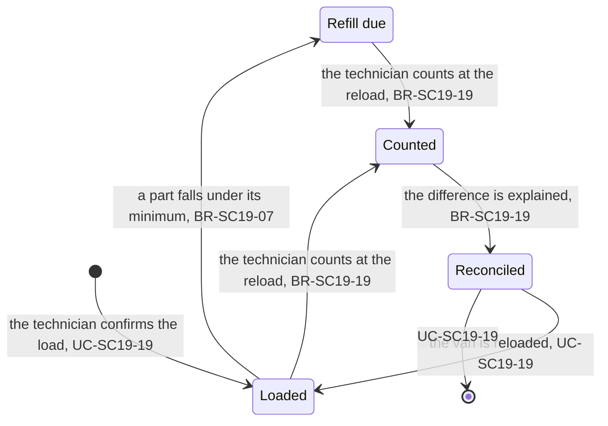

🏠 [Specs](../../../README.md) › 🏷️ [Sectors](../../README.md) › 🔧 [SC19 Trades and home services](../README.md) ›
🗃️ [Data](README.md) › 🗃️ E-SC19-13 Van stock

# 🗃️ E-SC19-13 Van stock

**Status:** ✅ specified

## Purpose

The stock of one technician's van against its standard load: limits, expected, counted and differences
([D563](../../../06-decisions/sectors/d563-benchmark-gaps-sc19-trades-and-home-services.md)). It is not the van of a
delivery round ([E-SC15-16 Van stock](../../sc15-wholesale-and-distribution/data/e-sc15-16-van-stock.md)), which follows
goods sold to customers on a route: this one follows the parts a technician uses on interventions against a standard
load, and it is counted at each reload, not at each round.

## Fields

| Name | Type | Required | Validation | Default | Example | Personal data | Custom fields |
|---|---|---|---|---|---|---|---|
| van | location (E-F7-07) | yes | a van location | - | Van 4 | no | no |
| part | item (E-F7-06) | yes | a part of the load | - | Seal 20/27 | no | no |
| minimum | number | yes | 0 or more | - | 10 | no | no |
| maximum | number | yes | not under the minimum | - | 40 | no | no |
| expected | number | no | loaded minus used | computed | 11 | no | no |
| counted | number | no | 0 or more | - | 10 | no | no |
| difference | number | no | counted minus expected | computed | -1 | no | no |
| explanation | text | no | required to reconcile | - | Broken in the cellar | no | no |
| state | Loaded, Refill due, Counted, Reconciled | yes | the lifecycle below | Loaded | Refill due | no | no |
| owner | user | yes | a user of the company | the creator | Claire P. | yes | no |

## Relations

- [E-F7-07 Location](../../../02-functional/f07-purchasing-and-stock/data/e-f07-07-location.md)
- [E-F7-06 Item](../../../02-functional/f07-purchasing-and-stock/data/e-f07-06-item.md)
- [E-F7-11](../../../02-functional/f07-purchasing-and-stock/data/e-f07-11-stock-count.md)
- [E-SC15-16 Van stock](../../sc15-wholesale-and-distribution/data/e-sc15-16-van-stock.md)

## Lifecycle

## Indexes and search

By van, part, state and difference.

## Retention

Kept ten years with the accounting records
([CR-FR-002](../../../10-country-packs/france/accounting/cr-fr-002-accounting-records-kept-ten-years.md)) and the counts
six years ([CR-FR-007](../../../10-country-packs/france/accounting/cr-fr-007-annual-stock-count.md)).

## Audit

Every load, use, count, difference, explanation and transfer, with who, when and the old and new value.

## Import and export

Export of the van's count as PDF; import of a standard load from CSV.

## Used by

- [UC-SC19-19](../use-cases/05-on-call-warranties-van-stock-and-site-quotes/uc-sc19-19-keep-stock-in-each-van.md)
- [UC-SC19-07](../use-cases/02-on-site-intervention/uc-sc19-07-record-parts-used.md)

## Open questions

None.

---

⬅️ [E-SC19-12 Warranty certificate](e-sc19-12-warranty-certificate.md) · ⬆️ [Up](README.md)
