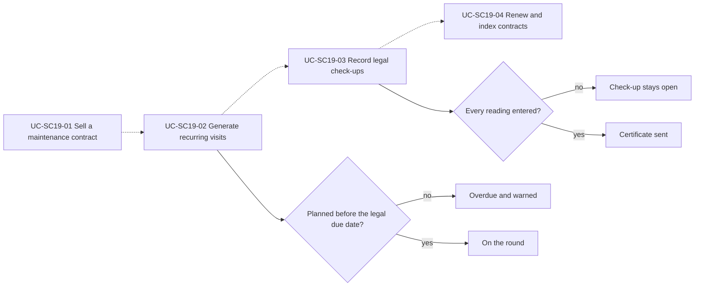
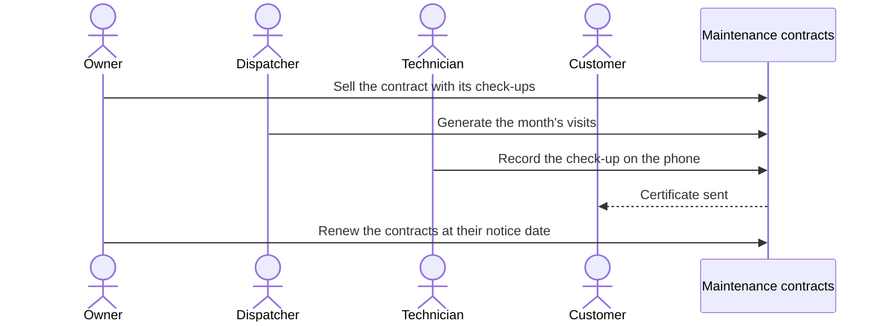

🏠 [Specs](../../../README.md) › 🏷️ [Sectors](../../README.md) › 🔧 [SC19 Trades and home services](../README.md) ›
🔀 [Flows](README.md) › 🔀 FL-SC19-01 Maintenance contracts

# 🔀 FL-SC19-01 Maintenance contracts

**Status:** 🔄 waiting for the owner

## Summary

A trades company sells a maintenance contract that lists the legal yearly check-ups, generates the visits before each
legal due date, records each check-up with its certificate, and renews and indexes the contracts at their notice date
([D563](../../../06-decisions/sectors/d563-benchmark-gaps-sc19-trades-and-home-services.md)).

## Personas

- [U13 Owner](../../../01-users/personas/u13-owner.md), who sells and renews the contracts
- [U09 Customer](../../../01-users/personas/u09-customer.md), who signs and receives the certificates
- [U29 Dispatcher](../../../01-users/personas/u29-dispatcher.md), who generates and plans the visits
- [U14 Field worker](../../../01-users/personas/u14-field-worker.md), who does the check-ups on the phone

## Flowchart

## Sequence diagram

## Steps

| Step | Persona | Screen | Use case | What happens |
|---|---|---|---|---|
| 1 | [U13](../../../01-users/personas/u13-owner.md) | [S-SC19-01](../screens/01-maintenance-contracts/s-sc19-01-maintenance-contract.md) | [UC-SC19-01](../use-cases/01-maintenance-contracts/uc-sc19-01-sell-a-maintenance-contract.md) | The owner sells a contract that lists the equipment and its legal check-ups |
| 2 | [U29](../../../01-users/personas/u29-dispatcher.md) | [S-SC19-02](../screens/01-maintenance-contracts/s-sc19-02-recurring-visits.md) | [UC-SC19-02](../use-cases/01-maintenance-contracts/uc-sc19-02-generate-recurring-visits.md) | The dispatcher generates the visits before each legal due date and plans them |
| 3 | [U14](../../../01-users/personas/u14-field-worker.md) | [S-SC19-03](../screens/01-maintenance-contracts/s-sc19-03-legal-check-ups.md) | [UC-SC19-03](../use-cases/01-maintenance-contracts/uc-sc19-03-record-legal-check-ups.md) | The technician records the legal check-up on the phone and sends the certificate |
| 4 | [U13](../../../01-users/personas/u13-owner.md) | [S-SC19-04](../screens/01-maintenance-contracts/s-sc19-04-contract-renewal.md) | [UC-SC19-04](../use-cases/01-maintenance-contracts/uc-sc19-04-renew-and-index-contracts.md) | The owner renews or ends the contracts at their notice date and applies the index |

### Entities and screens

| Entity | States in this flow | Shown at step and screen | Aggregated view |
|---|---|---|---|
| [E-SC19-01 Maintenance contract](../data/e-sc19-01-maintenance-contract.md) | Draft, Active, Renewal due, Ended | 1 [S-SC19-01](../screens/01-maintenance-contracts/s-sc19-01-maintenance-contract.md) | Maintenance contracts |
| [E-SC19-02 Planned visit](../data/e-sc19-02-planned-visit.md) | To plan, Proposed, Confirmed, Done, Overdue | 2 [S-SC19-02](../screens/01-maintenance-contracts/s-sc19-02-recurring-visits.md) | Planned visits |
| [E-SC19-03 Check-up certificate](../data/e-sc19-03-check-up-certificate.md) | Drafted, Signed, Sent | 3 [S-SC19-03](../screens/01-maintenance-contracts/s-sc19-03-legal-check-ups.md) | Check-up certificates |

## Errors

- **E1 A visit is overdue.** The legal due date of a check-up has passed before a visit is planned: the visit is marked
  Overdue, the dispatcher is warned and the customer is offered the nearest day
  ([BR-SC19-02](../business-rules/br-sc19-02-visits-are-planned-before-the-legal-due-date.md), step 2).

## Images

Every step and error, for each persona taking part, in light and dark mode (D120). Steps are numbered as in the Steps
table; E rows are the error cases.

| Step | Persona | Device | Light | Dark |
|---|---|---|---|---|
| 1 | U13 | desktop | [light](../images/01-maintenance-contracts/u13-owner/1-maintenance-contract-desktop-light.png) | [dark](../images/01-maintenance-contracts/u13-owner/1-maintenance-contract-desktop-dark.png) |
| 1 | U09 | phone | [light](../images/01-maintenance-contracts/u09-customer/1-maintenance-contract-phone-light.png) | [dark](../images/01-maintenance-contracts/u09-customer/1-maintenance-contract-phone-dark.png) |
| 1 | U13 | phone | [light](../images/01-maintenance-contracts/u13-owner/1-maintenance-contract-phone-light.png) | [dark](../images/01-maintenance-contracts/u13-owner/1-maintenance-contract-phone-dark.png) |
| 2 | U29 | desktop | [light](../images/01-maintenance-contracts/u29-dispatcher/2-recurring-visits-desktop-light.png) | [dark](../images/01-maintenance-contracts/u29-dispatcher/2-recurring-visits-desktop-dark.png) |
| 2 | U29 | phone | [light](../images/01-maintenance-contracts/u29-dispatcher/2-recurring-visits-phone-light.png) | [dark](../images/01-maintenance-contracts/u29-dispatcher/2-recurring-visits-phone-dark.png) |
| 3 | U14 | phone | [light](../images/01-maintenance-contracts/u14-field-worker/3-legal-check-ups-phone-light.png) | [dark](../images/01-maintenance-contracts/u14-field-worker/3-legal-check-ups-phone-dark.png) |
| 4 | U13 | desktop | [light](../images/01-maintenance-contracts/u13-owner/4-contract-renewal-desktop-light.png) | [dark](../images/01-maintenance-contracts/u13-owner/4-contract-renewal-desktop-dark.png) |
| 4 | U13 | phone | [light](../images/01-maintenance-contracts/u13-owner/4-contract-renewal-phone-light.png) | [dark](../images/01-maintenance-contracts/u13-owner/4-contract-renewal-phone-dark.png) |
| E1 | U13 | desktop | [light](../images/01-maintenance-contracts/u13-owner/e1-a-visit-is-overdue-desktop-light.png) | [dark](../images/01-maintenance-contracts/u13-owner/e1-a-visit-is-overdue-desktop-dark.png) |
| E1 | U13 | phone | [light](../images/01-maintenance-contracts/u13-owner/e1-a-visit-is-overdue-phone-light.png) | [dark](../images/01-maintenance-contracts/u13-owner/e1-a-visit-is-overdue-phone-dark.png) |

## Open questions

None.

---

⬆️ [Up](README.md) · ➡️ [FL-SC19-02 On-site intervention](fl-sc19-02-on-site-intervention.md)
