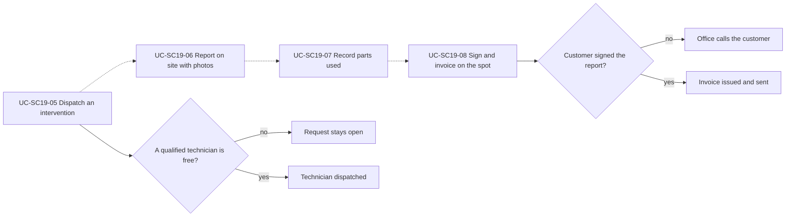
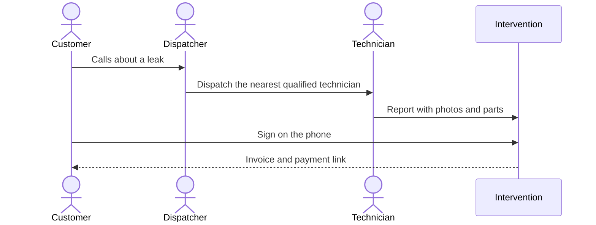

🏠 [Specs](../../../README.md) › 🏷️ [Sectors](../../README.md) › 🔧 [SC19 Trades and home services](../README.md) ›
🔀 [Flows](README.md) › 🔀 FL-SC19-02 On-site intervention

# 🔀 FL-SC19-02 On-site intervention

**Status:** ✅ specified

## Summary

A customer calls and the dispatcher sends the nearest qualified technician, who reports on site with photos, records the
parts taken from the van, and has the customer sign and pay at once
([D563](../../../06-decisions/sectors/d563-benchmark-gaps-sc19-trades-and-home-services.md)).

## Personas

- [U29 Dispatcher](../../../01-users/personas/u29-dispatcher.md), who receives the call and dispatches
- [U14 Field worker](../../../01-users/personas/u14-field-worker.md), who reports, records the parts and invoices
- [U09 Customer](../../../01-users/personas/u09-customer.md), who signs and pays

## Flowchart

## Sequence diagram

## Steps

| Step | Persona | Screen | Use case | What happens |
|---|---|---|---|---|
| 1 | [U29](../../../01-users/personas/u29-dispatcher.md) | [S-SC19-05](../screens/02-on-site-intervention/s-sc19-05-dispatch.md) | [UC-SC19-05](../use-cases/02-on-site-intervention/uc-sc19-05-dispatch-an-intervention.md) | The dispatcher records the call and sends the nearest qualified technician |
| 2 | [U14](../../../01-users/personas/u14-field-worker.md) | [S-SC19-06](../screens/02-on-site-intervention/s-sc19-06-site-report.md) | [UC-SC19-06](../use-cases/02-on-site-intervention/uc-sc19-06-report-on-site-with-photos.md) | The technician reports the times, the place, the photos and the work done |
| 3 | [U14](../../../01-users/personas/u14-field-worker.md) | [S-SC19-07](../screens/02-on-site-intervention/s-sc19-07-parts-used.md) | [UC-SC19-07](../use-cases/02-on-site-intervention/uc-sc19-07-record-parts-used.md) | The technician records the parts taken from the van, which lowers its stock |
| 4 | [U14](../../../01-users/personas/u14-field-worker.md) | [S-SC19-08](../screens/02-on-site-intervention/s-sc19-08-sign-and-invoice.md) | [UC-SC19-08](../use-cases/02-on-site-intervention/uc-sc19-08-sign-and-invoice-on-the-spot.md) | The customer signs the report and receives the invoice at once |

### Entities and screens

| Entity | States in this flow | Shown at step and screen | Aggregated view |
|---|---|---|---|
| [E-SC19-04 Intervention](../data/e-sc19-04-intervention.md) | Requested, Dispatched, On site, Reported, Invoiced, Cancelled | 1 [S-SC19-05](../screens/02-on-site-intervention/s-sc19-05-dispatch.md) | Interventions |
| [E-SC19-05 Site report](../data/e-sc19-05-site-report.md) | Open, Closed, Signed | 2 [S-SC19-06](../screens/02-on-site-intervention/s-sc19-06-site-report.md) | Site reports |

## Errors

- **E1 The signature is missing.** The customer refuses or is absent: no invoice is issued, the refusal or the remote
  request is recorded and the office calls the customer
  ([BR-SC19-08](../business-rules/br-sc19-08-the-invoice-follows-the-signed-report.md), step 4).

## Images

Every step and error, for each persona taking part, in light and dark mode (D120). Steps are numbered as in the Steps
table; E rows are the error cases.

| Step | Persona | Device | Light | Dark |
|---|---|---|---|---|
| 1 | U29 | desktop | [light](../images/02-on-site-intervention/u29-dispatcher/1-dispatch-desktop-light.png) | [dark](../images/02-on-site-intervention/u29-dispatcher/1-dispatch-desktop-dark.png) |
| 1 | U29 | phone | [light](../images/02-on-site-intervention/u29-dispatcher/1-dispatch-phone-light.png) | [dark](../images/02-on-site-intervention/u29-dispatcher/1-dispatch-phone-dark.png) |
| 2 | U14 | phone | [light](../images/02-on-site-intervention/u14-field-worker/2-site-report-phone-light.png) | [dark](../images/02-on-site-intervention/u14-field-worker/2-site-report-phone-dark.png) |
| 3 | U14 | phone | [light](../images/02-on-site-intervention/u14-field-worker/3-parts-used-phone-light.png) | [dark](../images/02-on-site-intervention/u14-field-worker/3-parts-used-phone-dark.png) |
| 4 | U14 | phone | [light](../images/02-on-site-intervention/u14-field-worker/4-sign-and-invoice-phone-light.png) | [dark](../images/02-on-site-intervention/u14-field-worker/4-sign-and-invoice-phone-dark.png) |
| 4 | U09 | phone | [light](../images/02-on-site-intervention/u09-customer/4-sign-and-invoice-phone-light.png) | [dark](../images/02-on-site-intervention/u09-customer/4-sign-and-invoice-phone-dark.png) |
| E1 | U29 | desktop | [light](../images/02-on-site-intervention/u29-dispatcher/e1-the-signature-is-missing-desktop-light.png) | [dark](../images/02-on-site-intervention/u29-dispatcher/e1-the-signature-is-missing-desktop-dark.png) |
| E1 | U29 | phone | [light](../images/02-on-site-intervention/u29-dispatcher/e1-the-signature-is-missing-phone-light.png) | [dark](../images/02-on-site-intervention/u29-dispatcher/e1-the-signature-is-missing-phone-dark.png) |

## Open questions

None.

---

⬅️ [FL-SC19-01 Maintenance contracts](fl-sc19-01-maintenance-contracts.md) · ⬆️ [Up](README.md) ·
➡️ [FL-SC19-03 Home services tax credit](fl-sc19-03-home-services-tax-credit.md)
