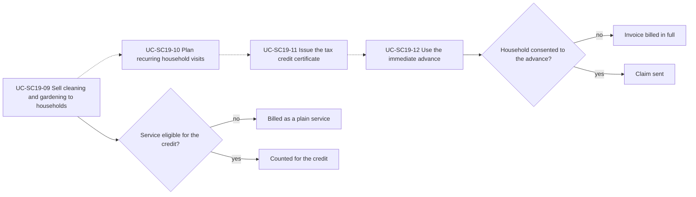
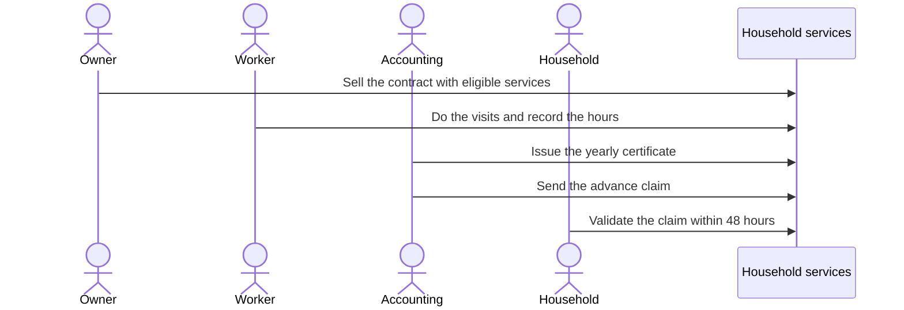

🏠 [Specs](../../../README.md) › 🏷️ [Sectors](../../README.md) › 🔧 [SC19 Trades and home services](../README.md) ›
🔀 [Flows](README.md) › 🔀 FL-SC19-03 Home services tax credit

# 🔀 FL-SC19-03 Home services tax credit

**Status:** ✅ specified

## Summary

A cleaning or gardening company sells to households with the eligible services marked, plans the recurring visits,
issues the yearly tax-credit certificate with the amounts paid, and sends the immediate advance claims of the households
that consented ([D563](../../../06-decisions/sectors/d563-benchmark-gaps-sc19-trades-and-home-services.md)).

## Personas

- [U13 Owner](../../../01-users/personas/u13-owner.md), who sells the household contracts
- [U09 Customer](../../../01-users/personas/u09-customer.md), who accepts, confirms the claim and receives the
  certificate
- [U29 Dispatcher](../../../01-users/personas/u29-dispatcher.md), who plans the visits
- [U14 Field worker](../../../01-users/personas/u14-field-worker.md), who does the visits and records the hours
- [U05 Accounting](../../../01-users/personas/u05-accounting.md), who issues the certificates and the advance claims

## Flowchart

## Sequence diagram

## Steps

| Step | Persona | Screen | Use case | What happens |
|---|---|---|---|---|
| 1 | [U13](../../../01-users/personas/u13-owner.md) | [S-SC19-09](../screens/03-home-services-tax-credit/s-sc19-09-household-services.md) | [UC-SC19-09](../use-cases/03-home-services-tax-credit/uc-sc19-09-sell-cleaning-and-gardening-to-households.md) | The owner sells a household contract that marks each service eligible or not |
| 2 | [U29](../../../01-users/personas/u29-dispatcher.md) | [S-SC19-10](../screens/03-home-services-tax-credit/s-sc19-10-household-visits.md) | [UC-SC19-10](../use-cases/03-home-services-tax-credit/uc-sc19-10-plan-recurring-household-visits.md) | The dispatcher plans the recurring visits and the worker records the hours |
| 3 | [U05](../../../01-users/personas/u05-accounting.md) | [S-SC19-11](../screens/03-home-services-tax-credit/s-sc19-11-tax-credit-certificate.md) | [UC-SC19-11](../use-cases/03-home-services-tax-credit/uc-sc19-11-issue-the-tax-credit-certificate.md) | Accounting issues the yearly certificate with the amounts the household paid |
| 4 | [U05](../../../01-users/personas/u05-accounting.md) | [S-SC19-12](../screens/03-home-services-tax-credit/s-sc19-12-immediate-advance.md) | [UC-SC19-12](../use-cases/03-home-services-tax-credit/uc-sc19-12-use-the-immediate-advance.md) | Accounting sends the advance claim of a household that consented and the household confirms it |

### Entities and screens

| Entity | States in this flow | Shown at step and screen | Aggregated view |
|---|---|---|---|
| [E-SC19-06 Household contract](../data/e-sc19-06-household-contract.md) | Draft, Active, Suspended, Ended | 1 [S-SC19-09](../screens/03-home-services-tax-credit/s-sc19-09-household-services.md) | Household contracts |

## Errors

- **E1 The service is not eligible.** A line is not in the eligible catalogue: it is marked ineligible, left out of the
  certificate and billed as a plain service
  ([BR-SC19-09](../business-rules/br-sc19-09-only-eligible-services-carry-the-tax-credit.md), step 1).

## Images

Every step and error, for each persona taking part, in light and dark mode (D120). Steps are numbered as in the Steps
table; E rows are the error cases.

| Step | Persona | Device | Light | Dark |
|---|---|---|---|---|
| 1 | U13 | desktop | [light](../images/03-home-services-tax-credit/u13-owner/1-household-services-desktop-light.png) | [dark](../images/03-home-services-tax-credit/u13-owner/1-household-services-desktop-dark.png) |
| 1 | U09 | phone | [light](../images/03-home-services-tax-credit/u09-customer/1-household-services-phone-light.png) | [dark](../images/03-home-services-tax-credit/u09-customer/1-household-services-phone-dark.png) |
| 1 | U13 | phone | [light](../images/03-home-services-tax-credit/u13-owner/1-household-services-phone-light.png) | [dark](../images/03-home-services-tax-credit/u13-owner/1-household-services-phone-dark.png) |
| 2 | U29 | desktop | [light](../images/03-home-services-tax-credit/u29-dispatcher/2-household-visits-desktop-light.png) | [dark](../images/03-home-services-tax-credit/u29-dispatcher/2-household-visits-desktop-dark.png) |
| 2 | U14 | phone | [light](../images/03-home-services-tax-credit/u14-field-worker/2-household-visits-phone-light.png) | [dark](../images/03-home-services-tax-credit/u14-field-worker/2-household-visits-phone-dark.png) |
| 2 | U29 | phone | [light](../images/03-home-services-tax-credit/u29-dispatcher/2-household-visits-phone-light.png) | [dark](../images/03-home-services-tax-credit/u29-dispatcher/2-household-visits-phone-dark.png) |
| 3 | U05 | desktop | [light](../images/03-home-services-tax-credit/u05-accounting/3-tax-credit-certificate-desktop-light.png) | [dark](../images/03-home-services-tax-credit/u05-accounting/3-tax-credit-certificate-desktop-dark.png) |
| 4 | U05 | desktop | [light](../images/03-home-services-tax-credit/u05-accounting/4-immediate-advance-desktop-light.png) | [dark](../images/03-home-services-tax-credit/u05-accounting/4-immediate-advance-desktop-dark.png) |
| 4 | U09 | phone | [light](../images/03-home-services-tax-credit/u09-customer/4-immediate-advance-phone-light.png) | [dark](../images/03-home-services-tax-credit/u09-customer/4-immediate-advance-phone-dark.png) |
| E1 | U13 | desktop | [light](../images/03-home-services-tax-credit/u13-owner/e1-the-service-is-not-eligible-desktop-light.png) | [dark](../images/03-home-services-tax-credit/u13-owner/e1-the-service-is-not-eligible-desktop-dark.png) |
| E1 | U13 | phone | [light](../images/03-home-services-tax-credit/u13-owner/e1-the-service-is-not-eligible-phone-light.png) | [dark](../images/03-home-services-tax-credit/u13-owner/e1-the-service-is-not-eligible-phone-dark.png) |

## Open questions

None.

---

⬅️ [FL-SC19-02 On-site intervention](fl-sc19-02-on-site-intervention.md) · ⬆️ [Up](README.md) ·
➡️ [FL-SC19-04 Installations and labels](fl-sc19-04-installations-and-labels.md)
